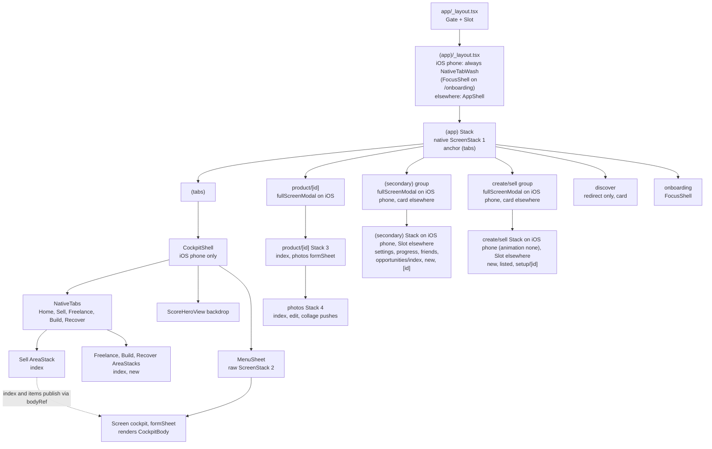
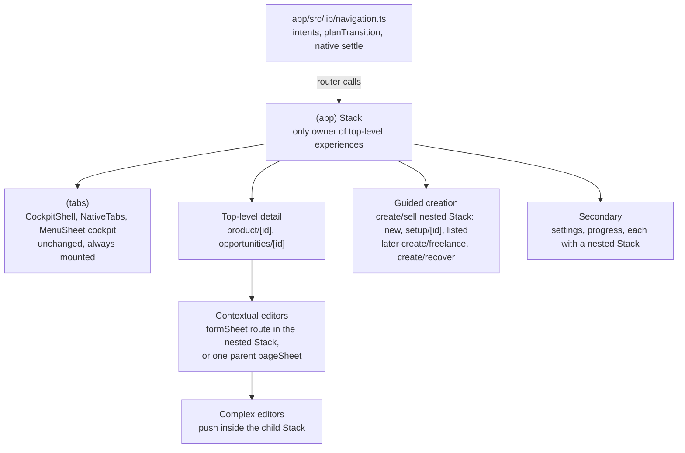

# Navigation

This is the navigation contract for the Expo app in `/app`. It records how navigation works today, what is wrong with it, the approved target, and the staged plan to get there. Implementation chats should read this file instead of re-auditing the app.

Where this file and the route table in [client.md](client.md) disagree about navigation behaviour, this file wins.

## 0. How to read this file

Every claim carries one of these labels.

| Label | Meaning |
| --- | --- |
| **[Code]** | Verified by reading the app code or the installed library source. |
| **[Predicted]** | Expected UIKit or react-native-screens runtime behaviour, inferred from source. Not observed on a device. |
| **[Decision]** | Approved product decision. Change only with product approval. |
| **[Proposal]** | Proposed technical approach. Can change during implementation if the stated goal still holds. |
| **[Experiment]** | Open question that a device experiment must answer. See [section 10](#10-native-lifecycle-signals-and-experiments). |

Rules for keeping this file current:

- When an experiment runs, record the observed result in section 10. Do not edit the prediction.
- When a stage ships, update section 3 (current implementation) and the stage's status in section 11.
- The target device for every native cockpit check is the iPhone 16 Pro.

Library versions this was written against: Expo SDK 57, React Native 0.86, Expo Router 57.0.25 (`Stack`, `NativeTabs` from `expo-router/unstable-native-tabs`), react-native-screens 4.26.2.

## 1. Summary

**What stays.** The cockpit is sound and is not part of this migration:

- `NativeTabs` with five tabs: Home, Sell, Freelance, Build, Recover.
- The real native cockpit form sheet in `MenuSheet` (`screenId="cockpit"`, detents `SHEET_RESTING_DETENT` (0.61) and 1, native drag).
- The shader and hero (`ScoreHeroView`) behind the cockpit.
- The tracked Swift tab-bar lift in `app/modules/nolume-sheet-tab-bar`.

**What changes.** **[Decision]**

- The `(app)` Expo Router stack becomes the single owner of temporary top-level experiences: detail pages, creation flows, Profile, and Progress. On iOS they are presented above the cockpit.
- Each creation flow is one stable presentation session with its own internal step navigation.
- Contextual editors stay owned by the experience that opened them.
- Cross-experience navigation goes through a thin typed navigation interface (`app/src/lib/navigation.ts`, built in Stage 3 for Sell creation). Expo Router stays authoritative for route state. There is no separate global navigation state machine.
- Handoffs between native presentations wait for a verified native lifecycle event, never a delay.

## 2. Approved product decisions

All items in this section are **[Decision]**.

### 2.1 Creation and presentation

- Sell creation moves to an `(app)`-owned presentation, **conditional on experiment E1 succeeding**.
- Sell creation keeps its current `fullScreenModal` presentation type during the migration.
- The visual design and the wizard business logic do not change. This includes the Phase 3 and 3.1 Sell behaviour and photo stability.
- If E1 fails, the current creation owner (`MenuSheet` cover) stays. Only a validated lifecycle-based Continue Setup handoff is implemented until another approach is approved.
- Future Freelance, Build and Recover creation flows follow the same presentation conventions.

### 2.2 Detail pages

- Product Detail (`/product/[id]`) is the canonical full-screen detail for Sell products.
- Home actions that target a Sell product open Product Detail.
- Generic mission detail (`/opportunities/[id]`) stays the detail for other mission types.
- The legacy Sell detail (`/sell/items/[id]`) is retired through safe redirects. Deep links to it keep working.
- Opening a mission from Home does not switch tabs.

### 2.3 Returning after creation

The return destination is the **originating main tab**.

| Journey | Returns to |
| --- | --- |
| Sell, Create product, Finish | Sell |
| Home, start Sell creation, Finish | Home |
| Home, Product Detail, Continue Setup, Finish | Home |
| Freelance, create mission, Finish | Freelance |

- An explicit, user-initiated tab change can establish a new origin.
- When there is no known origin (cold deep link, unknown entry point), the fallback is the creation's category tab.
- The origin is recorded in the navigation intent and carried by the session. It is never inferred from whichever route happens to be mounted during dismissal.
- Data refreshes for the correct category even when the user returns to a different tab.

### 2.4 Secondary pages

- Profile, Progress and mission detail use `fullScreenModal` on iOS where that is needed to appear above the cockpit.
- Web uses ordinary page navigation.
- Profile and Progress can have their own internal stacks.
- Closing them returns to the original cockpit location without remounting it.

### 2.5 Editing

- Short editors use contextual native sheets.
- Complex editors can use full-screen pages.
- Editors with unsaved changes ask for discard confirmation.
- Native swipe and back dismissal honour the same protection.
- Unfinished editor changes are never saved automatically.

**Creation drafts are different from editors.** A creation flow keeps meaningful draft progress when the user exits, following its domain rules. Sell setup saving the current step on exit is correct behaviour. A creation flow must not close after a failed required save while silently discarding unsaved input. The Identity and Details exits in Sell setup did this until Stage 3 (see [section 3.5](#35-known-problems), problem 6, and T13).

### 2.6 Already Listed

Finishing Already Listed returns to the originating tab (normally Sell) with subtle success feedback. It does not open a detail screen automatically.

### 2.7 Message someone

Keep the user-facing behaviour: after starting, the relevant mission opens. The Message someone sheet must finish dismissing before the mission is presented.

### 2.8 Discover

- The standalone Discover experience is deferred. There is no Discover-specific presentation system and no Discover migration stage.
- Money Hunt, Skills, Recovery, Expenses and the Home starters stay enabled. They are features in their own right.
- `/discover` stays as it is: a redirect-only route with no navigation entry.

### 2.9 Localization and tests

- Existing English strings stay. Localization is outside the navigation migration.
- Source-string navigation assertions are replaced with behavioural transition tests as code is migrated. Existing tests do not justify keeping incorrect behaviour.

## 3. Current implementation

This section describes the code as audited in October 2026. Update it as stages ship.

### 3.1 React and Expo Router hierarchy



`app.json` passes static `redirects` to the `expo-router` plugin: `/sell/new`, `/sell/listed` and `/sell/setup/[id]` go to their `/create/sell/…` routes, and `/sell/items/[id]`, `/sell/items/[id]/edit` and `/sell/items/[id]/collage` go to `/product/[id]` (Stage 4; a redirect keeps only path params, so an old `?photo=` is dropped). Expo Router applies them to `router.push` and friends and to incoming links, and adds the sources as root redirect routes (outside `(tabs)`). Metro needs a restart after `app.json` changes. **[Code]**

Off iOS phone, `(tabs)/_layout.tsx` renders `<Slot/>` instead of `CockpitShell` and `NativeTabs`. Web tabs therefore unmount when the user switches. **[Code]**

### 3.2 Native UIKit presentation hierarchy (iOS phone)


The presenting view controller for each edge is chosen at runtime by react-native-screens or UIKit. The "owner" label is the JavaScript navigator whose state decides that the presentation exists.

### 3.3 Components

**Root layout**, `app/src/app/_layout.tsx` **[Code]**

- `Slot` plus `Gate`, which redirects with `router.replace('/login')` or `router.replace('/')` for auth.
- Status bar style depends on `pathname.startsWith('/product/')` and `isCockpitRoot`.
- The app-wide `FeedbackProvider` draws its toast at the top on iOS (`placement="top"`), because the cockpit sheet covers the bottom of the root view. It still renders underneath native modals.

**`(app)` stack**, `app/src/app/(app)/_layout.tsx` **[Code]**

- A `Stack` with `headerShown: false`, `animation: 'none'` and a transparent native container (`unstable_nativeProps`), so the shader shows through.
- Declares `(tabs)`, `product/[id]` (`fullScreenModal` plus `slide_from_bottom` on iOS, `card` plus `fade` on web, `gestureEnabled: true`), `(secondary)` and `create/sell`. The last two use `secondaryPresentation()` in `app/src/lib/app-shell.ts`: `fullScreenModal` plus `slide_from_bottom` on iOS phone, `card` with no animation elsewhere.
- `onFinishTransitioning` is always passed (no longer dev only). It logs `native.app.finishTransitioning` in dev and calls `navigation.nativeSettled()`.
- A layout effect attaches the coordinator in `app/src/lib/navigation.ts` to the real router (`back`, `push`, `dismissTo`), the root state, the feedback toast and `navLog`, and forwards every container `state` event to `navigation.stateChanged()`. It is a layout effect so it is attached before any screen's mount effect runs.
- Every other route (`discover`, `onboarding`, `bloom-preview`) gets the default `card` with no animation.
- Redirects to `/onboarding` when there is no goal.
- `unstable_settings = { anchor: '(tabs)' }`. Expo Router reads `anchor ?? initialRouteName` (`getRoutesCore.js`), and `getStateFromPath` then puts `(tabs)` under a cold link to `/product/:id`, `/settings`, `/progress` or `/opportunities/*`. Verified in `app-shell.test.ts` against the real route files.
- The wrapper comes from `appWrapper()` in `app/src/lib/app-shell.ts`: `FocusShell` on `/onboarding`, `NativeTabWash` for every other path on iOS phone, `AppShell` on web, Android and iPad. On iOS phone the element type no longer changes between tabs, Product Detail and secondary pages (problem 3). Onboarding still swaps it.
- `NativeTabWash` renders the shader wash on every iOS phone path (`HeroWashSlot always`), so it is there behind the shell when a modal slides away.

**NativeTabs**, `app/src/app/(app)/(tabs)/_layout.tsx` **[Code]**

- On iOS phone: `<CockpitShell><NativeTabs>` with five triggers (`index`, `sell`, `freelance`, `build`, `recover`), `disableAutomaticContentInsets`, transparent.
- `disablePopToTop` and `disableScrollToTop` are not set, so the iOS defaults apply (both enabled).
- Area layouts render `AreaStack` from `cockpit-shell.tsx`: a `Stack` with transparent containers.
- `sell/_layout.tsx` declares only `index` (`animation: 'none'`). The legacy `items/[id]` pages are pushes in the same stack.

**CockpitShell**, `app/src/components/cockpit-shell.tsx` **[Code]**

- Holds the published hero state and one `detent` state for the whole app, not one per tab.
- The hero follows `tabPath`, the last cockpit path (`shellPath()` in `cockpit-scene.ts`). While Product Detail, a secondary page or Sell creation is on top, the hero keeps showing the tab underneath.
- Renders the tabs, an absolute `ScoreHeroView backdrop`, and `<MenuSheet><CockpitBody/></MenuSheet>`.
- Since Stage 3 it has no creation or resume logic. It logs mounts, detent changes and hero changes in dev.

**MenuSheet**, `app/src/components/menu-sheet.tsx` (do not change the cockpit screen) **[Code]**

```tsx
<ScreenStack>
  <Screen activityState={2} pointerEvents="none" />  // empty presenter
  <Screen stackPresentation="formSheet" screenId="cockpit"
          sheetAllowedDetents={[SHEET_RESTING_DETENT, 1]} sheetInitialDetentIndex={0}
          sheetGrabberVisible sheetLargestUndimmedDetentIndex="last"
          sheetExpandsWhenScrolledToEdge gestureEnabled={false}
          onSheetDetentChanged={…}>{children}</Screen>
</ScreenStack>
```

- The sheet content must be the screen's direct child. react-native-screens only connects drag-to-expand to a scroll view it finds as a direct subview.
- History from earlier sessions: creation was first a form sheet stacked on the cockpit. Presenting it from a second stack hid the cockpit, so it was moved into this stack. It later became `fullScreenModal` so the keyboard cannot shrink a form sheet and reveal Sell. Stage 3 moved it to the `(app)` stack (E1) and removed the `sell-create` screen and the `cover` and `onCoverDismiss` props. The cockpit screen is unchanged.
- react-native-screens 4.26 applies `sheetInitialDetentIndex` only on the first presentation. There is no prop to change the detent later. **[Code]** (`RNSScreen.mm`, `_sheetHasInitialDetentSet`)

**Native ScreenStack ownership** **[Code]**

There are four react-native-screens stacks that present modals:

1. The `(app)` stack: Product Detail, the secondary group and Sell creation.
2. `MenuSheet`: only the cockpit sheet, once, at launch.
3. `product/[id]`.
4. `product/[id]/photos`.

The `create/sell` and `(secondary)` nested stacks only push.

Each `RNSScreenStack` tracks only its own `_presentedModals`. Updates are serialized within one stack (`_updatingModals`, `_scheduleModalsUpdate`), never across stacks. A stack that needs to present while another stack's modal is on screen presents from the topmost presented view controller.

In `setModalViewControllers`, if the previous modal `isBeingDismissed`, the finish block returns without calling `afterTransitions`, which leaves `_updatingModals` set. Only `presentationControllerDidDismiss` (a user swipe) clears it. `onFinishTransitioning` is emitted from `afterTransitions`, `presentationControllerDidDismiss` and `didShowViewController`. (`node_modules/react-native-screens/ios/RNSScreenStack.mm`)

**Product Detail**

`app/src/app/(app)/product/[id]/index.tsx`, `app/src/components/product-page.tsx` **[Code]**

- Opened from the Sell board (`router.push('/product/:id')`). The id is the Sell item id.
- `close()` is `router.canGoBack() ? router.back() : router.dismissTo('/sell')`. The fallback reuses the `(tabs)` underneath instead of replacing the detail route with a new one.
- Continue Setup is `navigation.resumeCreation('sell', id)` (T1).
- Short editors (details, value, description, action, outcome, listings) use one React Native `<Modal presentationStyle="pageSheet">`, driven by local `sheet` state. "Add similar listing" swaps content inside the same modal (`adding` flag).
- Saves go through `rememberSellItem` and do not navigate.
- There is no unsaved-changes guard.

**Sell creation** (Stage 3) **[Code]**

- `/create/sell/new` (Category), `/create/sell/listed` (Already listed) and `/create/sell/setup/[id]` live in `app/src/app/(app)/create/sell/`. On iOS phone the group is one `(app)` `fullScreenModal` with its own `Stack` (`animation: 'none'`, paper background). Elsewhere the group is a `Slot` inside `AppShell` (`FocusShell` focus mode on web).
- Every creation URL carries `origin=<tab>`. The coordinator sets it when it pushes, and Category copies it into the setup URL.
- `SellJourney` (`app/src/components/sell-flow.tsx`) renders in place. It no longer publishes into the cockpit or a cover. Its iOS phone chrome (glass X and Back, top padding `insets.top + 8` like Product Detail) depends only on `phone && Platform.OS === 'ios'`.
- Category to Identity is `router.replace('/create/sell/setup/:id?origin=…')`, which targets the nested creation stack. The `(app)` route, and so the native modal, stays the same (T2, asserted in `app-shell.test.ts`).
- Setup places the draft during render, not in an effect, so the replace does not commit an empty frame.
- Setup steps (identity, photos, details, research, estimate, description) are local `step` state, seeded from the server `setup_step`. A refetch only moves the user forward when the server step changed since the last one seen (`serverStep` ref), so Back is not undone by a refetch.
- Finish runs `finishSellItem` and `rememberSellItem`, then `navigation.finishCreation('Ready to list')`. `refresh()` runs in the background and re-applies the saved item when it is done.
- X (Save & exit) saves the current step, then calls `navigation.closeExperience()` only if the save worked. If identity is untouched, it calls `discardSellItem` and `forgetSellItem` first. A failed save keeps the step open with the error (T13). A second X asks "Couldn't save this step" with "Keep editing" or "Leave without these changes".
- When `item.setup_done` is true and the user is not finishing, setup calls `navigation.closeExperience()` and shows "This item is already set up" with an X in case that close is ignored.
- The photo picker uses `UIImagePickerPresentationStyle.OVER_FULL_SCREEN`. A full-screen camera presented by creation had dismissed creation and the cockpit when it closed.
- Already Listed finishes with `navigation.finishCreation('Listing added')`. No detail page opens (2.6).
- Entry points: Sell "Sell something" and "Already listed" (`startCreation`), Money Hunt (`resumeCreation` with the new id), Product Detail and the legacy item page "Continue setup" (`resumeCreation`), and `/opportunities/new?mode=sell` (`startCreation`, which closes the secondary modal first).

**Sell AreaStack** **[Code]**

- The Sell AreaStack has one screen, `index`. The legacy item page (`sell/items/[id]`) was retired in Stage 4: its URLs redirect to `/product/[id]` and its files are gone.

**Product Photos and editing** **[Code]**

- `product/[id]/_layout.tsx` is a stack: `index` (no animation) and `photos` (`formSheet`, detents `[1]`). The sheet's `gestureEnabled` is `photosSheetGestureEnabled(getFocusedRouteNameFromRoute(route))`: on while the Photos overview is showing, off while `edit` or `collage` is on top.
- `photos/_layout.tsx` is a stack: `index`, `edit` and `collage` (`index` has no animation, the editors `slide_from_right`). All three spread `photosStackGestures` (`gestureEnabled: false`, `fullScreenGestureEnabled: false`), so nothing inside the sheet pops by swipe. `edit.tsx` and `collage.tsx` are the implementations (moved here in Stage 4).
- Both gesture rules live in `app/src/lib/photos-nav.ts`. **Why:** the editors are pushes inside the Photos sheet, so a native drag always targets the `photos` route of stack #3. With the gesture left on, one swipe closed the editor and Photos together, and a dirty Discard replayed that same pop.
- `itemLeaf(id, leaf)` in `app/src/lib/product-detail.ts` builds `/product/:id/photos/edit|collage`.
- Reorder, cover and delete commit immediately. **As built (native list, below):** on iOS the Photos overview is a SwiftUI `List` (Edit/Done, native reorder handles, a star for the cover, a chevron to open Edit Photo, swipe left to delete). Android and web keep a plain React Native list with Move earlier/later buttons.
- Edit Photo and Collage call `useDiscardGuard(dirty, confirmDiscard)` (Stage 4, see the Stage 4 section). Discard and the guard's `leave()` (after a save) both go back one level from the editor. They never replay the blocked action. Presentation: an editor fills the Photos sheet's full-height detent (rounded top corners, not edge to edge). Edge to edge would need `edit` and `collage` as `fullScreenModal` siblings in stack #3, a second native modal over the sheet, which was not done. Crop is a React Native `Modal` (`pageSheet`).

**React Native Modals** **[Code]**

| Modal | Where | Notes |
| --- | --- | --- |
| `Sheet` (`app/src/components/moves.tsx`, transparent, fade) | Sell "Marketplaces", Freelance "Message someone" and "Not tracked yet" | Rendered in the tab screen, outside the published cockpit body |
| Product editors | `ProductPage` | `pageSheet` |
| Crop | Edit Photo | `pageSheet` |
| Photo viewer | legacy item page | – |

- React Native's Fabric `Modal` presents from `[self reactViewController]`. That is a view controller react-native-screens does not track. **[Code]**
- **Device, 2026-10-14 (Stage 5):** the Freelance Message someone `Sheet` set `visible` but never reported `onShow` (`sheet.visible`, no `sheet.shown`). Fabric calls `onShow` from the present completion, and presents from the view controller of the nearest ancestor of the Modal's view. Rendered beside the page, that is the covered tab's controller, while the cockpit sheet is presented over it. Content passed to the cockpit as `below` is drawn inside the cockpit sheet itself, so the Modal presents from the sheet on screen, as the Product Detail editors do from their own screen. Freelance now renders both its sheets in `below`. Device-confirmed for Freelance on 2026-10-14. Sell's "Marketplaces" `Sheet` had the same fault (device log: `sheet.visible title=Marketplaces`, no `sheet.shown`) and is now rendered in `below` too.
- An earlier note here said these Modals were seen covering the cockpit. That is not reproduced.
- Message someone (and Start on a skill inside it) follows T9: on iOS the sheet closes, and `/opportunities/:id` is pushed from the `Sheet`'s `onDismiss`. Elsewhere it closes and pushes right away. Without this, `(app)` would present the mission modal while the RN `Modal` is still dismissing, and `setModalViewControllers` would hit the `beingDismissed` early return described under ScreenStack ownership.
- Start a skill's "Edit" link pushes `/settings` while the sheet stays open. On iOS phone that presents the secondary modal above the RN `Modal`. **[Predicted]**, not checked on the device.

**Profile, Progress and generic mission detail** **[Code]**

- `settings.tsx` (Profile) is one page with local segmented tabs (`?tab=profile|goal|account`) and inline forms. There are no sub-routes.
- `progress.tsx` is one page with a period selector and links to `/opportunities` and `/sell`.
- Both are opened from the hero and from the sheet heading (`router.push('/settings')`, `router.push('/progress')` in `score-hero.tsx`).
- `opportunities/[id].tsx` is the mission detail for every mission type. Home actions open it for all types, including Sell.
- All of them, plus `friends`, `opportunities/index` and `opportunities/new`, live in one route group, `app/src/app/(app)/(secondary)/`. URLs are unchanged.
- On iOS phone the group is one `fullScreenModal` with its own `Stack` (`(secondary)/_layout.tsx`). A page opened from inside the group (Progress, All activity, a mission) is a push in that stack, so there is only ever one native modal above the cockpit.
- The group's `screenLayout` draws the frame: paper background, one `ScrollView`, and a header. The first page gets a Close button. Deeper pages get Back (pops one page) and Close (`navigation.getParent().goBack()`, which removes the whole group in one modal dismissal). The pages themselves are unchanged.
- The group has its own `FeedbackProvider`, because the app-wide toast renders underneath native modals.
- Off iOS phone the group layout is a plain `Slot`, so web, Android and iPad render these pages inside `AppShell` as before.
- Mission detail: the in-page Back is hidden on iOS phone (the frame draws it). Elsewhere it is `canGoBack() ? back() : dismissTo(areaHref)`. "Back to Home" and "Back to this area" call `dismissTo`. Delete calls `back()` (falling back to `dismissTo(areaHref)`), then refreshes, because the tabs underneath stay mounted.

**Swift tab-bar lift**, `app/modules/nolume-sheet-tab-bar/ios/NolumeSheetTabBar.swift` (do not modify) **[Code]**

- Swizzles `viewDidLayoutSubviews`, `viewDidDisappear`, `UIView.addSubview` and `UITabBar.layoutSubviews`.
- Finds the presented sheet whose view has `screenId == "cockpit"`, finds the window's first `UITabBar`, and moves it into the sheet's container view.
- Restores the tab bar on the cockpit's `viewDidDisappear`.
- Because of this, any full-screen presentation over the cockpit (Product Detail today) puts the tab bar back underneath, and dismissal lifts it again.
- The lift depends only on the cockpit screen id. It does not depend on who presents what above it.

### 3.4 Route inventory (iOS phone)

| Route | Presentation and owner | Close or return today | Status |
| --- | --- | --- | --- |
| `/` Home | tab, content in cockpit body | – | Complete |
| `/sell` | tab | – | Complete |
| `/create/sell/new`, `/create/sell/setup/[id]`, `/create/sell/listed` | `(app)` `create/sell` group: `fullScreenModal`, own stack | X and Finish go through `navigation.ts` to the origin tab (`back()`, or `dismissTo(origin)` when the tab underneath differs) | Complete (Stage 3) |
| `/sell/new`, `/sell/setup/[id]`, `/sell/listed` | static redirects in `app.json` | – | Redirect |
| `/sell/items/[id]`, `…/edit`, `…/collage` | static redirects in `app.json` to `/product/[id]` | – | Redirect (Stage 4) |
| `/product/[id]` | `(app)` `fullScreenModal`, `dangerouslySingular` | `navigation.closeExperience()` (`back()`, or `dismissTo(origin)`) | Canonical, complete (Stage 4) |
| `/product/[id]/photos`, `edit`, `collage` | `formSheet` in stack #3, pushes in stack #4 | `back()`, guarded while dirty | Complete (Stage 4) |
| `/create/freelance`, `/create/recover`, `/create/build` | `(app)` `fullScreenModal` (`creationOptions`), single screen, not cockpit content | Close and Finish go through `navigation.ts` (`closeExperience`, `finishCreation`) to the origin tab. A changed form asks Keep editing / Discard first (`useCreationExit`) | Complete (Stage 5). Build is a placeholder form |
| `/freelance/new`, `/recover/new`, `/build/new` | static redirects in `app.json` to the routes above | – | Redirect (Stage 5) |
| `/freelance`, `/recover`, `/build` | tab | – | Complete |
| `/opportunities/[id]` | `(secondary)` group: `fullScreenModal`, own stack | frame Close or Back; area buttons use `dismissTo`; "Message someone else" uses `openTab` | Complete (Stage 2, 5) |
| `/opportunities`, `/opportunities/new` | `(secondary)` group | frame Close or Back; area buttons and mode redirects use `dismissTo` | Complete (Stage 2) |
| `/progress`, `/settings` | `(secondary)` group, opened through `openSecondary` | frame Close or Back. Profile asks before dropping unsaved edits (one `useDiscardGuard` in `settings.tsx`) | Complete (Stage 2, 5) |
| `/friends` | `(secondary)` group, desktop rail only | – | Placeholder |
| `/discover` | redirect only, `dismissTo` the new home of the tool | – | Deferred |
| System | image picker `OVER_FULL_SCREEN`, `Alert`, SwiftUI `Menu` | system | Aligned |

### 3.5 Known problems

These are ranked by impact.

**1. Multiple independent native presentation owners.** **[Code]**, with failure modes **[Predicted]**

- The `(app)` stack presents Product Detail.
- `MenuSheet` presents Sell creation.
- React Native `Modal`s are a third, untracked owner.
- Nothing orders presentations across stacks.

Continue Setup crosses owners and is gated on route state, not on native completion:

```ts
// app/src/components/product-page.tsx
queueSellResume(record.id);
router.dismissTo('/sell');
// app/src/components/cockpit-shell.tsx
if (pathname === '/sell') { const resumeId = takeSellResume(); if (resumeId != null) router.push(`/sell/setup/${resumeId}`); }
```

Predicted failure modes (experiment E9 confirms which one happens):

- `MenuSheet` presents while Product Detail is still `isBeingDismissed`. The finish block returns early, and the cover may never appear or `MenuSheet` may stop applying modal updates.
- The cover is presented on top of Product Detail before stack #1 dismisses it. UIKit then dismisses the wrong view controller, which shows up as a flash or overlap.

`MessageSheet` (an RN `Modal` dismissing while a route is pushed) is the same class of problem.

**Stage 3** (done, device-accepted 2026-10-13): Sell creation is an `(app)` modal, so `MenuSheet` presents only the cockpit. Continue Setup is `back()`, wait for the `(app)` stack's `onFinishTransitioning`, check that `(tabs)` is on top, then `push` (T1). RN `Modal`s are still a separate owner (Message someone, T9).

**2. Portal-based creation and route/presenter separation.** **[Code]**

- Creation routes exist in the Sell tab stack. Their UI is published through module globals into a presentation owned by `CockpitShell`.
- Whether the cover exists is derived from the pathname, the previous pathname and Sell stack snapshots, all hardcoded to Sell (`isSellCreationPath`, `readSellStack` looks for a route named `sell`).
- A past session's logs showed `decideCreationCover` returning `present=false pop=true` on the first tap of a product. The route was popped and creation never appeared until a second tap.
- The same pattern (`useCockpitBody`, `bodyRef`) renders every tab's content in one shared cockpit body. Components published this way run outside their own screen's route context, so `useLocalSearchParams` or `useIsFocused` inside them would read the wrong route.
- **Stage 3** (done, device-accepted 2026-10-13): the creation portal and all its heuristics are gone. `SellJourney` renders in its own route and no longer publishes into the cockpit, including when its screen is hidden. `bodyRef`, `CockpitBody` and `useCockpitBody` stay for tab content. `CreateFrame` stopped publishing into the cockpit in Stage 5.

**3. Shell remounts caused by wrapper switching.** **[Code]**

- `(app)/_layout.tsx` renders `NativeTabWash` or `AppShell` depending on `keepsNativeTabs(pathname)` (`app/src/components/shell.tsx`).
- Navigating to `/progress`, `/settings`, `/opportunities/*` or `/friends` changes the wrapper element type. React then unmounts and remounts the entire `(app)` stack, including `CockpitShell`, `MenuSheet`, the tabs, the cockpit sheet, the detent, scroll position and Home's local state.
- Likely reason the swap exists: a `card` pushed in the `(app)` stack sits underneath the presented cockpit sheet. Remounting removes the cockpit. **[Predicted]**
- So the fix has to present secondary pages modally, like Product Detail. Changing the wrapper alone would hide those pages under the cockpit.
- **Fixed in Stage 2** (device-verified 2026-10-13, one `CockpitShell` mount per session): the wrapper is constant on iOS phone and the secondary pages are one `fullScreenModal` group. Onboarding still swaps to `FocusShell` and remounts (out of scope).

**4. Duplicate navigation history from cross-navigator `push` and `replace`.** **[Code]**

`router.push` and `router.replace` resolve against the deepest navigator where the target diverges from the current state (`findDivergentState` in Expo Router). From a screen in the `(app)` stack, a tab path diverges at the `(app)` stack:

- `push('/')`, `push('/sell')` or `push(areaHref)` adds a second `(tabs)` route, which means a second `CockpitShell` and cockpit. Callers:
  - `opportunities/[id].tsx`: Back fallback, "Back to Home", "Back to this area"
  - `opportunities/index.tsx`: area buttons
  - `progress.tsx`
  - `feedback.tsx` ("again")
- `replace(areaHref)` from `opportunities/[id].tsx` after delete, and `/opportunities/new?mode=` replaces, swap the current `(app)` route for a new `(tabs)`.
- `router.replace('/product/:id')` in `sell/setup/[id].tsx` (the `setup_done` guard) replaces the existing `(tabs)` route. The stack becomes `[product]`, and Close falls back to `replace('/sell')`.
- Inside area stacks, `CreateFrame` Back was `router.push(backHref)` and `usePlaybookStart` finished with `router.replace(doneHref)`, both leaving duplicate `index` routes. Fixed in Stage 5 (below).
- `StackClient` PUSH without `getId` or `dangerouslySingular` always creates a new route, so a double tap pushes two detail screens.
- **Stage 2** (no duplicate `(tabs)` in the 2026-10-13 device session; the `dismissTo(tab)` paths themselves were not exercised there): the callers listed above (mission detail, All activity, Progress, feedback "again", `/opportunities/new?mode=`, `/discover`, the Product Detail close fallback) now use `dismissTo`. `POP_TO` finds the existing `(tabs)` by name, pops everything above it in one update, and passes the tab as `params.screen`. `NAVIGATE` would duplicate `(tabs)` too: StackRouter only reuses the *current* route by name unless `pop` is set. Both are asserted in `app-shell.test.ts`. `CreateFrame` and `usePlaybookStart` were fixed in Stage 5. Still open: the web and iPad rail's `push` to tabs (off iOS phone, so no cockpit is duplicated). Stage 3 removed the Sell setup `replace('/product/:id')`.

**5. Inconsistent navigation intentions.** **[Code]**

- A Sell item opened in three places: `/product/:id` (board), the legacy `/sell/items/:id` (Already Listed), and `/opportunities/:id` (Home, legacy cards).
- `Opportunity` and `SuggestedAction` in `app/src/api/types.ts` did not expose the Sell item id. Only `SellItemView.opportunity_id` existed.
- **Stage 4** (done, device-accepted 2026-10-14): the API exposes a nullable `sell_item_id`, and every Sell entry point goes through `navigation.openProduct` or `navigation.openMission` to `/product/:sellItemId`. See the Stage 4 section.
- "Close" is implemented as `back()`, `dismissTo('/sell')`, `replace('/sell')`, `push(backHref)`, `push(areaHref)` and `push('/')`.
- "Finish" is `dismissTo('/sell')` for Sell and `replace(doneHref)` elsewhere.
- Resume is a module global plus an effect.
- The tests in `cockpit-scene.test.ts`, `sell.test.ts` and `product-detail.test.ts` assert these exact router strings.
- **Stage 3** (done, device-accepted 2026-10-13): for Sell creation, start, resume, finish and close each have one coordinator intent. Already Listed no longer lands on the legacy page. The resume global is gone. The cover tests were replaced by planner tests (`navigation.test.ts`) and router tests that run those plans through Expo Router's `StackRouter` (`app-shell.test.ts`). The Home and legacy-card entry points moved in Stage 4.

**6. Missing lifecycle coordination and unsaved-input safeguards.** **[Code]**

- The only native lifecycle event consumed is the cover's `onDismissed`.
- No route uses `usePreventRemove` or `beforeRemove`.
- Edit Photo confirms discard only from its Close button. An edge swipe back or a Photos sheet swipe discards silently.
- Product editor drafts are discarded on swipe.
- In `sell/setup/[id].tsx`, `exit()` calls `saveIdentity(false).then(() => leave())` and `saveDetails(false).then(() => leave())`. Their `run()` catches the error, so the flow leaves even when the save failed. The typed name or details are lost. `saveEstimate` and `saveDescription` do check the result.
- `finish` awaits a full `refresh()` (invalidating and refetching every product query) before closing, even though `rememberSellItem` already updated the board.
- **Stage 3** (done, device-accepted 2026-10-13): the `(app)` stack's `onFinishTransitioning` is consumed by the coordinator. Identity and Details exits stay open when the save fails (T13). Finish no longer waits for `refresh()`.
- **Stage 4** (done, device-accepted 2026-10-14): Edit Photo, Collage and the product editors ask before discarding, from Close, a swipe or Android back (`usePreventRemove`, `allowSwipeDismissal`). See the Stage 4 section.

**7. Per-tab scroll and detent memory.** **[Code]**, effect **[Predicted]**

- There is one shared `ScrollView` (`MobileStage` in `score-hero.tsx`) whose content is swapped per tab through `bodyRef`, and one detent state in `CockpitShell`.
- Tabs very likely share one scroll offset. Experiment E7 checks this.
- Nothing listens for a re-tap on the focused tab.
- Native scroll-to-top cannot reach a scroll view that lives inside the presented sheet.
- There is no programmatic detent API.
- The shared `ScrollView` is required for drag-to-expand. Per-tab memory has to save and restore offsets, not mount separate scroll views.

## 4. Target architecture



Target route map **[Proposal]**. Exact paths are settled in the stage that builds them. Built so far: `(secondary)` (Stage 2, one group for all secondary pages) and `create/sell` (Stage 3).

| Route | Kind | iOS | Web |
| --- | --- | --- | --- |
| `(tabs)/*` | Shell | `NativeTabs` plus cockpit | `Slot` plus `AppShell` |
| `product/[id]` and nested | Top-level detail | `fullScreenModal` | card |
| `opportunities/[id]` | Top-level detail | `fullScreenModal` | card |
| `create/sell/{new, setup/[id], listed}` | Guided creation | `fullScreenModal` on the group, `animation: 'none'` inside | card |
| `settings/*`, `progress/*`, `opportunities/index` | Secondary | `fullScreenModal` with its own nested stack | card |
| `sell/items/[id]/*` | Legacy | redirect to `product/[id]` | redirect (done, Stage 4) |

With these declared, `AppShell` and `PhoneShell` are no longer used on iOS phone. Each secondary page draws its own header and Close button.

## 5. Presentation categories

Every new screen belongs to exactly one category. **[Proposal]**, except where a decision is cited.

### 5.1 Persistent application shell

- **Owner and parent:** `(tabs)` in the `(app)` stack. `NativeTabs` owns tab selection. `MenuSheet` owns the cockpit sheet.
- **Opens:** once, at app start. Never re-created by navigation.
- **Coexists with top-level experiences:** always mounted underneath them.
- **Closes:** never.
- **Nested navigation:** area stacks hold the tab's index (plus legacy routes until they are retired). Tab content is published into the cockpit body.
- **Unsaved state:** in-tab inline forms keep local state while the tab stays mounted.
- **iOS / web:** native tabs plus cockpit sheet / `Slot` plus rail or dock.

### 5.2 Top-level detail experience

Examples: Product Detail, mission detail.

- **Owner and parent:** `(app)` stack. The parent is the shell.
- **Opens:** `navigation.openProduct` or `navigation.openMission`, pushed with `dangerouslySingular`.
- **Coexists:** no other top-level experience is actively presented.
- **Closes:** Close button or system gesture, both calling `back()`.
- **Returns to:** the recorded origin tab, which is normally the tab underneath.
- **Nested navigation:** its own nested `Stack` for children (Photos pattern).
- **Unsaved state:** children guard themselves (5.5, 5.6). The detail page itself holds no drafts.
- **iOS / web:** `fullScreenModal` with `slide_from_bottom` / card with `fade`.

### 5.3 Top-level guided creation flow

- **Owner and parent:** `(app)` stack, conditional on E1 **[Decision]**. Until then, the `MenuSheet` cover.
- **Opens:** `navigation.startCreation` or `navigation.resumeCreation`.
- **Coexists:** no. It is never presented on top of another top-level experience. A handoff dismisses the previous one first.
- **Closes:** the X runs the domain exit (save the draft, or discard an untouched draft), then `closeExperience`. Finish runs `finishCreation`.
- **Returns to:** the origin tab, falling back to the category tab **[Decision]**.
- **Nested navigation:** steps are local state, or `replace` / push inside the flow's own nested stack with `animation: 'none'`. A step never presents a new top-level native presentation.
- **Unsaved state:** domain draft rules (2.5). A failed required save keeps the flow open.
- **iOS / web:** `fullScreenModal`, unchanged **[Decision]** / card.

### 5.4 Secondary destination

Examples: Profile, Progress, All activity.

- **Owner and parent:** `(app)` stack. The parent is the shell.
- **Opens:** `navigation.openProfile` or `navigation.openProgress`.
- **Coexists:** no.
- **Closes:** Close button, calling `back()`.
- **Returns to:** origin tab and cockpit location, without a remount **[Decision]**.
- **Nested navigation:** its own nested `Stack`. Internal pages are pushes. Back pops within it, and Close dismisses the whole destination.
- **Unsaved state:** editors inside follow 5.5 and 5.6.
- **iOS / web:** `fullScreenModal` / ordinary page **[Decision]**.

### 5.5 Contextual editor (short)

Examples: product value, description, listings.

- **Owner and parent:** the experience that opened it, and only that one.
- **Opens:** a `formSheet` route in the parent's nested stack, or one parent-owned `pageSheet` whose content swaps for nested short steps (the "Add similar listing" pattern).
- **Coexists:** sits inside a top-level experience.
- **Closes:** Done or Save saves and closes. Cancel or swipe closes, with confirmation when dirty.
- **Returns to:** its parent, which is not rebuilt.
- **Nested navigation:** content swap, or a push inside the same sheet.
- **Unsaved state:** a dirty flag guards Close, swipe and back **[Decision]**. Routes use `usePreventRemove`. React Native `Modal` sheets use `onRequestClose` or are moved to a router `formSheet`. **As built in Stage 4:** the product editors are one RN `Modal` (`pageSheet`). Each form reports dirty to the `Editor`, which sets `allowSwipeDismissal={!dirty && !listingAdd}` and routes Close, the dismiss attempt and Android back through one `leave()`.
- **iOS / web:** native sheet / dialog.

### 5.6 Complex editor

Examples: Edit Photo, collage.

- **Owner and parent:** the stack of the child that opened it (for example, the Photos stack).
- **Opens:** a push inside that stack, or a full-screen page.
- **Coexists:** inside one top-level experience.
- **Closes:** Save then `back()`. Back or Close confirms when dirty.
- **Returns to:** the immediate parent.
- **Nested navigation:** further pushes in the same stack. System presentations as needed.
- **Unsaved state:** `usePreventRemove(dirty)`. When it is hosted in a swipe-dismissable sheet, the host sheet's gesture is off for as long as the editor is open, dirty or not. **As built (Stage 4 finalization):** the host's layout derives that from the focused child route (`photosSheetGestureEnabled`), not from `setOptions` in the editor, and the editor has no swipe-back of its own.
- **iOS / web:** push in a sheet, or full screen / page.

### 5.7 System-owned presentation

Examples: image picker, `Alert`, SwiftUI `Menu`, share sheet.

- **Owner:** the system, called from the screen that needs it.
- **Rule:** the camera and library pickers always use `OVER_FULL_SCREEN` so that dismissing them never dismisses the presenter beneath **[Code]**.
- **Closes:** by the system. The calling screen stays as it was.

## 6. Invariants

"Logical" invariants can be checked from Expo Router state in dev builds or pure tests. "Native" invariants need device logs.

| # | Invariant | Check |
| --- | --- | --- |
| I1 | The cockpit stays mounted underneath temporary experiences. `CockpitShell` mounts once per session. | Native, plus a mount log |
| I2 | At most one top-level experience is actively presented. | Logical: at most one non-`(tabs)` route in the `(app)` stack once settled. Native: one presented controller above the cockpit. |
| I3 | Wizard steps never create competing top-level native presentations. | Logical: a creation session is one `(app)` route for its whole lifetime. |
| I4 | A child editor has exactly one owning experience. | Code review: the child route lives in its parent's nested stack. |
| I5 | Closing a child returns to its parent. | Logical |
| I6 | Closing a top-level experience returns to its recorded origin. | Logical |
| I7 | No operation creates a second `(tabs)` route. | Logical, as a dev assertion |
| I8 | Navigation never silently discards meaningful input. | Component, plus device |
| I9 | Repeated taps never start duplicate presentations. | Logical, plus device |
| I10 | A handoff between native presentations waits for native completion. | Native |

Temporary overlap in route state during a controlled native transition (for example, a route still in state while its dismissal animates) is not a violation. The invariants concern competing active presentations and ownership.

## 7. Origins and return destinations

All items here are **[Proposal]**, implementing decision 2.3.

- **Origin** is the main tab the user was on when a top-level experience started (`home`, `sell`, `freelance`, `build`, `recover`).
- `navigation.ts` reads the focused tab from router state when an intent is issued. It passes the origin as a route param (`origin=home`) on the top-level route. The origin then lives in Expo Router state, survives re-renders, and needs no store.
- A handoff (Product Detail to Continue Setup) copies the origin from the current experience's param into the next one.
- On iOS, the tab bar is hidden under a top-level `fullScreenModal`, so the tab underneath normally is the origin and closing is just `back()`.
  - `navigation.ts` compares the tab underneath with the recorded origin after closing. If they differ (cold deep link, web), it switches to the origin tab after the native settle signal.
  - **As built in Stage 3:** the comparison happens when the intent is issued. If they differ, the close is `dismissTo(originHref)`, a single `POP_TO` that removes the modal and selects the origin tab in one update (the Stage 2 pattern). There is no separate tab switch after settle.
- With no origin param (cold deep link, unknown entry point), the fallback is the category tab of the experience: Sell for products and Sell creation, the mission's area for missions.
- An explicit tab change by the user (web rail, iOS tab bar when no experience is presented) dismisses the active top-level experience. The new tab becomes the origin for anything opened next.
- Cache updates are independent of where the user lands. For example, `rememberSellItem` updates the Sell board even when Finish returns to Home.

## 8. Transition contracts

"Native wait" means the step waits for the native settle signal from section 10. The signal is a candidate until E2 passes. **No contract uses a timeout.** A fallback timer needs a new architecture review.

The shared rules: Back means the previous step or screen. Close means dismiss the whole experience to its owner. A swipe follows the Close rules.

### T1. Product Detail → Continue Setup (native wait required)

1. The user taps Continue setup, which calls `resumeCreation({ kind: 'sell', itemId })`. A second tap while this runs is ignored (I9).
2. Steps:
   1. `back()` pops `product/[id]`. The origin is copied from Product Detail's param.
   2. Wait for native settle (stack #1 has finished dismissing).
   3. Push the creation route for `itemId` with the same origin: today `/sell/setup/:id`; after E1 succeeds, `/create/sell/setup/:id`.
3. Setup opens at the saved `setup_step` from the cache. Nothing is marked complete.
4. Do not use `replace` here unless E3 proves it safe. Calling `back()` and `push()` in the same tick is batched by Expo Router's `routingQueue`, so it behaves like `replace`.
5. If E1 fails, the same sequence applies, and the push lands in the Sell stack where `MenuSheet` presents the cover. `pendingResume` and the `pathname === '/sell'` effect are removed either way.
6. **As built in Stage 3:** E1 passed, so the push is `/create/sell/setup/:id?origin=…`. After the settle, the coordinator checks that `(tabs)` really is the `(app)` top. If something else took over the stack meanwhile, it logs `transition.aborted` and does not push. Expected dev log: `intent.resumeCreation`, `transition.dismiss.request`, `native.app.finishTransitioning`, `transition.dismiss.finished`, `transition.present.request`, `native.app.finishTransitioning`, `creation.presented`.

### T2. Sell Category → Identity (no native wait)

1. `createSellItem` returns the new id.
2. Inside the creation session, either:
   - `replace('new' → 'setup/:id')` in the creation's nested stack with `animation: 'none'`, or
   - `router.setParams({ item: id })` when steps share one screen.
3. The outer `fullScreenModal` never changes. The session key (the `(app)` route) stays constant (I3).
4. Until E1 succeeds, the current `sameCreationSession` heuristic keeps doing this job.
5. **As built in Stage 3:** the `replace` option, carrying `origin`. The heuristic is deleted.

### T3. Finish Sell creation → originating tab (native wait only for follow-up feedback)

1. Finish is disabled while busy.
2. `finishSellItem`, then `rememberSellItem`. The board updates from the cache.
3. `finishCreation` closes the session with `back()` to the origin. If the origin differs from the tab underneath, it switches tabs after native settle.
4. `refresh()` runs in the background and does not block the close.
5. The success toast shows after native settle.
6. Never: a success page, opening Product Detail automatically, or leaving a stale creation route in any stack.
7. Already Listed finishes the same way, with its subtle success feedback **[Decision]**.
8. **As built in Stage 3:** the toast is the app-wide `FeedbackProvider` card ("Ready to list", "Listing added"), drawn at the top on iOS so the cockpit sheet does not hide it. Already Listed still awaits `refresh()` before finishing, as it did before.

### T4. Close unfinished creation, keeping the draft (no native wait)

1. X runs the domain exit for the current step:
   - Identity untouched: `discardSellItem`, then `forgetSellItem`, then close.
   - Otherwise: save the current step without advancing, then close.
   - Steps with nothing to save just close.
2. The flow returns to the origin. The draft shows on the board, and Product Detail offers Continue Setup.
3. If a required save fails, T13 applies.

### T5. Product Detail → Photos → Edit Photo → Back (no native wait)

1. Push `photos` (a `formSheet` in stack #3). Push `edit` in stack #4.
2. Edit declares `usePreventRemove(dirty)`. While `edit` or `collage` is on top, the Photos sheet's `gestureEnabled` is false, and the editors themselves have `gestureEnabled: false` and `fullScreenGestureEnabled: false`. **As built (Stage 4 finalization):** this is the host layout's rule, for clean editors too.
3. Save calls `back()` to Photos. Back or Close while dirty asks "Discard changes?". Keep editing stays. Discard goes back one level, to Photos. A drag on the sheet can never close editor and Photos together.
4. Closing Photos calls `back()` to Product Detail, which is not rebuilt. Photo order and cover changes are already committed through `rememberSellItem`.

### T6. Home → Mission detail → Home (no native wait)

1. `openMission({ missionId, sellItemId })` from Home. If `sellItemId` is present, Product Detail opens instead **[Decision]**. **As built in Stage 4:** `navigation.openMission(id, { sellItemId, origin? })`. The id comes from the API's `sell_item_id`, never from the client. Without one, the generic `/opportunities/:id` opens. The route is `/product/:sellItemId?origin=home`.
2. The detail is a `fullScreenModal` over the cockpit. There is no tab switch, wrapper swap or remount.
3. Close calls `back()`. Home's scroll position, detent and local filter are unchanged. **As built:** Product Detail's Close is `navigation.closeExperience()`. The origin is the tab underneath, so it is `back()` and no tab switch.
4. In-page links to other areas use `closeExperience` and then an explicit tab switch, never `push(areaHref)`.

### T7. Profile → Skills & Preferences → Edit → Return (no native wait)

The sub-pages are not built yet. This is the convention for when they are.

1. `openProfile()` presents `settings` as a `fullScreenModal` with its own stack.
2. Skills & Preferences is a push in that stack. Edit is a push or a `formSheet` in the same stack, guarded by 5.5 or 5.6.
3. Back pops one level. Close dismisses Profile to the origin with the cockpit intact.
4. Until the sub-pages exist, the current `?tab=` segments stay.

### T8. Progress → Breakdown → Return (no native wait)

Not built yet; same convention as T7. `openProgress()` presents a `fullScreenModal` with a nested stack. Breakdown is a push. Back returns to Progress, and Close returns to the origin.

### T9. Message someone → Mission detail (native wait required)

1. `startPlaybook` succeeds and the mission id is known.
2. The sheet closes (`visible=false`).
3. The mission opens only after the React Native `Modal` reports `onDismiss` (iOS). This is a native completion event from the modal itself. On web it opens right away.
4. Stage 5 keeps the `Modal` and wraps the wait in `lib/sheet-handoff.ts` (`createSheetHandoff`): `run(action)` closes and parks the action, `dismissed()` (the `Modal`'s `onDismiss`) runs it once. The same helper serves "Later" to "Message someone", "Edit skills" to Profile and the sheet to the mission.
5. No same-tick close and push (E8). No timers.
6. "Message someone else" from a mission is a different handoff: `openTab('freelance', 'message')`. It does `dismissTo` Freelance, waits for the `(app)` stack to settle, then `setParams({ start: 'message' })`. The Freelance screen opens the sheet from that param and clears it, so a repeat request works. A push of the tab's own index would duplicate it in the tab's stack, so params are used.

### T10. Cold deep link → Detail → Close (native wait only for the fallback tab switch)

1. `unstable_settings.initialRouteName = '(tabs)'` in `(app)/_layout.tsx` makes Expo Router build `(tabs)` underneath, so the cockpit exists. (Stage 2 uses the current name, `anchor`. Expo Router 57 reads `anchor ?? initialRouteName`.)
2. The detail opens without an origin param.
3. Close calls `back()` to `(tabs)`. If the tab underneath is not the category tab, switch to it after native settle.
4. Legacy `/sell/items/:id` links redirect to `/product/:id`. **As built in Stage 4:** `app.json` redirects (also for `edit` and `collage`, which land on Product Detail).

### T11. Switching tabs with no top-level experience (no native wait)

1. Native tab selection (`JUMP_TO`). The cockpit sheet stays presented and the Swift lift is unaffected.
2. Today, scroll offset and detent are shared across tabs (problem 7).
3. Per-tab memory and the focused-tab re-tap (scroll to top, sheet back to the resting detent) are the separate cockpit enhancement in section 11, gated on E4, E5 and E7.
4. With no top-level experience, tab selection has nothing to dismiss.

### T12. Double tapping a navigation action

1. `navigation.ts` ignores an intent while a transition is pending, and logs the dropped intent in dev.
2. Detail routes also use `dangerouslySingular`, so a second push of the same detail is a no-op even outside `navigation.ts`.
3. Save and Finish buttons stay disabled while their request is in flight (the current `busy` pattern).
4. The pending flag clears on the native settle signal, or on the next `pageFocused` navigation event, with a dev warning in that case. There is no timer.
5. **As built in Stage 3:**
   - **Pending** means the coordinator's own plan is waiting for a settle. Any intent then is ignored (`intent.ignored reason=pending`). Starting creation while creation is open is ignored too (`reason=creation-open`).
   - **Busy** means the `(app)` route list changed outside a plan (a Close button, a card tap, a page that just mounted) and its settle has not arrived. The first intent then is deferred (`intent.deferred`) and runs on that settle (`intent.resumed`). A second one is ignored. This is what makes `/opportunities/new?mode=sell` wait for its own present before closing.
   - Both clear only on `onFinishTransitioning`. There is no `pageFocused` fallback and no timer. If a settle never arrives, the next `(app)` transition's settle clears them (see the Stage 3 risks).
   - **As built in Stage 4:** `product/[id]` has `dangerouslySingular`, so a second push of the same item moves it to the top instead of stacking. The coordinator already ignores that request (`reason=already-open`), so singular only covers links outside it. A different product tapped while one is presenting is ignored (`pending`).

### T13. Failed save during a creation exit

1. X saves the current step. If the save fails, the flow stays open on that step, keeps the input, and shows the error inline.
2. A second X while the error shows asks: "Keep editing" (default) or "Leave without these changes". Leaving keeps the draft as last saved and drops only this step's unsaved input, which the user has explicitly confirmed.
3. This fixes `saveIdentity(false).then(leave)` and `saveDetails(false).then(leave)` in `sell/setup/[id].tsx` (Stage 3). The exact wording is settled in Stage 3, in English.
4. **As built in Stage 3:** every saving exit (identity, discard of an untouched draft, details, estimate, description) leaves only on success. The confirmation is an `Alert` (`confirmAction` with custom labels): title "Couldn't save this step", message "Your draft keeps what was saved before.", buttons "Keep editing" (cancel style) and "Leave without these changes". Any new save attempt clears the flag. On web it is `window.confirm` with OK and Cancel.

## 9. Navigation interface

Stage 3 built the Sell creation part **[Code]**, in `app/src/lib/navigation.ts` and `app/src/lib/navigation.test.ts`. The file does not import `expo-router`, so the planner and the coordinator run under `tsx --test`.

```ts
type MainTab = 'home' | 'sell' | 'freelance' | 'build' | 'recover';
type CreationKind = 'sell' | 'sell-listed' | 'freelance' | 'recover' | 'build';

type Intent =
  | { type: 'startCreation'; kind: CreationKind }
  | { type: 'resumeCreation'; kind: 'sell'; itemId: number }
  | { type: 'openProduct'; itemId: number; origin?: MainTab }                                  // Stage 4. A Sell item id, never an opportunity id
  | { type: 'openMission'; missionId: number; sellItemId?: number | null; origin?: MainTab }   // Stage 4. A sellItemId opens Product Detail
  | { type: 'openSecondary'; href: string }                                                    // Stage 5. Profile, Progress
  | { type: 'openTab'; tab: MainTab; start?: string }                                          // Stage 5. Close what is open, show a tab, then set `start`
  | { type: 'finishCreation'; feedback?: string }
  | { type: 'closeExperience' };

type NavSnapshot = {
  tabUnderneath: MainTab | null;
  topLevel: { route: string; origin: MainTab | null; id: string | null } | null; // origin and id from the route's (or its focused page's) params
  pending: boolean;
  nativeSettle: boolean; // iOS only. Elsewhere steps run back to back.
};

type Step =
  | { op: 'push'; href: string }
  | { op: 'back' }
  | { op: 'dismissTo'; href: string }
  | { op: 'awaitNativeSettle'; top: string } // the (app) route expected on top after the settle
  | { op: 'toast'; message: string }
  | { op: 'ignore'; reason: string };

export function planTransition(now: NavSnapshot, intent: Intent): Step[]; // pure
export function readSnapshot(root: unknown, pending: boolean, nativeSettle: boolean): NavSnapshot;

export const navigation: {
  attach(deps: NavigatorDeps): () => void; // (app)/_layout.tsx
  stateChanged(): void;                     // container 'state' event
  nativeSettled(): void;                    // (app) onFinishTransitioning
  startCreation(kind?: CreationKind): void;
  resumeCreation(kind: 'sell', itemId: number): void;
  openProduct(itemId: number, origin?: MainTab): void;                                          // Stage 4
  openMission(missionId: number, options?: { sellItemId?: number | null; origin?: MainTab }): void; // Stage 4
  finishCreation(feedback?: string): void;
  closeExperience(): void;
};
```

Differences from the proposal below: a module singleton instead of a `useNavigation()` hook (screens call `navigation.startCreation(…)` directly, and nothing needs React state), `dismissTo` instead of `switchTab` (section 7), and an expected top on each wait so an interrupted handoff aborts instead of stacking. Stage 4 added `openProduct` and `openMission` (below). The other intents (`openProfile`, `openProgress`, `switchTab`) are later stages.

Detail intents (Stage 4) **[Code]**: nothing open means one push. Another top-level page open means `back`, wait for the settle, then push, because a top-level modal is never replaced. Creation open means ignore (`creation-open`): its X owns the save or discard decision. The same product already open means ignore (`already-open`). Origin is the explicit one, else the open page's, else the tab underneath, else Sell for a product and Home for a mission. Dev log: `intent.openProduct` or `intent.openMission`, then `detail.presented` after the settle.

The original proposal, kept for the later stages **[Proposal]**:

```ts
type MainTab = 'home' | 'sell' | 'freelance' | 'build' | 'recover';
type CreationKind = 'sell' | 'sell-listed' | 'freelance' | 'recover' | 'build';

type Intent =
  | { type: 'openProduct'; productId: number }
  | { type: 'openMission'; missionId: number; sellItemId?: number | null }
  | { type: 'startCreation'; kind: CreationKind }
  | { type: 'resumeCreation'; kind: 'sell'; itemId: number }
  | { type: 'finishCreation'; feedback?: string }
  | { type: 'closeExperience' }
  | { type: 'openProfile'; tab?: 'profile' | 'goal' | 'account' }
  | { type: 'openProgress' }
  | { type: 'switchTab'; tab: MainTab };

// Read from Expo Router state when an intent is issued. Never stored.
type NavSnapshot = {
  tabUnderneath: MainTab | null;
  topLevel: { route: string; origin: MainTab | null } | null;
  pending: boolean;
};

type Step =
  | { op: 'push'; href: string; singular?: boolean }
  | { op: 'back' }
  | { op: 'switchTab'; tab: MainTab }
  | { op: 'awaitNativeSettle' }
  | { op: 'toast'; message: string }
  | { op: 'ignore'; reason: string };

// Pure. Covered by tsx --test.
export function planTransition(now: NavSnapshot, intent: Intent): Step[];

// Hook for screens: reads the snapshot, runs the steps, logs each step in dev.
export function useNavigation(): { go(intent: Intent): void };

// Wired to the verified native signal from E2.
export function nativeSettled(): void;
```

**May:**
- Translate intents into Expo Router calls.
- Wait for native completion.
- Drop duplicate or incompatible intents.
- Carry origins across handoffs.
- Emit dev diagnostics.

**Must not:**
- Replace Expo Router.
- Keep a copy of the navigation stack. The only module state is the `pending` flag and the queued remainder of one plan. (As built: also the `busy` flag, one deferred intent, and the last seen `(app)` route keys, used only to detect that a native transition started.)
- Store mission or product business state.
- Grow into a global state machine.
- Touch the cockpit detents or the Swift tab-bar lift.

Screens that only navigate inside their own stack (a step, a child editor push, `back()`) keep calling the router directly. `navigation.ts` is for crossing experience boundaries.

## 10. Native lifecycle signals and experiments

E9, E2, E6, E1 and E3 have run (see [10.1](#101-observed-results)). The others are pending. **Do not treat `onFinishTransitioning` or any other signal as proven until E2 records an observed pass.**

Candidate settle signals:

- `onFinishTransitioning` on the `(app)` stack, passed through `unstable_nativeProps`. The vendored `NativeStackView` spreads these onto `ScreenStack` **[Code]**. Emitted from `afterTransitions`, `presentationControllerDidDismiss` and `didShowViewController` **[Code]**.
- `onAppear` on the cockpit `Screen` in `MenuSheet`. This requires a `MenuSheet` prop, so it is only for the experiment branch unless approved.
- Native-stack `transitionEnd` events on the `(tabs)` route.
- For React Native `Modal`s: `onDismiss`.

Experiments run on a throwaway branch and are never merged. Run them on the iPhone 16 Pro with the Stage 1 diagnostics.

| Id | Question | Prediction | Pass criteria | Observed |
| --- | --- | --- | --- | --- |
| E1 | Can Sell creation be an `(app)` `fullScreenModal` route over the cockpit? | Yes, as Product Detail is | Cockpit stays presented underneath. Tab bar is restored under the modal and lifted again after dismissal. Keyboard does not reveal Sell. Picker open and close does not dismiss creation or the cockpit. Category to Identity does not flash. | Run 2026-10-13. **Pass.** Full height over the cockpit and tab bar, one shell mount, in-session replace without a native event, keyboard shows nothing behind, picker open and cancel, and clean exits (4 of 4). Back inside setup snaps forward to the saved step. That is setup logic, not navigation. See [10.1](#101-observed-results). |
| E2 | Which signal fires exactly once after a dismissal has finished? | `onFinishTransitioning` on `(app)` | Fires once, after the animation, for `back()`, `dismissTo` and swipe where allowed. Never early. Also fires for an interrupted or cancelled swipe. | Run 2026-10-13. **Pass, with conditions.** After the animation for `back()` (5 of 5). Early, with no dismissal, when another stack presents at the same time. Swipe not applicable (E6). Interrupted not reproducible by hand. See [10.1](#101-observed-results). |
| E3 | Does `replace` from one modal to another in the `(app)` stack present the new modal? | No (blank or flash) | New modal visible and the old one gone, with no flash | Run 2026-10-13. **Approach A (`replace`): Fail, worse than predicted.** The old modal is dismissed and the new one is never presented. It is presented late on the next modal change, and a later exit orphans a controller. **Approach B (`back()`, wait for `onFinishTransitioning`, `push`): Pass** in 1 of 1 cycles, with the cockpit visible between the two animations. Repeats and double-tap not run. See [10.1](#101-observed-results). |
| E4 | Does re-tapping the focused native tab emit `tabPress`? | Unknown | Event observed in JavaScript | Not run |
| E5 | Can the cockpit be returned to the resting detent from JavaScript (for example, setting `sheetAllowedDetents` to `[0.61]` and back)? | Possibly | Sheet animates to 0.61, drag still works, lift intact. If not, a native method is needed and requires approval. | Not run |
| E6 | Does `gestureEnabled` do anything on a `fullScreenModal`? | No | Documented either way | Run 2026-10-13. **Pass.** No. A swipe scrolls the content. |
| E7 | Do tabs share the cockpit scroll offset? Does `scrollTo` restoration keep drag-to-expand? | Shared; restoration works | Both answered | Not run |
| E8 | Does closing an RN `Modal` while pushing a route overlap or flash? | Sometimes | Documented. T9 sequence passes. | Not run |
| E9 | What actually happens in today's Continue Setup? | One of the two problem 1 failure modes | Logged sequence identifies the mode | Run 2026-10-13. **Pass.** Both modes occur, decided by a race between the two native stacks: the cover is lost (1 of 3 runs), or the cover is presented over Product Detail and Product Detail is left presented, orphaned and unresponsive (2 of 3). See [10.1](#101-observed-results). |

### 10.1 Observed results

Diagnostics: `app/src/lib/nav-log.ts` (dev only). `route.*` lines come from Expo Router state, `native.*` lines from react-native-screens callbacks. JavaScript timestamps for native events are delivery times, not UIKit times, but their order is reliable.

#### E9 — Continue Setup today

- **Date:** 2026-10-13. iPhone 16 Pro, Debug build from Oct 12 (no native changes since), Metro bundle at the Stage 1 diagnostics commit.
- **Scenario:** Sell, open unfinished product 17 ("Take the front"), wait, tap Continue setup once, wait 3 s. Repeated after a relaunch. A control run opened and closed Product Detail with Close.
- **Status:** **Pass** (the logged sequence identifies the failure). The root cause is a race between two native stacks, not one deterministic mode.

**Control: Product Detail Close.** Route state is final within 40 ms. The native dismissal finishes about 515 ms after the request. Product Detail's own `willDisappear` and `didDisappear` never reach JavaScript, because the screen unmounts before UIKit runs them.

```text
[nav +29412ms] product.close.request id=17 canGoBack=true … inflight=none
[nav +29416ms] route.action type=GO_BACK
[nav +29454ms] route.state app=(tabs) tab=sell
[nav +29514ms] native.cockpit.willAppear
[nav +30029ms] native.cockpit.didAppear
[nav +30030ms] native.app.finishTransitioning
```

**Run 1 (Product Detail open 5 s): the cover is lost.** The cover is committed 540 ms before Product Detail's dismissal finishes. The cover screen never reports `willAppear`. The app showed the Sell board.

```text
[nav +52566ms] product.resume.request id=17 …
[nav +52575ms] route.action type=POP_TO to=(tabs)/sell/index
[nav +52683ms] resume.take id=17 push=/sell/setup/17
[nav +52688ms] route.action type=PUSH to=setup/[id] id=17
[nav +52745ms] cover.commit show=true path=/sell/setup/17
[nav +52776ms] native.cockpit.willAppear          ← Product Detail starts dismissing
[nav +53285ms] native.cockpit.didAppear           ← Product Detail gone
[nav +53286ms] native.app.finishTransitioning
                                                  ← no native.sell-create.* ever
```

Tapping Sell something seven times afterwards pushed `new` seven times into the Sell stack (`sell=index>setup/[id]:17>new>new>…`). It produced no native event and nothing visible. React keeps the cover mounted (`show=true`), so `MenuSheet` gets no new child change and never retries. Only a relaunch recovered. This matches the `previous.beingDismissed` early return in `setModalViewControllers`. Whether `_updatingModals` also stays set is not visible in these logs. `native.menusheet.finishTransitioning` was added after this run to show it.

**Run 2 (after relaunch, Product Detail open 1.6 s): the cover appears without the cockpit reappearing.**

```text
[nav +13149ms] product.resume.request id=17 …
[nav +13163ms] route.action type=POP_TO to=(tabs)/sell/index
[nav +13280ms] route.action type=PUSH to=setup/[id] id=17
[nav +13338ms] cover.commit show=true path=/sell/setup/17
[nav +13362ms] native.app.finishTransitioning     ← 24 ms later, no dismissal animation
[nav +13385ms] native.sell-create.willAppear
[nav +13893ms] native.sell-create.didAppear
                                                  ← no native.cockpit.willAppear/didAppear
[nav +25593ms] route.action type=POP_TO to=index  ← creation closed
[nav +25646ms] cover.commit show=false path=/sell
                                                  ← still no native.cockpit.didAppear
```

Creation opened at the saved step. The cockpit stayed "disappeared" from Product Detail's presentation through creation and after creation closed.

**Run 3 (E2 step F, Product Detail open 0.8 s): same as run 2, and the orphan is confirmed.** After X in creation, Product Detail was visible again. Its Close button did nothing. Route state already said `app=(tabs)` and Product Detail's React screen had been removed at +31543 ms.

```text
[nav +31475ms] product.resume.request id=17 … sinceFinish=844ms
[nav +31543ms] route.removed path=/product/17 …
[nav +31653ms] cover.commit show=true path=/sell/setup/17
[nav +31674ms] native.app.finishTransitioning     ← 21 ms later, no cockpit.willAppear
[nav +31695ms] native.sell-create.willAppear
[nav +32202ms] native.sell-create.didAppear
[nav +32203ms] native.menusheet.finishTransitioning
[nav +34683ms] route.action type=POP_TO to=index  ← X in creation
[nav +34746ms] cover.commit show=false path=/sell
[nav +35269ms] native.menusheet.finishTransitioning
                                                  ← no native.cockpit.*; Product Detail visible, dead
```

**Mechanism, from the logs plus `RNSScreenStack.mm`:**

1. `MenuSheet` presents the cover from the topmost controller, which is Product Detail.
2. The `(app)` stack then finds a controller it does not own on top. It drops Product Detail from `_presentedModals` and runs `afterTransitions` without dismissing it. That is the topmost-controller branch of `setModalViewControllers`.
3. That explains the early `finishTransitioning` and the cockpit never reappearing. Product Detail stays presented natively with no React tree behind it.

**Race window.** In every run, the `(app)` stack acts about 190–200 ms after the `POP_TO`, and the cover commit lands about 170 ms after it. Whichever stack UIKit serves first decides the outcome. Run 1 lost the cover (Product Detail was already being dismissed). Runs 2 and 3 orphaned Product Detail (the cover was presented first). How long Product Detail had been open (5 s, 1.6 s, 0.8 s) may correlate, but three runs cannot show it.

**Cover rendering (separate, confirmed on device).** The `MenuSheet` creation cover shows creation only in the top third, with the hero and an empty cockpit sheet visible below. This also happens on a plain Sell something open with no Product Detail involved, so it is not caused by the handoff. An earlier session reported similar clipping. The Stage 1 diagnostics add only JavaScript event handlers, and react-native-screens makes the same native calls with or without them. So the clipping is very likely pre-existing, but no build without the diagnostics has been checked.

**Architectural implication.** Gating on route state (`pathname === '/sell'`) runs about 170 ms after the request, but native dismissal needs about 510 ms. Two stacks then race in UIKit, and either outcome is broken. Any handoff across presentations must wait for a native completion signal, and should not cross native stacks at all. This supports I10 and moving creation to the `(app)` stack, subject to E1.

#### E2 — native completion signal

- **Date:** 2026-10-13, same device and build as E9.
- **Scenarios:**
  - Product Detail opened and closed with Close: 5 times across the E9 control and E2 steps A and C.
  - Swipe-down attempt on Product Detail (step B).
  - Fast Close attempt (step C).
  - Sell something cover open (step D).
  - Profile push (step E).
  - Continue Setup (step F).
- **Status:** **Pass, with conditions.** `(app)` `onFinishTransitioning` is reliable for a dismissal that only the `(app)` stack performs. It is not proof that a controller is gone when another stack presents at the same time.

| Question | Observed |
| --- | --- |
| Fires at all? | Yes. |
| After native dismissal completes? | Yes for `back()`: 5 of 5 fired about 505–520 ms after `GO_BACK`, in the same millisecond as `native.cockpit.didAppear`, which always came first. For `dismissTo` with a competing presentation (E9 runs 2 and 3), it fired after 21–24 ms with no dismissal. That is a false positive. |
| Once or multiple times? | Once per present and once per dismiss. Twice at stack mount (`(tabs)` willAppear and didAppear). |
| Programmatic and gesture? | A swipe cannot dismiss a `fullScreenModal`. It scrolls the content (see E6). No gesture dismissal exists to test at this level. |
| Unrelated transitions? | Yes. It also fires for presents, card pushes (`settings`) and stack mounts. It does not identify a transition. |
| Can it be tied to one request? | Only by sequence. Take the first `onFinishTransitioning` after the dismissal's route commit, while nothing else can start on the `(app)` stack. A present that is still animating finishes first: react-native-screens queues the dismissal behind it and then emits again. So "pending" must cover opening as well as closing (T12). |
| Interrupted, or not delivered? | Not reproducible by hand: Product Detail is fully presented before Close can be hit (262 ms after `didAppear` was the fastest). From source: on the `previous.beingDismissed` early return, the stack does not call `afterTransitions` and never emits. A waiter can therefore hang. That is the T12 fallback case (next `pageFocused`, with a dev warning, no timer). |
| A more precise callback? | `native.cockpit.didAppear` (cockpit `Screen` `onAppear`). It ended every normal dismissal, and it correctly did **not** fire when Product Detail was orphaned. It needs a callback on the cockpit `Screen`, which requires approval. Per-route `transitionEnd` is never delivered for the popped route. `native.menusheet.finishTransitioning` fires for `MenuSheet` modal changes and 3–4 times at mount. |

**Recommendation (smallest reliable mechanism).** Coordinate handoffs on the `(app)` stack's `onFinishTransitioning`:

- A single pending flag covers the whole intent, open or close. It is set when the router call is made and cleared by the first `onFinishTransitioning` after that call's route commit.
- No other `(app)` transition may start while it is set.
- In dev, assert that `native.cockpit.didAppear` arrived before that `onFinishTransitioning` for any close of a top-level experience on iOS. Otherwise warn. This catches orphaning without a timer.
- The signal is only trustworthy while the `(app)` stack is the only owner of top-level presentations. That is what the target architecture establishes.

#### E6 — `gestureEnabled` on a `fullScreenModal`

- **Date:** 2026-10-13. Swipe down on Product Detail (`gestureEnabled: true`).
- **Observed:** the swipe scrolls the content (overscroll), and Product Detail does not move or dismiss. No `gestureCancel` or other native event.
- **Status:** **Pass** (documented). The prediction "No" holds. Close buttons are the only way to dismiss a top-level `fullScreenModal`.

#### E1 — root-owned creation

- **Date:** 2026-10-13, same device and build. Throwaway branch `exp/nav-stage1`.
- **Setup:**
  - `(app)/exp` is declared as a `fullScreenModal`, with its own `Stack` (`new`, then `setup/[id]`). `setup/[id]` re-exports the real Sell setup screen.
  - `/exp/` was added to `keepsNativeTabs`, as Product Detail is, so the shell does not remount.
  - Entry is a dev-only row on the Sell board that opens draft 17 (saved step: photos).
- **Scenario:**
  - Open, Continue (an in-session `replace`), Back inside setup, camera and library open and cancel, Save & exit.
  - Then twice more, once closing from the first screen.
  - Then Home and back to Sell.
- **Status:**
  - **Presentation: Pass.**
  - **Keyboard: Pass** (second run, after relaunch). The Back problem below blocked Identity, so a text field on the first screen was used instead. Focus, typing and dismissal showed no Sell, cockpit or tab bar, and logged no route or native event. Closing logged the usual `cockpit.didAppear` and `finishTransitioning` 508 ms after `GO_BACK`.
  - **Back inside setup: Fail, not navigation.**

```text
[nav +07835ms] route.action type=PUSH to=exp/new
[nav +07922ms] native.cockpit.willDisappear
[nav +07922ms] native.app.willAppear route=exp key=tTa
[nav +08438ms] native.app.didAppear route=exp key=tTa
[nav +08439ms] native.app.finishTransitioning
[nav +13264ms] route.action type=REPLACE to=setup/[id] id=17   ← no native event, no flash seen
…
[nav +298761ms] route.action type=POP_TO to=(tabs)/sell/index  ← Save & exit
[nav +298909ms] native.cockpit.willAppear
[nav +299424ms] native.cockpit.didAppear
[nav +299424ms] native.app.finishTransitioning
```

- Creation covers the cockpit and the tab bar at full height. Compare the `MenuSheet` cover, which is clipped to the top third (E9).
- `cockpit.mount` stayed at 1. No `app.wrapper` change. No duplicate `(tabs)` warning.
- Each of the three exits (`dismissTo` twice, `back()` once) ended with `cockpit.didAppear` and then `finishTransitioning` in the same millisecond, about 515 ms later. That is the E2 pattern.
- **Back snaps forward.** Back from the first photo shows Identity for one frame, then the photo step again. No route action is logged. In `sell/setup/[id].tsx` the effect that follows server step changes (the `anchor` effect after the placement effect) sees `item.setup_step` (`photos`) differ from the anchor that `back()` just set (`identity`), and calls `setStep(item.setup_step)`. That component is unchanged from `main` and is the same one the cover renders. So this is a pre-existing Sell logic bug, not caused by the route. This is derived from the code; a control run on the cover is pending.
- **Experiment artifacts that matter for Stage 3:**
  - Outside a Sell path, `SellJourney` renders in place *and* publishes the same body into the hidden cockpit (`useCockpitBody(phoneBody, !creation && …)`). Its footer also reserves 64 pt for a tab bar.
  - `CockpitShell` takes the hero from `cockpitArea(pathname)`, so the hero is removed under any non-tab route. That is invisible while the modal covers it, but visible when route state and native presentation disagree (E3).

#### E3 — modal to modal (Product Detail to creation)

- **Date:** 2026-10-13, same build. Dev-only buttons on Product Detail for draft 17.
- **Approach A: `router.replace('/exp/setup/17')`. Fail.**
- **Approach B: `back()`, wait for `onFinishTransitioning`, then `push`. Pass** (one cycle, after relaunch; see below).

**Run 1: the new modal is never presented.** Product Detail is dismissed and creation does not appear. Waiting 17 s changed nothing.

```text
[nav +404224ms] route.action type=REPLACE to=exp/setup/[id] id=17
[nav +404281ms] route.state app=(tabs)>exp:17 tab=sell
[nav +404335ms] native.cockpit.willAppear         ← Product Detail dismissing
[nav +404842ms] native.cockpit.didAppear
[nav +404842ms] native.app.finishTransitioning    ← no native.app.willAppear route=exp
```

The mechanism comes from `setModalViewControllers` in `RNSScreenStack.mm`:

1. `(app)` modals are presented from the cockpit sheet, the topmost controller, which this stack does not own.
2. For the swap, `changeRootController` falls through to the topmost branch and becomes Product Detail. The stack calls `[productDetail dismissViewControllerAnimated:YES completion:finish]`.
3. In `finish`, Product Detail is no longer attached, so the stack runs `afterTransitions` and returns. Nothing is presented, and nothing retries.

The source comment there points to upstream issue 1813. `onFinishTransitioning` fires anyway.

**Effects of the phantom route.** Route state says `exp` is on top, but nothing is presented natively. `/sell` is blurred, and `pathname` is `/exp/setup/17`, so `CockpitShell` drew no hero. After the cockpit was collapsed, the area above it was white.

**Run 2: the stuck modal is presented late.** Opening Product Detail again presents the stuck `exp` without animation in the same frame, then Product Detail on top. Creation was seen flashing under Product Detail as it opened.

```text
[nav +433638ms] route.action type=PUSH to=product/[id]/index id=17
[nav +433788ms] native.app.willAppear route=exp key=GyNB2
[nav +433788ms] native.app.didAppear route=exp key=GyNB2
[nav +433788ms] native.app.willAppear route=product/[id] key=7gCUp
[nav +434293ms] native.app.didAppear route=product/[id] key=7gCUp
```

**Run 3: the replace works, and there are now two creation screens.** This time the change root is the stuck `exp`, which this stack owns. The normal path runs: Product Detail is dismissed, revealing creation copy 1, then copy 2 is presented over it. This was seen as creation appearing under Product Detail and then duplicating.

```text
[nav +436479ms] route.action type=REPLACE to=exp/setup/[id] id=17
[nav +436542ms] route.state app=(tabs)>exp:17>exp:17
[nav +436595ms] native.app.willAppear route=exp key=GyNB2
[nav +437100ms] native.app.didAppear route=exp key=GyNB2
[nav +437138ms] native.app.willAppear route=exp key=yktEC
[nav +437642ms] native.app.didAppear route=exp key=yktEC
```

**Exit: a controller is orphaned.** Save & exit (`dismissTo('/sell')`) removes both routes. The topmost branch calls `dismiss` on the top copy only. The lower copy stays presented with its React tree removed. Unlike every clean exit, there is no `native.cockpit.willAppear` or `didAppear`. The screen showed the hero and tab bar with a blank cockpit. The orphan is inferred from the log and the code; what it draws was not established.

```text
[nav +440790ms] route.action type=POP_TO to=(tabs)/sell/index
[nav +440868ms] route.state app=(tabs) tab=sell sell=index
[nav +441428ms] native.app.finishTransitioning    ← no native.cockpit.*
```

**Approach B, after a relaunch.** Product Detail is fully dismissed (`cockpit.didAppear`) before the push. Creation is presented once at the saved step, and Save & exit brings the cockpit back with its content.

```text
[nav +08872ms] e3b.request href=/exp/setup/17
[nav +08882ms] route.action type=GO_BACK
[nav +09009ms] native.cockpit.willAppear
[nav +09512ms] native.cockpit.didAppear
[nav +09512ms] native.app.finishTransitioning
[nav +09512ms] e3b.push href=/exp/setup/17
[nav +09515ms] route.action type=PUSH to=exp/setup/[id] id=17
[nav +09598ms] native.app.willAppear route=exp key=Czrhl
[nav +10119ms] native.app.didAppear route=exp key=Czrhl
[nav +10120ms] native.app.finishTransitioning
…
[nav +25845ms] route.action type=POP_TO to=(tabs)/sell/index   ← Save & exit
[nav +25981ms] native.cockpit.willAppear
[nav +26482ms] native.cockpit.didAppear
[nav +26482ms] native.app.finishTransitioning
```

- From tap to settled creation took about 1.25 s: 630 ms to dismiss, an 86 ms gap, then 520 ms to present. The Sell cockpit is visible while Product Detail slides down and while creation slides up. That is inherent to closing and then opening. A `replace` cannot avoid it (approach A).
- Possible later polish: dismiss Product Detail without animation so only the creation slide shows. Not tested.
- Each step changes one modal, so every update takes the owned path in `setModalViewControllers`.
- Not run: three repeats, and a double-tap. The experiment dropped a second request while one was pending (`e3b.ignored`), but that was not exercised. Journeys B (20 repeats) and M (double-tap) cover both in Stage 3.

**Implication.**

- While the cockpit sheet is presented, the `(app)` stack is only reliable when each update adds or removes **one** modal at the top. A swap (`replace`), or removing two modals in one update (`dismissTo` across two), loses or orphans a controller.
- That rules out `replace` between top-level experiences, even with the `(app)` stack as the only owner. T1 must close, wait for the signal, then present.
- Any UI driven by `pathname` follows route state even when the native side never presented the route.

#### Other observations from these runs

- **Profile remounts the shell twice (problem 3, I1).** Opening Profile logs `cockpit.unmount`, `cockpit.mount count=2` and `app.wrapper wrapper=AppShell`. The whole `(app)` stack remounts, including the `settings` screen itself (`route.removed` then `route.focus`). Going back logs `cockpit.mount count=3`. The Profile page showed an empty full screen with only an old "Back" label. Not investigated in Stage 1.
- **Production cover, same session as E1 (second run).** Sell something logs a normal native sequence: `cover.commit show=true`, `native.cockpit.willDisappear`, `native.sell-create.willAppear`, then `didAppear` 519 ms later. Category still rendered in the top third, over the hero and a blank cockpit. So the presentation lifecycle is correct and the fault is in the cover's layout or rendering. The same build drew E1 full height, so the fault is specific to the `MenuSheet` cover, not to `fullScreenModal`. Not root-caused. Stage 3 deletes the cover when E1 passes.
- **Duplicate Sell routes.** After the cover was lost in E9 run 1, every Sell something tap pushed another `new` (`sell=index>setup/[id]:17>new>new>…`). This is I9 behaviour in the current code.

#### Stage 2 acceptance — 2026-10-13

iPhone 16 Pro, dev build, one session of about 220 s. Journeys refer to the Stage 2 checklist. Contract journeys F (Profile), G (Progress, All activity, Back, Close) and D (Home, mission, Close; run with Sell mission 37, not a Recover mission) are covered.

| Journey | Result |
| --- | --- |
| A. Profile, Close (contract F) | **Pass**, visual and logs |
| B. Progress, Close | **Pass** |
| C. Home, mission 37, Close (contract D) | **Pass**. Back on Home, no tab switch |
| D. Progress, All activity, Back, All activity, mission 35, Close (contract G) | **Pass** |
| E. Tab switching, plus Profile from Freelance | **Pass**. Close returned to Freelance |
| F. Product Detail 17 and 16, Close | **Pass** |
| G. Repeats: Profile 5×, Progress 5×, Product Detail 3×, some under 250 ms after the previous `finishTransitioning` | **Pass** |
| H. Cold deep link | **Inconclusive, deferred.** Expo documents that app-specific cold deep links are not supported when cold-launching a development build. The `(tabs)` anchor stays. It is verified only in `app-shell.test.ts`. Check it on a standalone build later. |
| Not run | Explicit tab switch from a secondary page (`dismissTo(tab)`: no `POP_TO` in the session), Message someone (T9 handoff), feedback "again" |

Log evidence:

- `cockpit.mount count=1` once at launch, and no `cockpit.unmount` in the session (I1).
- `app.wrapper wrapper=NativeTabWash path=/` once at launch, never again.
- No `route.warn.duplicate-tabs` or `route.warn.stacked-top-level` (I7, I2). Every Close ends in `route.state app=(tabs)`.
- Each presentation is one native modal: `native.cockpit.willDisappear` and `native.app.willAppear route=(secondary)` in the same millisecond, `didAppear` about 510 ms later, then one `native.app.finishTransitioning`. Each Close is the reverse: `native.cockpit.willAppear`, `didAppear` about 505 ms later, then one `finishTransitioning`.
- Pushes inside the group log no `native.app.*` events (they are inside the group's own stack). Back logs `route.removed` for one page only, and the modal stays.
- Close from three pages deep is one `GO_BACK`: three `route.removed` lines, then a single cockpit `willAppear`/`didAppear` pair. One modal was dismissed, not three.
- `cockpit.hero` fires only on `JUMP_TO` tab switches. It never fires for Profile, Progress, missions or Product Detail.
- Diagnostic gap: the first page of the group logs as `app=(tabs)>(secondary)` (or `(secondary):37`), without the inner page name. The nested state reaches the parent only after a push inside the group, which then logs `(secondary)(progress>opportunities/index)`. `route.focus` names the page in every case.

#### Stage 3 acceptance — 2026-10-13

iPhone 16 Pro, dev build, three runs on 2026-10-13. Journey letters in the run 2 table follow the Stage 3 device checklist, not the contract journeys in section 12. Contract journeys A, B (8 of 20 cycles), H (partly) and J are covered.

Device run 1 (journey A, fixed) **[Measured]**: Finish saved the item (`setup_step=done`) and logged `intent.finishCreation`, then `intent.ignored reason=nothing-open`, so creation stayed open. The coordinator read `(app)` at the top of the container state. Expo Router mounts the root layout inside its one `__root` route (`ExpoRoot.js`), so the reader found no `(app)` at all. The same run shows the other symptoms: Continue setup pushed over Product Detail without closing it (`route.warn.stacked-top-level`), the wait after the present aborted with no `actual`, and busy never triggered. The test fixtures had the same flat shape, so they passed. The reader now goes through `__root`, both test fixtures use the real nesting, and a regression test replays the run.

Device run 2 (iPhone 16 Pro, 13 October, six recordings) **[Measured]**. The pasted `[nav]` log runs about 313 s, from roughly 16:07:37 to 16:12:50. It covers recordings 1–3 only. Recordings 4 (airplane mode, 16:13:18) and 5 (photo library, 16:14:58) are visual only.

| Journey | Recording | Log evidence | Result |
| --- | --- | --- | --- |
| A, create and Finish (item 19) | 16:07:32 | `startCreation` → `creation.presented` after 704 ms. Category → setup is one `REPLACE` with no `native.app` events, so the modal stayed. Finish: `transition.dismiss.request` → `transition.dismiss.finished` after 618 ms, then "Ready to list". | **Pass** |
| B, Continue setup | 16:10:19 | 8 handoffs (item 15 ×6, items 21 and 23): each `dismiss.request` → `dismiss.finished` → `present.request` (same ms) → `creation.presented`. No `stacked-top-level`. | **Pass for 8 warm cycles.** The 20-cycle run and the double tap are pending. |
| E, Back inside setup | 16:11:37 | Back is local step state with no route events. Each creation has exactly one `REPLACE` (Category → setup), so no session was replaced. | **Pass** (visual) |
| C, Save & exit | 16:10–16:12 | 13 `closeExperience`, each followed by `dismiss.finished`. Drafts 20–23 appear on the board. | **Pass** |
| D, failed save | 16:13:18 | Not in the log. Category error shown while offline. On Estimate, X, X again → "Couldn't save this step" → leave → Sell. | **Pass** (visual). Every step offline is pending. |
| I, photo library | 16:14:58 | Not in the log. The picker opens over creation and returns to the same step. Save & exit → draft with photo on the board. | **Pass** (visual) |
| J, Find something | – | No log line existed for it. | **Failed in run 2**, fixed below. **Pass in run 3** (visual). |

Across the whole log: `cockpit.mount count=1` once, every `(app)` transition ends in `native.app.finishTransitioning`, and there are no `route.warn.*`, `transition.aborted`, `intent.ignored` or `intent.deferred` lines.

Find something (run 2) **[Code]**:
- **Cause.** "Find something" never navigates. It flips `hunt` on the Sell screen, which renders `MoneyHunt` inline. That is the intended Money Hunt (cockpits.md), and it is unchanged since the native cockpit landed, so it is not a Stage 3 regression.
- **Why it looked dead.** `MoneyHunt` was the last item in the cockpit sheet, after the board, "Already listed" and the marketplaces link. With 9+ cards it opened far below the resting sheet, so the tap looked dead and a second tap hid it again.
- **Ruled out.** `GET /v1/discover` returns 200 with 8 categories, and both hero actions run through the same `actionsRef` path that "Sell something" uses.
- **Fix.** Money Hunt now renders first in the sheet, and the toggle logs `sell.hunt.toggle open=… loaded=…`.
- **Handoff.** After a successful start Money Hunt clears the found item and `busy`, because it stays mounted under the modal and would otherwise show a stuck Start button when creation closes. The handoff itself is `resumeCreation` from the Sell tab: one push, no close step.

Device run 3 (16:43, after the Find something fix) **[Measured]**, visual only: Find something opens Money Hunt at the top of the Sell sheet, and it works functionally. No `[nav]` log was shared for this run. So the `sell.hunt.toggle` line and the Money Hunt → creation log sequence are not confirmed on the device. The plan for that handoff is covered by `navigation.test.ts`.

Not run, or only partly run. These are follow-ups, not verified:

- 20 consecutive Continue setup cycles (contract B). 8 warm cycles passed.
- A deliberate double tap during a handoff (contract M, T12). No `intent.ignored` appears in any log, so the guard never fired on the device.
- A full Already Listed completion (contract I).
- Home-origin creation and return (contract B2). There is no Home entry point until Stage 4. The origin logic is covered by tests only.
- The Stage 2 journeys (F, G, D) after Stage 3. Run 2 shows one cockpit mount and no warnings, but no secondary page was opened.
- Offline saves on every step, and backgrounding the app during creation (rest of contract H). Category and Estimate were checked offline.
- Cold links to the old `/sell/new`, `/sell/listed` and `/sell/setup/:id` URLs. The redirects are covered only by `app-shell.test.ts`. Like Stage 2's H, cold links need a standalone build.
- The web check of the creation flow.

Minor UX follow-ups, not navigation:

- Offline errors show raw native text (`ExpoModulesCore/Promise.swift:56`, `UnexpectedException`) instead of a short connection message.
- The inline Money Hunt presentation is not ideal. A redesign or removal is explicitly deferred. Because it opens at the top of the sheet's scroll content, a sheet already scrolled down still hides it.
- A few transitional frames show the system photo picker partly over the form before it settles.
- The Sell cockpit shows briefly between Product Detail closing and creation opening. That is T1 as designed.

## 11. Roadmap

Each stage is one implementation chat. A stage ships only after its acceptance journeys pass on the iPhone. The Swift module and the cockpit `Screen` in `MenuSheet` are untouched in every stage.

### Stage 1 — Diagnostics and native experiments

Status: done. Results in [10.1](#101-observed-results).

- **Scope:**
  - Dev-only (`__DEV__`) navigation logging in a new `app/src/lib/nav-log.ts`. It records one `[nav]` line per event with the current tab, cockpit detent, top-level route, child route, pending transition and origin.
  - Sources: `unstable_navigationEvents` from `expo-router` (`pageFocused`, `pageBlurred`, `pageRemoved`, `actionDispatched`), `onFinishTransitioning` on the `(app)` stack (merged into the existing `unstable_nativeProps`), and the existing `CockpitShell` detent and cover callbacks.
  - A one-time `CockpitShell` mount log for I1.
  - Then E9, E2, E1 and E3 on a throwaway branch. Add E4 and E5 if they need no broad changes.
- **Files:** `nav-log.ts` (new), `(app)/_layout.tsx`, `cockpit-shell.tsx` (log lines only). Experiment-only changes stay on the throwaway branch.
- **Not in scope:** any behaviour change on the main branch.
- **Acceptance:** with logging on, release behaviour is identical. The results table in section 10 has observed results with log excerpts.
- **Risk:** low.

### Stage 2 — Application shell stability

- **Scope:**
  - Keep the wrapper element type constant on iOS phone.
  - Declare `settings`, `progress`, `opportunities/index`, `opportunities/new`, `opportunities/[id]` and `friends` as `fullScreenModal` on iOS and card on web, each with its own header and Close button.
  - Add `unstable_settings.initialRouteName = '(tabs)'`.
  - Replace the cross-navigator `push` and `replace` calls from problem 4 with `back()` or close-then-switch.
  - Add a dev assertion for I7.
- **Files:** `(app)/_layout.tsx`, `components/shell.tsx`, `opportunities/[id].tsx`, `opportunities/index.tsx`, `opportunities/new.tsx`, `progress.tsx`, `settings.tsx`, `friends.tsx`, `components/feedback.tsx`, `components/product-page.tsx` (close fallback).
- **Depends on:** Stage 1 logs, to prove there is no remount.
- **Acceptance:** journeys D, F and G pass. The mount log shows one `CockpitShell` mount for the session. No second `(tabs)` route appears.
- **Risk:** medium. Profile, Progress and missions visibly become modal presentations.

Status: **done**. Device acceptance A–G passed on 2026-10-13, and cold deep links are deferred to a standalone build (see [Stage 2 acceptance](#stage-2-acceptance--2026-10-13)). The notes below were written before the device run. Device results live only in 10.1.

What was built **[Code]**:

- `app/src/lib/app-shell.ts`: `appWrapper()` (constant `NativeTabWash` on iOS phone except onboarding) and `secondaryPresentation()`.
- `(app)/(secondary)/`: Profile, Progress, Friends and `opportunities/*` moved here (URLs unchanged), with a group layout that draws Close and Back.
- `unstable_settings = { anchor: '(tabs)' }` on `(app)`.
- The hero follows the last tab path (`shellPath()`), so it does not switch under Product Detail or a secondary page.
- The problem 4 callers now use `dismissTo`. Message someone follows T9.
- Diagnostics: `route.state` shows the pages inside a group once its nested state exists (`(secondary)(progress>opportunities/index)`; the first page alone logs as `(secondary)`). `route.warn.stacked-top-level` fires when more than one non-`(tabs)` route sits in `(app)` (I2). `cockpit.hero` logs whenever the hero's tab changes.
- `app/src/lib/app-shell.test.ts` drives Expo Router's own `getStateFromPath`, `findDivergentState`, payload builder and `StackRouter` over the real route files. It covers: one wrapper type, presentation config, secondary routes in the group, pushes inside the group, Back vs Close, `dismissTo` reusing the same `(tabs)` key, push or navigate duplicating it, Product Detail close, and cold links building `(tabs)` underneath. Removing the anchor makes the cold-link tests fail.

Deviations from the plan above **[Proposal]**:

- **One group instead of one modal per route.** With per-route modals, Progress → All activity → mission stacks three modals. Close-to-tab or a tab link would then remove several in one update, which E3 showed orphans a controller. The group keeps one native modal, and Close always removes exactly one. 5.4's "own nested Stack" is shared by all secondary pages instead of one per page.
- **`anchor`** instead of `initialRouteName` (same mechanism, current name).
- **Frame instead of a header per page.** The group draws one header for all pages so the pages themselves stay unchanged.
- **No dev assertion that throws.** I7 and I2 are warnings in the existing `[nav]` log, not exceptions.

Known limits, deferred **[Code]**:

- A cold link opens over Home, not the item's category tab. Switching to the fallback tab needs the native settle signal and an origin (T10 step 3, section 7). That belongs to the Stage 3 coordinator.
- The legacy `/opportunities/new?mode=sell` lands on the Sell board on iOS phone instead of opening creation, because creation lives in `MenuSheet` until Stage 3, and presenting it while the secondary modal dismisses races two stacks (E9). Stage 3 changed it to `navigation.startCreation('sell')`.
- The feedback card's "again" link to `/freelance?start=message` opens the Message someone RN `Modal` while the secondary modal is still dismissing. Not checked on the device. A clean fix needs the T9-style native wait from the coordinator.
- "Set a new goal" in Profile goes to `/onboarding`, which still swaps the wrapper, remounts, and finishes with `replace('/?welcome=1')`. Onboarding is out of scope.
- `bloom-preview` (dev only) is still a `card` in `(app)` and would sit under the secondary modal.

Predicted risks, still unchecked on the device **[Predicted]**:

- A cold link presents two modals at once at launch: the cockpit sheet (`MenuSheet`) and the detail or secondary modal (`(app)`). That is the E9 race. It may lose one of them, or present the detail first. Needs a standalone build (dev builds do not support cold app links).
- `dismissTo(tab)` from a secondary page dismisses the modal and switches the native tab in the same update. The tab switch is not a modal change, so E3 should not apply, but the hero and the cockpit body change during the dismissal animation.

### Stage 3 — Sell navigation foundation

- **Scope:**
  - Build `navigation.ts` with `resumeCreation`, `startCreation`, `finishCreation` and `closeExperience`, plus pure tests.
  - Implement T1 with the signal verified in E2. Delete `queueSellResume`, `takeSellResume` and the `pathname === '/sell'` effect.
  - If E1 passed: move `new`, `setup/[id]` and `listed` into `(app)/create/sell/` as one `fullScreenModal` session (T2). Then remove the cover, `useCreationBody`, `creationRef`, `creationPath`, `setCreationExit`, `runCreationExit`, `decideCreationCover`, `creationHandoffReady`, `abandonedSellStackKey`, `sameCreationSession`, `isSellCreationPath`, `isSellCreationRouteName` and `readSellStack`, but only once the new session works on the device. `MenuSheet` loses only its `cover` and `onCoverDismiss` props.
  - Origins (section 7). T3, T4 and T13, including the Identity and Details exit fix. A non-blocking `refresh()` after Finish. The `setup_done` guard closes the flow instead of `replace('/product/:id')`. Already Listed finishes per 2.6.
  - If E1 failed: only T1 (with the push into the Sell stack), T13, and the Already Listed finish.
- **Files:** `lib/navigation.ts` and its test (new), `components/product-page.tsx`, `components/cockpit-shell.tsx`, `components/cockpit-context.tsx`, `components/sell-flow.tsx`, `lib/cockpit-scene.ts` and its test, `components/menu-sheet.tsx` (cover props only), `(tabs)/sell/*`, `(app)/create/sell/*` (new), `lib/sell.test.ts`.
- **Must not change:** wizard business logic, Phase 3 and 3.1 Sell behaviour, photo stability, `rememberSellItem` and `startSellWrite` ordering, or the `fullScreenModal` type.
- **Acceptance:** journeys A, B, H, plus Already Listed and Money Hunt start, each passing 20 times in a row for B.
- **Risk:** high when E1 passed, low to medium otherwise.

Status: **done** (2026-10-13). The flows listed as passed in [Stage 3 acceptance](#stage-3-acceptance--2026-10-13) were accepted on the iPhone. The cases listed there as not run are follow-ups, not verified. The notes below were written before the device runs, except where they say otherwise. Device results live only in 10.1.


What was built **[Code]**:

- `app/src/lib/navigation.ts`: the planner and coordinator from section 9, with T1, T3, T4 and the T12 rules. It logs `intent.*`, `intent.ignored`, `intent.deferred`, `intent.resumed`, `transition.dismiss.request`, `transition.dismiss.finished`, `transition.present.request`, `creation.presented` and `transition.aborted` through `navLog`.
- `(app)/create/sell/` with `_layout.tsx`, `new.tsx`, `listed.tsx` and `setup/[id].tsx` (moved with `git mv` from `(tabs)/sell/`). The group is declared in `(app)/_layout.tsx` with the secondary presentation.
- `(app)/_layout.tsx` attaches the coordinator and always passes `onFinishTransitioning`.
- Entry points use the coordinator: the Sell hero action and "Already listed", Money Hunt, Product Detail and legacy item "Continue setup", and `/opportunities/new?mode=sell`.
- Removed: the `MenuSheet` cover and its props, all cover, resume and abandoned-stack logic in `CockpitShell`, the creation portal in `cockpit-context.tsx`, the creation heuristics in `cockpit-scene.ts` (`sameCreationSession`, `creationAvailabilityChanged`, `creationHandoffReady`, `isSellCreationPath`, `isSellCreationRouteName`, `readSellStack`, `decideCreationCover`, `abandonedSellStackKey`, `holdsCockpitScene`), `queueSellResume`, `takeSellResume`, `useLeaveSell`, and the `useCockpitBody` `active` flag. `leaveSell` stays for the legacy item page.
- Setup: T13, the Back snap-forward fix, the `setup_done` guard closing the flow, render-time placement, and the non-blocking `refresh()`.
- `app.json` redirects for the three old URLs.
- Tests: `navigation.test.ts` (18: plan tables, origins, double taps, abort, defer, a mount-time intent, finish to Home with toast). `app-shell.test.ts` adds 7 router tests over the real route files: the route tree, start, the Category→Identity replace targeting the nested stack, the Continue Setup plan run through `StackRouter` (one `(tabs)`, same key), finish to the origin via `back` or `POP_TO`, and the redirects. The cover heuristic tests are deleted, and the source-string tests point at the new files. Total: 73 tests before the device runs. The device fixes added a `__root` regression test, a Money Hunt handoff test and a Find something placement test, for 76.

Deviations **[Proposal]**:

- **`dismissTo(origin)` instead of a tab switch after settle**, when the origin differs from the tab underneath (section 7). One `POP_TO`, as in Stage 2.
- **Busy and deferred**, on top of pending (T12). Needed because a screen's mount effect, and a Close button outside the coordinator, change the `(app)` stack without a plan.
- **The coordinator attaches in a layout effect**, because a child's mount effect runs before the parent's `useEffect`.
- **Redirects in `app.json`** instead of redirect screens. The sources become root routes, so nothing creation-like is left in the Sell tab.
- **Creation top padding** is `insets.top + 8` (as on Product Detail and the secondary group), instead of the cover's fixed 20.
- **The app-wide toast is drawn at the top on iOS.** At the bottom it sat under the cockpit sheet.
- **No `openProduct`.** That and `dangerouslySingular` are Stage 4.
- **Home has no Sell creation entry point** today. Home starters go to `/sell?start=hunt` and Home actions open mission detail. So "Home, start Sell creation, Finish → Home" and B2 cannot be run until Stage 4. The origin logic for Home is covered by tests only.

Known limits **[Code]**:

- Money Hunt kept its `busy` spinner after handing off, because the component stays mounted under the modal. Fixed in device run 2.
- Money Hunt opens at the top of the sheet's scroll content. If the sheet was scrolled down first, it is still off-screen until you scroll up.
- Already Listed still awaits `refresh()` before finishing.
- `/opportunities/new?mode=sell` drops its `start` param. Category never read it.

Predicted risks **[Predicted]**:

- If an `(app)` settle never arrives (E2 saw an early settle when another stack presented at the same time), the coordinator stays pending or busy until the next `(app)` transition settles. Symptom: a Continue Setup or Sell something tap that logs `intent.ignored reason=pending` or `intent.deferred` and does nothing. There is no timer by design.
- An early settle during a dismissal (E2's condition) would pass the top check, because route state is already final, and present while UIKit is still dismissing. That needs another stack to present at the same moment, which no Stage 3 path does.
- The hero is unchanged under creation, because creation is not a cockpit area. Observed in run 2: no `cockpit.hero` line during creation, and the Sell cockpit returned each time.

### Stage 4 — Detail and editor consistency

- **Scope:**
  - `openProduct` and `openMission` with `dangerouslySingular`.
  - API: expose the Sell item id on `Opportunity` and `SuggestedAction` (Laravel resource, `vendor/bin/pint --dirty --format agent`, logging per the API rules), so that Home opens Product Detail (T6).
  - Redirect `/sell/items/[id]` to `/product/[id]`. Keep `edit` and `collage` as the shared implementations re-exported by `photos/*`.
  - Delete the dead `background` routes and `lib/sell-background-sheet.ts`.
  - Unsaved-change guards for product editors, Edit Photo and collage (T5).
  - Replace source-string tests with behavioural ones.
- **Files:** `components/product-page.tsx`, `(tabs)/index.tsx`, `(tabs)/sell/index.tsx`, `(tabs)/sell/items/[id]/*`, `product/[id]/photos/*`, `api/types.ts`, the API resource and controller, `lib/product-detail.test.ts`.
- **Acceptance:** journeys C and D. Deep links to old item URLs still work.
- **Risk:** medium.

Status: **done, device-accepted 2026-10-14** (iPhone 16 Pro). Implemented 2026-10-13. The editor and Photos fixes below, and the native Photos list, passed the device checks recorded in their sections.

What was built **[Code]**:

- **API.** `Opportunity::sellItemId()` returns the id of the `sell_item` playbook's item, or `null` when the mission is not a Sell item, the item is gone, or the item belongs to another user (the last case logs `opportunity.sell_item.owner_mismatch`). `OpportunityResource` (so the detail too) and the Home `suggested_actions` rows expose it as `sell_item_id`. The list, the detail and Home eager-load `sellItem`, so there is one query however many missions. A mission that is not a `sell_item` playbook costs no query. Tests: `OpportunitySellItemIdTest` (9, including the id sequences differing, a stale item, another user's item, 403, and the query count).
- **Coordinator.** `openProduct` and `openMission` as in section 9. `NavSnapshot.topLevel` has an `id`. The settle log for a detail is `detail.presented`.
- **Entry points.** Home (featured action, action lines, Upcoming), the Sell board (items use `openProduct`, legacy cards use `openMission`), `AreaList`, Freelance, the All activity rows (a Sell row opens its product through the coordinator, which closes the secondary modal first), and the mission detail screen itself (an old link to a Sell mission opens its product). Product Detail's Close is `navigation.closeExperience()`.
- **Legacy.** `app.json` redirects `/sell/items/[id]`, `…/edit` and `…/collage` to `/product/[id]`. Removed: `(tabs)/sell/items/[id]/*`, the `background` routes and `photos/_layout`'s `background` screen, `lib/sell-background-sheet.ts`, `leaveSell`, `components/listing-photo.tsx` and the legacy branch of `itemLeaf`. `edit.tsx` and `collage.tsx` moved into `product/[id]/photos/` with `git mv`. Background removal in Edit Photo is untouched.
- **Guards.** `lib/discard.ts` (`createDiscardGuard`: one dialog at a time, `isDirty`), `lib/use-discard-guard.ts` (`usePreventRemove`, then leave through a state change) and `confirmDiscard` ("Discard changes?", Keep editing, Discard). Edit Photo and Collage use the hook, with `leave()` after a save. A failed save keeps the screen open, as before. The product editors report dirty per form to `Editor`, which also ignores Close while a save is in flight.
- **Tests.** 96 frontend tests: `navigation.test.ts` (30), `app-shell.test.ts` (new: Product Detail through `StackRouter`, legacy redirects, route tree without the legacy pages), and `discard.test.ts` (7). The source-string tests for the removed files are gone.

Deviations **[Proposal]**:

- A redirect cannot carry a query string, so `/sell/items/4/edit?photo=9` lands on Product Detail, not on that photo.
- The guard leaves in an effect after a state change, not by dispatching inside the callback (a stale `preventRemove` would intercept it again).
- `dangerouslySingular` is not covered by an automated test: loading Expo Router's `StackClient` under `tsx` needs React Native. It is a static prop.

Predicted risks **[Predicted]**:

- ~~Whether a swipe-back on Edit Photo, or a drag on the Photos sheet, calls the discard callback.~~ Superseded by the finalization section: the editors have no swipe-back and the sheet is not draggable while one is open.
- A dirty product editor on `allowSwipeDismissal={false}`: the swipe is an attempt that calls `onRequestClose`. Not yet seen on a device.
- `dangerouslySingular` re-adds a route in place if it is ever hit. Expo's own comment warns that this can freeze RNS screens. The coordinator makes that path unreachable from the app.
- A mission screen opened by an old link to a Sell mission shows "Opening your item" and hands off like Continue Setup (close, settle, push). Same mechanism, not run.

#### Stage 4 finalization — Photos editors and gestures

Status: **device-accepted 2026-10-14**. Retest 1 passed for B to G (editors, dirty and Discard, Collage, parent Photos dismissal and restoration, cockpit and Product Detail stable) and failed for the Photos horizontal swipe, which the native list below resolved. A clean editor cannot be swiped down, kept on purpose: editors always use explicit Back/Close and only the Photos overview supports sheet dismissal gestures.

Device report that triggered it: (A) a swipe down on Edit Photo closed the editor and Photos together. (B) A right swipe on the Photos overview shifted the page horizontally.

Hierarchy **[Code]**: Product Detail (top-level) > Photos overview (a `formSheet` owned by Product Detail, stack #3) > Edit Photo / Edit Collage (pushes in stack #4, inside that sheet). One dismissal removes only the level the user is on.

Root causes:

- **A [Code, from the sources].** The editor is not a native presentation. The only thing UIKit can dismiss is the sheet. `onNativeDismissCancelled` in `NativeStackView.native.js` dispatches `POP` with `source: <photos route key>` on stack #3, so a drag targets `photos`, not the editor. Clean editor: the drag dismissed the whole sheet. Dirty editor: `usePreventRemove` caught it, and the old `useDiscardGuard` replayed `data.action` on Discard, which was that same pop of `photos`.
- **B [Not proven].** The RNS iOS gating (`shouldReceiveTouch` in `RNSScreenStack.mm`) rejects stack pop gestures when the stack has fewer than two screens or the top screen is modal, and the reorder gesture is vertical only. So from the sources the Photos overview should not start a horizontal pop. Left unexplained: expo-router forces `fullScreenGestureEnabled: true` for vertical (sheet) presentations, and on iOS 26 RNS defaults full-screen swipe to on. The fix removes every horizontal navigation recogniser from the Photos subtree by configuration. Whether that was the trigger needs the device. If A passes and B does not, the next suspect is outside navigation (the SwiftUI glass `AddMenu`/Close controls).

What changed **[Code]**:

- `app/src/lib/photos-nav.ts`: `photosStackGestures` and `photosSheetGestureEnabled`.
- `product/[id]/_layout.tsx`: the `photos` sheet's `gestureEnabled` follows the focused child route. Product Detail, the cockpit and unrelated routes are untouched.
- `photos/_layout.tsx`: `index`, `edit` and `collage` have no swipe-back (`gestureEnabled: false`, `fullScreenGestureEnabled: false`).
- `lib/use-discard-guard.ts`: Discard and `leave()` dispatch `GO_BACK` from the editor. They no longer replay the blocked action. Adds `editor.leave.blocked`, `editor.leave.answer` and `editor.leave.back` dev logs.
- Photos is kept alive under the editor and Product Detail is not remounted, as before (a push in stack #4).

Presentation tradeoff **[Decision]**: the editors fill the sheet's full-height detent, not the whole screen. Edge to edge would need them as `fullScreenModal` siblings of `photos` in stack #3, which stacks a second native modal over the sheet. That is the structure the cockpit and E3 rules avoid, so it was not done without approval.

Device retest 1 (2026-10-14): editors and dirty/Discard passed, the sheet is draggable again after an editor, and a clean editor can't be swiped down (kept on purpose: editors always use explicit Back/Close, only the Photos overview supports sheet dismissal). **Problem B (sideways swipe shifts the Photos overview) still failed**, with `[RNScreens] FormSheet with ScrollView expects at most 2 subviews. Got 5 for container: RNSSafeAreaViewComponentView` in Metro.

Form-sheet layout investigation **[Code, from the sources]**:

- The warning is in `RNSScreenContentWrapper.mm` (`coerceChildScrollViewComponentSizeToSize:`). `ScreenContentWrapper` wraps every screen, and on iOS 26 a `SafeAreaView` sits inside it. A wrapper walks up `parentViewController` and registers itself with the first form-sheet `RNSScreen` above it, so the screens inside the Photos stack (overview, Edit, Collage) each become the sheet's content wrapper when they appear. The sheet then looks for a `ScrollView` that is a direct child of that SafeAreaView and, if it finds one, forces its frame to the sheet size (minus `subviews[0]` when it is at index 1). More than 2 children means the ScrollView is at neither index and RNS falls back to `setFrame:` of the whole sheet.
- Which screen warns is not provable from the message. By count, none of the Photos screens can have 5 children: the overview and Edit Photo each have one root `View` (it has a `backgroundColor`, so Fabric keeps it as a native view, confirmed in `ViewShadowNode.cpp`, `formsView`), and Collage has one child, a ScrollView. The Oct 12 Metro log also shows the same pair of warnings at cold start, before any Photos screen exists. So at least that source is not Photos. It is not a cockpit change either (the cockpit was not touched). Not identified further.
- `collapsable: false` is **not** relevant to the Photos screens: their roots are already native views. It was not added.
- Collage was the one screen with a ScrollView as the direct child of the sheet's content. RNS therefore resized it to the full sheet with no top inset, which is why its "Pictures" Back label sat against the grabber. Fixed with a root `View` (background, 16pt top padding). Behaviour and the Back control are unchanged.
- The row reorder pan used the default activation, so a sideways swipe that started on the 36pt handle activated it: the row lifted, `scrollEnabled` turned off (the list relaid out), and haptics fired. `commit` is a no-op for an unchanged order, so no request was sent. Fixed with `activeOffsetY([-10, 10])` and `failOffsetX([-20, 20])`.
- A vertical ScrollView bounces even when its content fits (`alwaysBounceVertical` defaults to true), so a diagonal swipe moved a short list. Set to `false` on the overview.
- Dev probes added to the overview: `photos.list.layout` (the ScrollView's `y` and `height`), `photos.list.scrollBegin` and `photos.reorder.lift`. `y` near 0 with the full sheet height would mean RNS is resizing the list (header covered). A `scrollBegin` or `lift` during a sideways swipe says which gesture took it. These are diagnostics. If B still fails they say where to look.

#### Photos overview as a native SwiftUI list

Status: **done, device-accepted 2026-10-14** (iPhone 16 Pro).

Why: the custom ScrollView plus pan-gesture reorder kept showing layout and gesture problems inside the form sheet, and several rounds of config fixes did not settle them.

Feasibility **[Code, from the installed `@expo/ui` 57.0.22]**:

- No new dependency and no rebuild. `@expo/ui` was already installed and compiled in (Pods lock: `ExpoUI (57.0.22)`; the app already uses its `Host`, `Button` and `Menu`). `List`, `List.ForEach` (`onMove`, `onDelete`), `SwipeActions`, `RNHostView` and the `environment('editMode', …)` modifier are all in that build, so a Metro reload is enough.
- Reorder: `List.ForEach` forwards SwiftUI's `onMove(from:to:)` as `{ sourceIndices, destination }`. `environment('editMode', 'active')` is a constant binding, so the system reorder handles show while it is active. `applyNativeMove` in `lib/photos-list.ts` maps the event (destination is an insertion point in the pre-move list) to the new order, and the existing `reorderSellPhotos` path persists it (a failed request restores the previous order and shows the error).
- Thumbnails: Expo UI's `Image` takes a file URL and reads it with `Data(contentsOf:)` on the main thread, which is wrong for remote photos of up to 2 MB. The thumbnail is therefore a React Native `Image` hosted in the row by `RNHostView` (async load and cache, downscaled to 56 pt, `sunken` colour as the placeholder).
- Extra scroll view: the SwiftUI list is the only scroller in the sheet. Its collection view is not a `RCTScrollViewComponentView`, so the RNS form-sheet ScrollView lookup (see the layout investigation above) finds nothing in the Photos overview and cannot resize it by construction. The header stays in the React Native tree above the `Host`.
- Delete: not the red edit-mode minus buttons (no `onDelete` on `List.ForEach`). A trailing swipe action "Delete" opens the existing confirmation, and it is unavailable while editing.

Behaviour:

- Normal mode: thumbnail, label (`shotLabel`), a star (filled for the cover, tap to set the cover through `coverSellPhoto`, no request for the current cover), a chevron. A row tap opens Edit Photo, or Edit Collage for a collage (`rowHref`).
- Edit mode (the header's Edit, shown for two or more photos): stars and chevrons are hidden, rows do not navigate, and the button reads Done. Deleting down to one photo leaves edit mode.
- Empty: "No photos yet." with a prominent Add photo menu (library, camera, collage). The header `+` menu is unchanged.
- The custom Gesture Handler/Reanimated reorder, its haptics, and the earlier ScrollView layout probes are removed from this screen.
- Unchanged: the sheet gesture rules in `lib/photos-nav.ts`, the editors, the dirty guard, upload and compression, the cache updates.

Device results (2026-10-14, iPhone 16 Pro) **[Device]**: all twelve acceptance steps passed. Photos opens as the native list with correct thumbnails, repeated horizontal swipes do not shift the header or rows, Edit shows Apple's reorder handles, a reorder persists, Done restores the normal list, the star changes the cover, a row opens Edit Photo and Back returns to the same overview, the sheet still dismisses vertically, swipe-to-delete works, and the empty state works. The `[RNScreens] FormSheet with ScrollView expects at most 2 subviews. Got 5` warning no longer appears. It disappeared when the Photos ScrollView was replaced, so that ScrollView was the source after all. The earlier layout investigation could not prove this from the sources, and the startup warning in the Oct 12 log came from older code and is not explained by it. No UIKit presentation or layout errors were seen.

Before the device run, the unverified points were: `RNHostView` images in list rows, row taps against the star button, the reorder handles and drop animation, and native vertical drag-to-dismiss with a list under the finger. All passed.

Tests: `lib/photos-list.test.ts` (9): native move mapping (down, up, no-op, several rows, bad input, cover flag follows the photo), Edit/Done, row href and the edit-mode block, the star, and the iOS-only native list. Add, delete, upload and the editors are unchanged and covered by the earlier tests and the device steps.

Tests: 104 frontend tests (8 new in `app-shell.test.ts`: editors push inside stack #4 and leave stack #3 and the (app) stack untouched, Close pops only the editor, the discard action pops only the editor, closing Photos returns to Product Detail, the sheet gesture rule, the stack gesture config, the layouts use them). Not testable without a device: that UIKit honours the options, that `usePreventRemove` fires for a sheet drag, the Keep/Discard dialog sequence, save and failed-save inside the editor (they need React Native), and B itself.

### Stage 5 — Other app sections

**Status: done, device-accepted 2026-10-14, except the flows listed as not run under "Stage 5 acceptance" below.** 150 frontend tests and `tsc` pass.

- **Creation.** Freelance, Recover and Build creation are `(app)/create/{freelance,recover,build}.tsx`: root-owned `fullScreenModal`s (same `creationOptions` as Sell), declared in `(app)/_layout.tsx`. They keep their single-screen forms and business logic. Build stays a placeholder form. The old `/x/new` paths are redirects in `app.json` (they need a Metro restart to take effect).
  - Start: `navigation.startCreation('freelance' | 'recover' | 'build')`, which pushes `/create/<kind>?origin=<tab>` once. A second tap, or a tap while any creation, mission or Profile page is open, is dropped. Over a Profile or custom-mission page it closes that page first.
  - Close: `useCreationExit(dirty)` in `create-flow.tsx`. A changed form asks Keep editing / Discard from the Close button, an iOS swipe and Android back (`usePreventRemove`). Leaving is a state change first, and the coordinator close runs in an effect after the guard has stopped preventing.
  - Finish: `usePlaybookStart(exit.finish)`. A failed request stays on the form with its input. Success goes through `finishCreation`: `back()` to the origin, or `dismissTo(origin)` when the tab underneath differs. Cold link with no origin falls back to the category tab.
  - `CreateFrame` no longer publishes into the cockpit. It draws `GlassClose` on iOS phone and the old back link elsewhere.
- **Missions.** Entry points use `openMission` with the origin of the tab they sit on (Home, Freelance, Recover). `NAVIGATE` repeated inside the `(secondary)` stack reuses the current route, so All activity rows and "Review a cost" do not add copies. Nothing replaces one native modal with another.
- **Handoffs.** Message someone to mission, Later to Message, Edit skills to Profile: `sheet-handoff.ts` (T9). Feedback "again", mission "Message someone else": `openTab` (T9, point 6).
- **Profile and Progress.** Opened with `openSecondary` (closes Product Detail first, ignored over creation or another secondary page). Profile has local tabs only, so there are no sub-pages. Each form reports its dirty state to one `useDiscardGuard` in `settings.tsx`. Hidden-but-mounted forms stay guarded, so a tab switch inside Profile does not drop a draft.
- **Targeted back (found on device, fixed).** The coordinator's `back` was `router.back()`, an untargeted `GO_BACK`. React Navigation gives that to the deepest focused navigator first, so with Progress → All activity open it popped one page inside the `(secondary)` stack instead of removing the modal. The `(app)` stack did not change, UIKit sent no finish signal, and the plan stayed pending until the next Close. `appBackAction(root)` now returns `GO_BACK` with `target` set to the `(app)` navigator's state key (found under `__root`), and the layout dispatches it on the container. Ordinary Back inside secondary pages (the frame's Back, a swipe) is untouched, and the frame's Close was already targeted. Tests run the real coordinator over the real routers, with a dispatcher that models deepest-first bubbling and `target` (`app-shell.test.ts`).
- **Tab sheets are cockpit sheet content (found on device, fixed).** The Freelance Message someone and Not tracked yet sheets and Sell's Marketplaces sheet are RN `Modal`s. Rendered beside the page they sat in the covered tab's view controller and never presented (`sheet.visible`, no `sheet.shown`). They are now rendered inside `below`, which is drawn in the cockpit sheet. See React Native Modals above. A structural test pins it (`app-shell.test.ts`).
- **Coordinator additions.** `CreationKind` gains `freelance | recover | build`; intents `openSecondary` and `openTab`; step `setParams`; `isCreationRoute()`. Still one coordinator.
- **Tests.** `navigation.test.ts` (creation kinds and origin fallbacks, `openSecondary`, `openTab`, double taps, aborted `openTab`, no plan replaces a modal), `app-shell.test.ts` (creation routes and redirects, Close and Finish over the same `(tabs)` key, `openTab` params, Progress to All activity to mission staying in one group, repeated `NAVIGATE` adds no copy), `sheet-handoff.test.ts`.
- **Not testable without a device or React Native:** the Keep/Discard dialog sequence, `onDismiss` timing, the swipe on a creation modal, that the real expo-router `navigate` override dedupes a double tap on All activity rows, and Profile's dirty state wiring.
- **Known limitations, not fixed:**
  - Profile "Set a new goal" does `router.push('/onboarding')`. That swaps the `appWrapper` to `FocusShell` and remounts the app (onboarding is out of scope).
  - Profile has no sub-pages. There are no Achievements, XP or milestone pages.
  - All activity Sell rows open Product Detail through the coordinator, which closes the secondary modal first (Stage 4 behaviour).
  - Mission "Back to Home" and "Back to this area" use `dismissTo` (explicit tab changes).
  - `cockpit-scene.test.ts` still asserts the old `/x/new` cockpit paths. It is harmless.
- **Acceptance:** device journeys K, N, O, P, Q (below), plus F, G and the `[nav]` log checks. Results below.
- **Risk:** medium.

#### Stage 5 acceptance — 2026-10-14

iPhone, dev build, three sessions on 2026-10-14. The results below come from what was reported and from `[nav]` and API log lines. No full per-journey run was recorded.

| Check | Evidence | Result |
| --- | --- | --- |
| Progress opens and closes from Sell | reported | **Pass** |
| Progress → All activity → Recover mission: opens inside the secondary stack with Back and Close, X closes the whole group | reported | **Pass** |
| Progress → All activity → Sell product (before the targeted-back fix) | reported: cockpit exposed, product opened late, Close went to Sell | **Failed.** Cause: untargeted `GO_BACK` popped a secondary page and left the plan pending. Fixed. |
| Progress → All activity → Sell product (after the fix) | reported plus `[nav]`: the whole secondary group is dismissed, the coordinator waits for native completion, then Product Detail presents and closes cleanly. No duplicate-tab, stacked-modal or aborted-transition warnings. | **Pass** |
| Freelance and Recover creation to the new mission | API log: `playbooks/freelance` at 13:46:10 then `opportunities/47`, `playbooks/recover_money` at 13:47:18 then `opportunities/48` | **Worked** (log). Close, Finish and Keep/Discard were not reported individually. |
| Message someone sheet (hero button) | before the fix: `sheet.visible` and no `sheet.shown`. After moving the sheets into the cockpit content: reported | **Failed, then Pass** |
| Message someone: Start the note → mission opens once | reported, plus API log (`playbooks/freelance` 14:32:20 and 14:32:42, then `opportunities/50` and `/51`) | **Pass** |
| Message someone: start from a skill | reported | **Pass** |
| Message someone: skills "Edit" opens Profile | reported | **Pass** |
| Sell "Marketplaces aren't connected" | before the fix: `sheet.visible title=Marketplaces`, no `sheet.shown`, nothing shown | **Failed, then Pass.** Moved into the cockpit content in the same way, and re-run on the device: it opens. |

Not run, or not reported. These are follow-ups, not verified:

- Keep editing / Discard dialogs on the Freelance, Recover and Build creation forms (button, swipe, Android back), and a failed save on them.
- Build creation (placeholder form) open and close.
- Home-origin creation and mission returns for Freelance and Recover, and "Message someone else" from a mission (`openTab` with `setParams`), and feedback "again".
- Profile's dirty-edit guard (Keep editing / Discard from Close, and a tab switch inside Profile).
- A double tap on an All activity row and on Add a lead (covered by tests only).
- The old `/freelance/new`, `/recover/new` and `/build/new` links (redirects, covered by tests only, and they need a Metro restart).
- The web check of the new creation routes.
- Journey F and G cockpit mount counts after Stage 5 (no `cockpit.mount count=2` was reported, but it was not specifically checked).

**Follow-up: keep All activity as the return point for Sell products.** Opening a Sell row in All activity closes the whole secondary group and presents Product Detail over the tab, so Close returns to the tab and not to the list (Stage 4 handoff, still the design). The contract wants Progress → All activity → Product Detail → Back → All activity. Not implemented. Two options were compared:

- **Product Detail as a child of the secondary group.** Needs a second route for the same page, a different base path for its root-relative Photos links, and a Photos form sheet inside a nested modal (never run). Double Close and Back chrome. Continue setup would work unchanged.
- **Product Detail over the secondary modal in the `(app)` stack** (preferred). One route, Photos and editors unchanged, Close is the targeted `back()` and returns to the list with its state. It changes invariant I2 (one top-level experience), needs a three-step Continue setup plan (close product, close secondary, present creation), and must never run `dismissTo` while the product is stacked, because removing two modals in one update orphans a controller (E3).
- **Experiment first.** A dev-only button on a Sell row in All activity pushes `/product/:id` directly. Check on the device: `(tabs)>secondary>product` in route state, no `native.cockpit.willAppear`, one `finishTransitioning`, Close returns to the same list and Back still reaches Progress, ten open and close cycles, swipe down and a double tap, Photos and Edit Photo over the stacked product, and `native.cockpit.didAppear` after closing both.

### Separate track — cockpit memory enhancement

- **Scope:** per-tab scroll offset save and restore, per-tab detent, and focused-tab re-tap (scroll to top and resting detent).
- **Depends on:** E4, E5 and E7. Not combined with any screen migration.
- **Risk:** medium to high, because it touches drag-to-expand behaviour. Any native change needs approval.

Discover has no stage (2.8).

## 12. Testing and acceptance

| Kind | Tooling | Used for | Stages |
| --- | --- | --- | --- |
| Pure transition tests | Existing `npm test` (`tsx --test src/lib/*.test.ts`) | `planTransition` tables: origins, duplicate drops, handoff steps, fallbacks | 3, 4, 5 |
| Route integration tests | `app-shell.test.ts` loads Expo Router's own route builder, path parser, `findDivergentState` and `StackRouter` over the real files under `src/app` (no `jest-expo`) | Which navigator an href targets, what a plan does to the `(app)` stack, cold links, redirects | 2, 3 |
| Component tests | None in the repo. Not planned. | – | – |
| Native lifecycle logging | Stage 1 `[nav]` logs | I1, I2, I7, I10. Experiment evidence | All |
| Physical iPhone verification | iPhone 16 Pro, dev build | Every journey below. Anything involving the cockpit, the lift, sheets or gestures | All |
| Web check | Expo web | Close, Back and browser back on the same journeys | 2 to 5 |

Acceptance journeys. Every one needs the device. The plan for each is automatable with pure tests.

| Id | Journey | Expected |
| --- | --- | --- |
| A | Sell, Sell something, category, Identity through Description, Finish | One continuous presentation. Back on Sell with the item on the board. No detail page. |
| B | Sell, product draft, Continue setup | Product Detail fully dismisses, then creation opens at the saved step. No flash. 20 repeats. |
| B2 | Home, Sell mission, Continue setup, Finish | Back on Home. Sell board updated. |
| C | Product Detail, Photos, Edit Photo, change something, swipe back | Discard confirmation. Photos and Product Detail intact. |
| D | Home, Recover mission, Close | Home with the same scroll and detent. No tab switch. |
| E | Scroll Home, move the detent, switch to Sell and back, re-tap | Current behaviour documented. Target after the cockpit track. |
| F | Hero, Profile, Close | Cockpit not remounted (mount log). |
| G | Hero, Progress, All activity, Back, Close | Same as F. |
| H | During creation: background the app, open the camera, fail a save offline, press X | Input kept or an error shown. Never a silent exit. |
| I | Already Listed, Finish | Origin tab with success feedback. |
| J | Sell, Find something, start from a Money Hunt result | Creation opens over Sell. |
| K | Freelance, Message someone, start | The sheet finishes dismissing, then the mission opens. |
| L | Cold start from `sidehustle://product/:id`, then Close | Cockpit underneath, then the Sell tab. |
| M | Double-tap a Sell board card, and Continue setup | One presentation. |
| N | Freelance, Add a lead, fill a field, Close, Keep editing, Close, Discard | Dialog both ways. Back on Freelance, one `(tabs)`. Same for Recover. |
| O | Freelance, Add a lead, Finish, then open the new mission, Close | Finish returns to Freelance. The mission opens once, Close returns to the same tab. |
| P | Mission, Message someone else | Mission closes, Freelance shows, the message sheet opens once. Repeat after closing it. |
| Q | Profile, edit a field, Close | Keep editing / Discard. Skills Edit, Profile opens after the sheet is gone. |

For each journey, check: one `CockpitShell` mount, one `(tabs)` route, the tab bar lifted again after every Close, and no `[nav]` warnings.

## 13. Adding a new screen

1. Pick its category in section 5. If none fits, update this document first.
2. Put the route where its owner lives:
   - Top-level routes in `(app)/`, declared in `(app)/_layout.tsx` with an explicit `presentation` for iOS and web.
   - Children in the parent's nested stack.
3. Cross-experience navigation goes through `navigation.ts`. Never `push` or `replace` a tab path from outside `(tabs)`.
4. Back is `back()`. Close goes through `closeExperience` or `back()`. Never navigate to a URL to "go back".
5. Any editor declares its dirty guard (5.5, 5.6). Any creation flow declares its exit rule (T4, T13).
6. Pickers use `OVER_FULL_SCREEN`.
7. Do not publish UI into `CockpitBody` from a screen that is not a tab index.

## 14. Source index

| Area | Files |
| --- | --- |
| Layouts | `app/src/app/_layout.tsx`, `app/src/app/(app)/_layout.tsx`, `app/src/app/(app)/(tabs)/_layout.tsx`, `(tabs)/{sell,freelance,build,recover}/_layout.tsx`, `product/[id]/_layout.tsx`, `product/[id]/photos/_layout.tsx` |
| Cockpit | `app/src/components/cockpit-shell.tsx` (`CockpitShell`, `AreaStack`), `menu-sheet.tsx` (`MenuSheet`), `cockpit-context.tsx`, `score-hero.tsx` (`ScoreHeroView`, `MobileStage`), `hero-wash-host.tsx` (`NativeTabWash`, `HeroWashSlot`), `app/src/lib/cockpit-scene.ts` |
| Swift lift | `app/modules/nolume-sheet-tab-bar/ios/NolumeSheetTabBar.swift`, `NolumeSheetTabBarSubscriber.swift` |
| Shell | `app/src/lib/app-shell.ts` (`appWrapper`, `secondaryPresentation`), `app/src/components/shell.tsx` (`AppShell`, `FocusShell`), `moves.tsx` (`Sheet`, `CockpitFrame`) |
| Navigation | `app/src/lib/navigation.ts` (coordinator), `app/src/lib/sheet-handoff.ts` (sheet to presentation handoff), `app/src/lib/nav-log.ts` (dev logging), `app/src/lib/discard.ts` and `use-discard-guard.ts` (unsaved-change guard), `app/app.json` (`expo-router` redirects) |
| Sell | `(tabs)/sell/index.tsx`, `(app)/create/sell/_layout.tsx`, `new.tsx`, `listed.tsx`, `setup/[id].tsx`, `app/src/components/sell-flow.tsx`, `app/src/lib/sell-cache.ts` |
| Product | `product/[id]/index.tsx`, `photos/*`, `app/src/components/product-page.tsx`, `editing-sheet.tsx`, `app/src/lib/product-detail.ts` |
| Missions and areas | `(tabs)/index.tsx`, `freelance/*`, `recover/*`, `build/*`, `opportunities/*`, `(app)/create/{freelance,recover,build}.tsx`, `app/src/components/create-flow.tsx` (`useCreationExit`, `CreateFrame`), `feedback.tsx` |
| Secondary | `(app)/(secondary)/_layout.tsx`, `settings.tsx`, `progress.tsx`, `friends.tsx`, `opportunities/*`; `(app)/discover.tsx` (redirect) |
| Tests | `app/src/lib/navigation.test.ts`, `app-shell.test.ts`, `sheet-handoff.test.ts`, `discard.test.ts`, `cockpit-scene.test.ts`, `sell.test.ts`, `product-detail.test.ts`; `api/tests/Feature/Api/OpportunitySellItemIdTest.php` |
| Library source | `node_modules/react-native-screens/ios/RNSScreenStack.mm`, `RNSScreen.mm`, `node_modules/expo-router/build/react-navigation/native-stack/views/NativeStackView.native.js`, `expo-router/build/global-state/getNavigationAction.js`, `routingQueue.js`, `layouts/StackClient.js`, `native-tabs/types.d.ts`, `react-native/React/Fabric/Mounting/ComponentViews/Modal/RCTModalHostViewComponentView.mm` |
