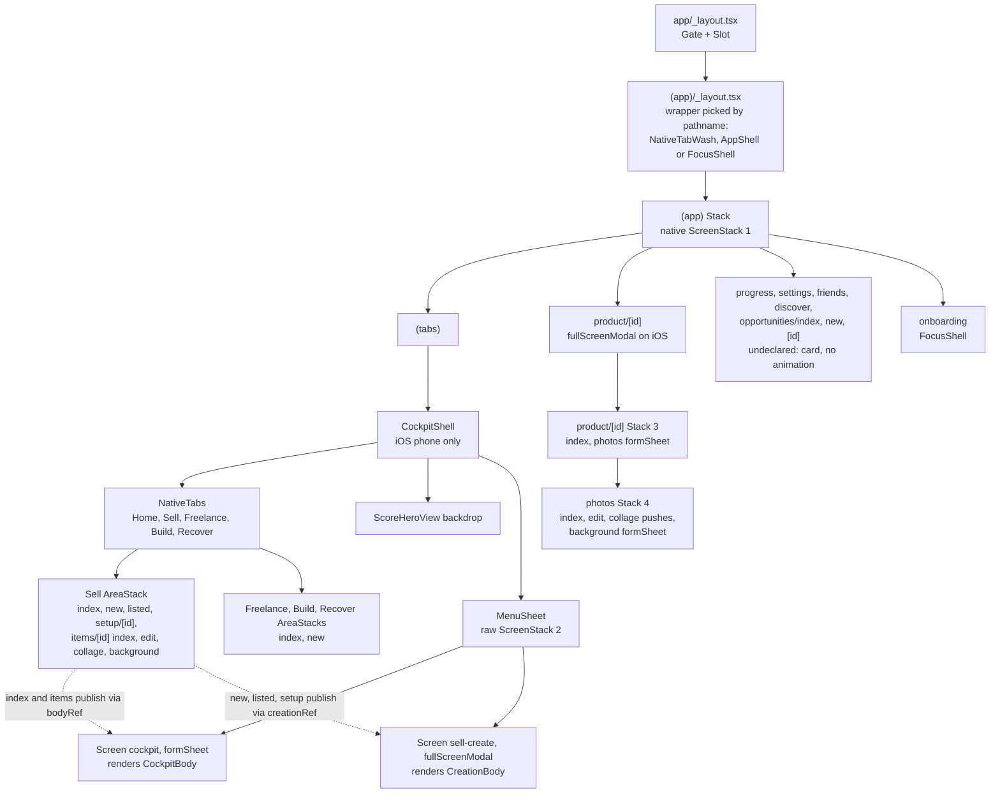
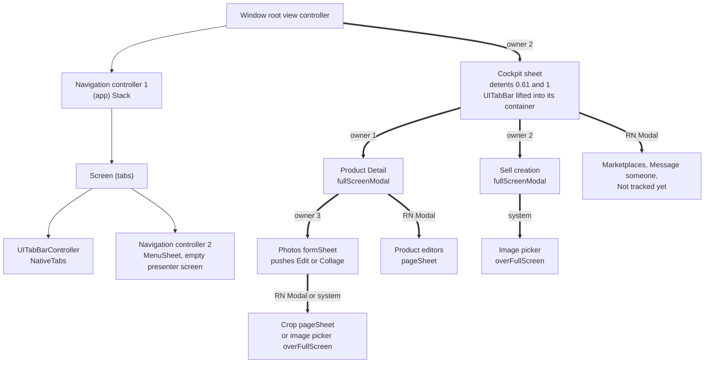
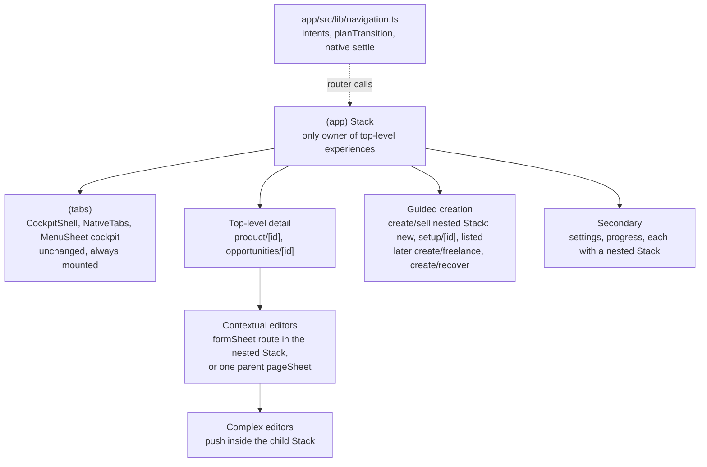

# Navigation

This is the navigation contract for the Expo app in `/app`. It records how navigation works today, what is wrong with it, the approved target, and the staged plan to get there. Implementation chats should read this file instead of re-auditing the app.

Where this file and the route table in [client.md](client.md) disagree about navigation behaviour, this file wins.

## 0. How to read this file

Every claim carries one of these labels.

| Label | Meaning |
| --- | --- |
| **[Code]** | Verified by reading the app code or the installed library source. |
| **[Predicted]** | Expected UIKit or react-native-screens runtime behaviour, inferred from source. Not observed on a device. |
| **[Decision]** | Approved product decision. Change only with product approval. |
| **[Proposal]** | Proposed technical approach. Can change during implementation if the stated goal still holds. |
| **[Experiment]** | Open question that a device experiment must answer. See [section 10](#10-native-lifecycle-signals-and-experiments). |

Rules for keeping this file current:

- When an experiment runs, record the observed result in section 10. Do not edit the prediction.
- When a stage ships, update section 3 (current implementation) and the stage's status in section 11.
- The target device for every native cockpit check is the iPhone 16 Pro.

Library versions this was written against: Expo SDK 57, React Native 0.86, Expo Router 57.0.25 (`Stack`, `NativeTabs` from `expo-router/unstable-native-tabs`), react-native-screens 4.26.2.

## 1. Summary

**What stays.** The cockpit is sound and is not part of this migration:

- `NativeTabs` with five tabs: Home, Sell, Freelance, Build, Recover.
- The real native cockpit form sheet in `MenuSheet` (`screenId="cockpit"`, detents `SHEET_RESTING_DETENT` (0.61) and 1, native drag).
- The shader and hero (`ScoreHeroView`) behind the cockpit.
- The tracked Swift tab-bar lift in `app/modules/nolume-sheet-tab-bar`.

**What changes.** **[Decision]**

- The `(app)` Expo Router stack becomes the single owner of temporary top-level experiences: detail pages, creation flows, Profile, and Progress. On iOS they are presented above the cockpit.
- Each creation flow is one stable presentation session with its own internal step navigation.
- Contextual editors stay owned by the experience that opened them.
- Cross-experience navigation goes through a thin typed navigation interface (`app/src/lib/navigation.ts`, not built yet). Expo Router stays authoritative for route state. There is no separate global navigation state machine.
- Handoffs between native presentations wait for a verified native lifecycle event, never a delay.

## 2. Approved product decisions

All items in this section are **[Decision]**.

### 2.1 Creation and presentation

- Sell creation moves to an `(app)`-owned presentation, **conditional on experiment E1 succeeding**.
- Sell creation keeps its current `fullScreenModal` presentation type during the migration.
- The visual design and the wizard business logic do not change. This includes the Phase 3 and 3.1 Sell behaviour and photo stability.
- If E1 fails, the current creation owner (`MenuSheet` cover) stays. Only a validated lifecycle-based Continue Setup handoff is implemented until another approach is approved.
- Future Freelance, Build and Recover creation flows follow the same presentation conventions.

### 2.2 Detail pages

- Product Detail (`/product/[id]`) is the canonical full-screen detail for Sell products.
- Home actions that target a Sell product open Product Detail.
- Generic mission detail (`/opportunities/[id]`) stays the detail for other mission types.
- The legacy Sell detail (`/sell/items/[id]`) is retired through safe redirects. Deep links to it keep working.
- Opening a mission from Home does not switch tabs.

### 2.3 Returning after creation

The return destination is the **originating main tab**.

| Journey | Returns to |
| --- | --- |
| Sell, Create product, Finish | Sell |
| Home, start Sell creation, Finish | Home |
| Home, Product Detail, Continue Setup, Finish | Home |
| Freelance, create mission, Finish | Freelance |

- An explicit, user-initiated tab change can establish a new origin.
- When there is no known origin (cold deep link, unknown entry point), the fallback is the creation's category tab.
- The origin is recorded in the navigation intent and carried by the session. It is never inferred from whichever route happens to be mounted during dismissal.
- Data refreshes for the correct category even when the user returns to a different tab.

### 2.4 Secondary pages

- Profile, Progress and mission detail use `fullScreenModal` on iOS where that is needed to appear above the cockpit.
- Web uses ordinary page navigation.
- Profile and Progress can have their own internal stacks.
- Closing them returns to the original cockpit location without remounting it.

### 2.5 Editing

- Short editors use contextual native sheets.
- Complex editors can use full-screen pages.
- Editors with unsaved changes ask for discard confirmation.
- Native swipe and back dismissal honour the same protection.
- Unfinished editor changes are never saved automatically.

**Creation drafts are different from editors.** A creation flow keeps meaningful draft progress when the user exits, following its domain rules. Sell setup saving the current step on exit is correct behaviour. A creation flow must not close after a failed required save while silently discarding unsaved input. The Identity and Details exits in Sell setup currently do this (see [section 3.5](#35-known-problems), problem 6).

### 2.6 Already Listed

Finishing Already Listed returns to the originating tab (normally Sell) with subtle success feedback. It does not open a detail screen automatically.

### 2.7 Message someone

Keep the user-facing behaviour: after starting, the relevant mission opens. The Message someone sheet must finish dismissing before the mission is presented.

### 2.8 Discover

- The standalone Discover experience is deferred. There is no Discover-specific presentation system and no Discover migration stage.
- Money Hunt, Skills, Recovery, Expenses and the Home starters stay enabled. They are features in their own right.
- `/discover` stays as it is: a redirect-only route with no navigation entry.

### 2.9 Localization and tests

- Existing English strings stay. Localization is outside the navigation migration.
- Source-string navigation assertions are replaced with behavioural transition tests as code is migrated. Existing tests do not justify keeping incorrect behaviour.

## 3. Current implementation

This section describes the code as audited in October 2026. Update it as stages ship.

### 3.1 React and Expo Router hierarchy



Off iOS phone, `(tabs)/_layout.tsx` renders `<Slot/>` instead of `CockpitShell` and `NativeTabs`. Web tabs therefore unmount when the user switches. **[Code]**

### 3.2 Native UIKit presentation hierarchy (iOS phone)



The presenting view controller for each edge is chosen at runtime by react-native-screens or UIKit. The "owner" label is the JavaScript navigator whose state decides that the presentation exists.

### 3.3 Components

**Root layout**, `app/src/app/_layout.tsx` **[Code]**

- `Slot` plus `Gate`, which redirects with `router.replace('/login')` or `router.replace('/')` for auth.
- Status bar style depends on `pathname.startsWith('/product/')` and `isCockpitRoot`.

**`(app)` stack**, `app/src/app/(app)/_layout.tsx` **[Code]**

- A `Stack` with `headerShown: false`, `animation: 'none'` and a transparent native container (`unstable_nativeProps`), so the shader shows through.
- Declares only `(tabs)` and `product/[id]` (`fullScreenModal` plus `slide_from_bottom` on iOS, `card` plus `fade` on web, `gestureEnabled: true`).
- Every other route gets the default `card` with no animation.
- Redirects to `/onboarding` when there is no goal.
- No `unstable_settings.initialRouteName`, so a cold deep link to `/product/:id` has no `(tabs)` underneath.
- Wraps the stack in `FocusShell` (onboarding), `NativeTabWash` (iOS phone when `keepsNativeTabs(pathname)` is true) or `AppShell` (everything else). See problem 3.

**NativeTabs**, `app/src/app/(app)/(tabs)/_layout.tsx` **[Code]**

- On iOS phone: `<CockpitShell><NativeTabs>` with five triggers (`index`, `sell`, `freelance`, `build`, `recover`), `disableAutomaticContentInsets`, transparent.
- `disablePopToTop` and `disableScrollToTop` are not set, so the iOS defaults apply (both enabled).
- Area layouts render `AreaStack` from `cockpit-shell.tsx`: a `Stack` with transparent containers.
- `sell/_layout.tsx` declares `index`, `new`, `listed` and `setup/[id]` with `animation: 'none'` ("These routes only fill the cover sheet").

**CockpitShell**, `app/src/components/cockpit-shell.tsx` **[Code]**

- Holds the published hero state and one `detent` state for the whole app, not one per tab.
- Renders the tabs, an absolute `ScoreHeroView backdrop`, and `<MenuSheet cover={…} onCoverDismiss={dismissCreation}><CockpitBody/></MenuSheet>`.
- Decides whether the Sell creation cover is shown, using `decideCreationCover`, `creationHandoffReady`, `abandonedSellStackKey` and `readSellStack` from `app/src/lib/cockpit-scene.ts`, plus `armedPath`, `blockedPath` and `previous` refs.
- Dispatches `POP_TO_TOP` on the Sell stack key to clear abandoned creation routes.
- Consumes the Continue Setup resume: when `pathname === '/sell'`, it calls `takeSellResume()` and then `router.push('/sell/setup/:id')`.
- The cover's `onDismissed` calls `runCreationExit()` or `leaveSell(router)`.

**MenuSheet**, `app/src/components/menu-sheet.tsx` (do not change the cockpit screen) **[Code]**

```tsx
<ScreenStack>
  <Screen activityState={2} pointerEvents="none" />  // empty presenter
  <Screen stackPresentation="formSheet" screenId="cockpit"
          sheetAllowedDetents={[SHEET_RESTING_DETENT, 1]} sheetInitialDetentIndex={0}
          sheetGrabberVisible sheetLargestUndimmedDetentIndex="last"
          sheetExpandsWhenScrolledToEdge gestureEnabled={false}
          onSheetDetentChanged={…}>{children}</Screen>
  {cover ? <Screen stackPresentation="fullScreenModal" screenId="sell-create"
                   gestureEnabled onDismissed={onCoverDismiss}>{cover}</Screen> : null}
</ScreenStack>
```

- The sheet content must be the screen's direct child. react-native-screens only connects drag-to-expand to a scroll view it finds as a direct subview.
- History from earlier sessions: creation was first a form sheet stacked on the cockpit. Presenting it from a second stack hid the cockpit, so it was moved into this stack. It later became `fullScreenModal` so the keyboard cannot shrink a form sheet and reveal Sell.
- react-native-screens 4.26 applies `sheetInitialDetentIndex` only on the first presentation. There is no prop to change the detent later. **[Code]** (`RNSScreen.mm`, `_sheetHasInitialDetentSet`)

**Native ScreenStack ownership** **[Code]**

There are four react-native-screens stacks that present modals:

1. The `(app)` stack.
2. `MenuSheet`.
3. `product/[id]`.
4. `product/[id]/photos`.

Each `RNSScreenStack` tracks only its own `_presentedModals`. Updates are serialized within one stack (`_updatingModals`, `_scheduleModalsUpdate`), never across stacks. A stack that needs to present while another stack's modal is on screen presents from the topmost presented view controller.

In `setModalViewControllers`, if the previous modal `isBeingDismissed`, the finish block returns without calling `afterTransitions`, which leaves `_updatingModals` set. Only `presentationControllerDidDismiss` (a user swipe) clears it. `onFinishTransitioning` is emitted from `afterTransitions`, `presentationControllerDidDismiss` and `didShowViewController`. (`node_modules/react-native-screens/ios/RNSScreenStack.mm`)

**Product Detail**

`app/src/app/(app)/product/[id]/index.tsx`, `app/src/components/product-page.tsx` **[Code]**

- Opened from the Sell board (`router.push('/product/:id')`), and by the Sell setup redirect when `setup_done` is true. The id is the Sell item id.
- `close()` is `router.canGoBack() ? router.back() : router.replace('/sell')`.
- Continue Setup is `queueSellResume(id)` followed by `router.dismissTo('/sell')`.
- Short editors (details, value, description, action, outcome, listings) use one React Native `<Modal presentationStyle="pageSheet">`, driven by local `sheet` state. "Add similar listing" swaps content inside the same modal (`adding` flag).
- Saves go through `rememberSellItem` and do not navigate.
- There is no unsaved-changes guard.

**Sell creation portal and cover** **[Code]**

- The routes `/sell/new`, `/sell/listed` and `/sell/setup/[id]` live in the Sell tab stack and render `null` on iOS.
- `SellJourney` (`app/src/components/sell-flow.tsx`) publishes their UI with `useCreationBody(node)` into module globals in `app/src/components/cockpit-context.tsx` (`creationRef`, `creationPath`, listeners). `CreationBody` renders that UI inside the `MenuSheet` cover.
- `setCreationExit` and `runCreationExit` pass the exit handler through another global.
- Category to Identity is `router.replace('/sell/new' → '/sell/setup/:id')` in the Sell stack. The cover survives only because `sameCreationSession` treats both paths as one session.
- Setup steps (identity, photos, details, research, estimate, description) are local `step` state, seeded from the server `setup_step`. This part is a good pattern and stays.
- Finish runs `finishSellItem`, then `refresh()`, then `leave()`, which is `router.dismissTo('/sell')`.
- Exit saves the current step, then leaves. If identity is untouched, it calls `discardSellItem` and `forgetSellItem`.
- When `item.setup_done` is true, the setup screen calls `router.replace('/product/:id')`.
- The photo picker uses `UIImagePickerPresentationStyle.OVER_FULL_SCREEN`. A full-screen camera presented by creation had dismissed creation and the cockpit when it closed.
- Already Listed (`listed.tsx`) finishes with `router.replace('/sell/items/:id')`, which lands on the legacy page.

**Sell AreaStack and the legacy item page** **[Code]**

- `/sell/items/[id]` renders inside the cockpit sheet through `CockpitPage`.
- "Back to Sell" calls `leaveSell`. "Continue setup" calls `router.push('/sell/setup/:id')`.
- Its `edit` and `collage` children are pushes in the Sell stack. `background` renders `null` because `publishBackgroundSheet` is never called.

**Product Photos and editing** **[Code]**

- `product/[id]/_layout.tsx` is a stack: `index` (no animation) and `photos` (`formSheet`, detents `[1]`, `gestureEnabled`).
- `photos/_layout.tsx` is a stack: `index`, `edit` and `collage` (`slide_from_right`), and `background` (`formSheet`, dead).
- `photos/edit|collage|background.tsx` re-export the `sell/items/[id]` versions.
- `itemLeaf(pathname, id, leaf)` in `app/src/lib/product-detail.ts` picks the product or legacy path.
- Reorder, cover and delete commit immediately.
- Edit Photo confirms discard only from its Close button (`requestClose`). Saving calls `router.back()`. Crop is a React Native `Modal` (`pageSheet`).

**React Native Modals** **[Code]**

| Modal | Where | Notes |
| --- | --- | --- |
| `Sheet` (`app/src/components/moves.tsx`, transparent, fade) | Sell "Marketplaces", Freelance "Message someone" and "Not tracked yet" | Rendered in the tab screen, outside the published cockpit body |
| Product editors | `ProductPage` | `pageSheet` |
| Crop | Edit Photo | `pageSheet` |
| Photo viewer | legacy item page | – |

- React Native's Fabric `Modal` presents from `[self reactViewController]`. That is a view controller react-native-screens does not track. **[Code]**
- A past device session observed the Message someone modal covering the tab bar and the cockpit sheet, so these do present over the cockpit. **[Code]** plus device observation.
- `MessageSheet` calls `onClose()` and `router.push('/opportunities/:id')` in the same tick.

**Profile, Progress and generic mission detail** **[Code]**

- `settings.tsx` (Profile) is one page with local segmented tabs (`?tab=profile|goal|account`) and inline forms. There are no sub-routes.
- `progress.tsx` is one page with a period selector and links to `/opportunities` and `/sell`.
- Both are opened from the hero and from the sheet heading (`router.push('/settings')`, `router.push('/progress')` in `score-hero.tsx`).
- `opportunities/[id].tsx` is the mission detail for every mission type. Home actions open it for all types, including Sell.
- Its Back button is `canGoBack() ? back() : push(areaHref)`. The closed-result page has `push('/')` and `push(areaHref)`. Delete calls `replace(areaHref)`.
- All three are `card` routes in the `(app)` stack. On iOS phone they trigger the shell remount (problem 3).

**Swift tab-bar lift**, `app/modules/nolume-sheet-tab-bar/ios/NolumeSheetTabBar.swift` (do not modify) **[Code]**

- Swizzles `viewDidLayoutSubviews`, `viewDidDisappear`, `UIView.addSubview` and `UITabBar.layoutSubviews`.
- Finds the presented sheet whose view has `screenId == "cockpit"`, finds the window's first `UITabBar`, and moves it into the sheet's container view.
- Restores the tab bar on the cockpit's `viewDidDisappear`.
- Because of this, any full-screen presentation over the cockpit (Product Detail today) puts the tab bar back underneath, and dismissal lifts it again.
- The lift depends only on the cockpit screen id. It does not depend on who presents what above it.

### 3.4 Route inventory (iOS phone)

| Route | Presentation and owner | Close or return today | Status |
| --- | --- | --- | --- |
| `/` Home | tab, content in cockpit body | – | Complete |
| `/sell` | tab | – | Complete |
| `/sell/new`, `/sell/setup/[id]`, `/sell/listed` | Sell stack route plus `MenuSheet` cover | X and Finish call `dismissTo('/sell')`; listed finish calls `replace('/sell/items/:id')` | Works through heuristics |
| `/sell/items/[id]` and `edit`, `collage` | inside cockpit sheet | `leaveSell`, `back()` | Legacy, to retire |
| `…/background` (both trees) | `formSheet` route | – | Dead |
| `/product/[id]` | `(app)` `fullScreenModal` | `back()`, else `replace('/sell')` | Canonical |
| `/product/[id]/photos`, `edit`, `collage` | `formSheet` in stack #3, pushes in stack #4 | `back()` | Good pattern |
| `/freelance`, `/recover` | tab | – | Complete |
| `/freelance/new`, `/recover/new` | inside cockpit sheet (`CreateFrame`) | Back calls `push(backHref)`; done calls `replace(doneHref)` | Not a guided flow |
| `/build`, `/build/new` | tab, cockpit | – | Placeholder |
| `/opportunities/[id]` | `(app)` card | see above | Remounts shell |
| `/opportunities`, `/opportunities/new` | `(app)` card | `PhoneShell` back | Remounts shell |
| `/progress`, `/settings` | `(app)` card | `PhoneShell` back | Remounts shell |
| `/friends` | `(app)` card, desktop rail only | – | Placeholder |
| `/discover` | redirect only | – | Deferred |
| System | image picker `OVER_FULL_SCREEN`, `Alert`, SwiftUI `Menu` | system | Aligned |

### 3.5 Known problems

These are ranked by impact.

**1. Multiple independent native presentation owners.** **[Code]**, with failure modes **[Predicted]**

- The `(app)` stack presents Product Detail.
- `MenuSheet` presents Sell creation.
- React Native `Modal`s are a third, untracked owner.
- Nothing orders presentations across stacks.

Continue Setup crosses owners and is gated on route state, not on native completion:

```ts
// app/src/components/product-page.tsx
queueSellResume(record.id);
router.dismissTo('/sell');
// app/src/components/cockpit-shell.tsx
if (pathname === '/sell') { const resumeId = takeSellResume(); if (resumeId != null) router.push(`/sell/setup/${resumeId}`); }
```

Predicted failure modes (experiment E9 confirms which one happens):

- `MenuSheet` presents while Product Detail is still `isBeingDismissed`. The finish block returns early, and the cover may never appear or `MenuSheet` may stop applying modal updates.
- The cover is presented on top of Product Detail before stack #1 dismisses it. UIKit then dismisses the wrong view controller, which shows up as a flash or overlap.

`MessageSheet` (an RN `Modal` dismissing while a route is pushed) is the same class of problem.

**2. Portal-based creation and route/presenter separation.** **[Code]**

- Creation routes exist in the Sell tab stack. Their UI is published through module globals into a presentation owned by `CockpitShell`.
- Whether the cover exists is derived from the pathname, the previous pathname and Sell stack snapshots, all hardcoded to Sell (`isSellCreationPath`, `readSellStack` looks for a route named `sell`).
- A past session's logs showed `decideCreationCover` returning `present=false pop=true` on the first tap of a product. The route was popped and creation never appeared until a second tap.
- The same pattern (`useCockpitBody`, `bodyRef`) renders every tab's content in one shared cockpit body. Components published this way run outside their own screen's route context, so `useLocalSearchParams` or `useIsFocused` inside them would read the wrong route.

**3. Shell remounts caused by wrapper switching.** **[Code]**

- `(app)/_layout.tsx` renders `NativeTabWash` or `AppShell` depending on `keepsNativeTabs(pathname)` (`app/src/components/shell.tsx`).
- Navigating to `/progress`, `/settings`, `/opportunities/*` or `/friends` changes the wrapper element type. React then unmounts and remounts the entire `(app)` stack, including `CockpitShell`, `MenuSheet`, the tabs, the cockpit sheet, the detent, scroll position and Home's local state.
- Likely reason the swap exists: a `card` pushed in the `(app)` stack sits underneath the presented cockpit sheet. Remounting removes the cockpit. **[Predicted]**
- So the fix has to present secondary pages modally, like Product Detail. Changing the wrapper alone would hide those pages under the cockpit.

**4. Duplicate navigation history from cross-navigator `push` and `replace`.** **[Code]**

`router.push` and `router.replace` resolve against the deepest navigator where the target diverges from the current state (`findDivergentState` in Expo Router). From a screen in the `(app)` stack, a tab path diverges at the `(app)` stack:

- `push('/')`, `push('/sell')` or `push(areaHref)` adds a second `(tabs)` route, which means a second `CockpitShell` and cockpit. Callers:
  - `opportunities/[id].tsx`: Back fallback, "Back to Home", "Back to this area"
  - `opportunities/index.tsx`: area buttons
  - `progress.tsx`
  - `feedback.tsx` ("again")
- `replace(areaHref)` from `opportunities/[id].tsx` after delete, and `/opportunities/new?mode=` replaces, swap the current `(app)` route for a new `(tabs)`.
- `router.replace('/product/:id')` in `sell/setup/[id].tsx` (the `setup_done` guard) replaces the existing `(tabs)` route. The stack becomes `[product]`, and Close falls back to `replace('/sell')`.
- Inside area stacks, `CreateFrame` Back is `router.push(backHref)` and `usePlaybookStart` finishes with `router.replace(doneHref)`. Both leave duplicate `index` routes (`app/src/components/create-flow.tsx`).
- `StackClient` PUSH without `getId` or `dangerouslySingular` always creates a new route, so a double tap pushes two detail screens.

**5. Inconsistent navigation intentions.** **[Code]**

- A Sell item opens in three places: `/product/:id` (board), the legacy `/sell/items/:id` (Already Listed), and `/opportunities/:id` (Home, legacy cards).
- `Opportunity` and `SuggestedAction` in `app/src/api/types.ts` do not expose the Sell item id. Only `SellItemView.opportunity_id` exists.
- "Close" is implemented as `back()`, `dismissTo('/sell')`, `replace('/sell')`, `push(backHref)`, `push(areaHref)` and `push('/')`.
- "Finish" is `dismissTo('/sell')` for Sell and `replace(doneHref)` elsewhere.
- Resume is a module global plus an effect.
- The tests in `cockpit-scene.test.ts`, `sell.test.ts` and `product-detail.test.ts` assert these exact router strings.

**6. Missing lifecycle coordination and unsaved-input safeguards.** **[Code]**

- The only native lifecycle event consumed is the cover's `onDismissed`.
- No route uses `usePreventRemove` or `beforeRemove`.
- Edit Photo confirms discard only from its Close button. An edge swipe back or a Photos sheet swipe discards silently.
- Product editor drafts are discarded on swipe.
- In `sell/setup/[id].tsx`, `exit()` calls `saveIdentity(false).then(() => leave())` and `saveDetails(false).then(() => leave())`. Their `run()` catches the error, so the flow leaves even when the save failed. The typed name or details are lost. `saveEstimate` and `saveDescription` do check the result.
- `finish` awaits a full `refresh()` (invalidating and refetching every product query) before closing, even though `rememberSellItem` already updated the board.

**7. Per-tab scroll and detent memory.** **[Code]**, effect **[Predicted]**

- There is one shared `ScrollView` (`MobileStage` in `score-hero.tsx`) whose content is swapped per tab through `bodyRef`, and one detent state in `CockpitShell`.
- Tabs very likely share one scroll offset. Experiment E7 checks this.
- Nothing listens for a re-tap on the focused tab.
- Native scroll-to-top cannot reach a scroll view that lives inside the presented sheet.
- There is no programmatic detent API.
- The shared `ScrollView` is required for drag-to-expand. Per-tab memory has to save and restore offsets, not mount separate scroll views.

## 4. Target architecture



Target route map **[Proposal]**. Exact paths are settled in the stage that builds them.

| Route | Kind | iOS | Web |
| --- | --- | --- | --- |
| `(tabs)/*` | Shell | `NativeTabs` plus cockpit | `Slot` plus `AppShell` |
| `product/[id]` and nested | Top-level detail | `fullScreenModal` | card |
| `opportunities/[id]` | Top-level detail | `fullScreenModal` | card |
| `create/sell/{new, setup/[id], listed}` | Guided creation | `fullScreenModal` on the group, `animation: 'none'` inside | card |
| `settings/*`, `progress/*`, `opportunities/index` | Secondary | `fullScreenModal` with its own nested stack | card |
| `sell/items/[id]/*` | Legacy | redirect to `product/[id]` | redirect |

With these declared, `AppShell` and `PhoneShell` are no longer used on iOS phone. Each secondary page draws its own header and Close button.

## 5. Presentation categories

Every new screen belongs to exactly one category. **[Proposal]**, except where a decision is cited.

### 5.1 Persistent application shell

- **Owner and parent:** `(tabs)` in the `(app)` stack. `NativeTabs` owns tab selection. `MenuSheet` owns the cockpit sheet.
- **Opens:** once, at app start. Never re-created by navigation.
- **Coexists with top-level experiences:** always mounted underneath them.
- **Closes:** never.
- **Nested navigation:** area stacks hold the tab's index (plus legacy routes until they are retired). Tab content is published into the cockpit body.
- **Unsaved state:** in-tab inline forms keep local state while the tab stays mounted.
- **iOS / web:** native tabs plus cockpit sheet / `Slot` plus rail or dock.

### 5.2 Top-level detail experience

Examples: Product Detail, mission detail.

- **Owner and parent:** `(app)` stack. The parent is the shell.
- **Opens:** `navigation.openProduct` or `navigation.openMission`, pushed with `dangerouslySingular`.
- **Coexists:** no other top-level experience is actively presented.
- **Closes:** Close button or system gesture, both calling `back()`.
- **Returns to:** the recorded origin tab, which is normally the tab underneath.
- **Nested navigation:** its own nested `Stack` for children (Photos pattern).
- **Unsaved state:** children guard themselves (5.5, 5.6). The detail page itself holds no drafts.
- **iOS / web:** `fullScreenModal` with `slide_from_bottom` / card with `fade`.

### 5.3 Top-level guided creation flow

- **Owner and parent:** `(app)` stack, conditional on E1 **[Decision]**. Until then, the `MenuSheet` cover.
- **Opens:** `navigation.startCreation` or `navigation.resumeCreation`.
- **Coexists:** no. It is never presented on top of another top-level experience. A handoff dismisses the previous one first.
- **Closes:** the X runs the domain exit (save the draft, or discard an untouched draft), then `closeExperience`. Finish runs `finishCreation`.
- **Returns to:** the origin tab, falling back to the category tab **[Decision]**.
- **Nested navigation:** steps are local state, or `replace` / push inside the flow's own nested stack with `animation: 'none'`. A step never presents a new top-level native presentation.
- **Unsaved state:** domain draft rules (2.5). A failed required save keeps the flow open.
- **iOS / web:** `fullScreenModal`, unchanged **[Decision]** / card.

### 5.4 Secondary destination

Examples: Profile, Progress, All activity.

- **Owner and parent:** `(app)` stack. The parent is the shell.
- **Opens:** `navigation.openProfile` or `navigation.openProgress`.
- **Coexists:** no.
- **Closes:** Close button, calling `back()`.
- **Returns to:** origin tab and cockpit location, without a remount **[Decision]**.
- **Nested navigation:** its own nested `Stack`. Internal pages are pushes. Back pops within it, and Close dismisses the whole destination.
- **Unsaved state:** editors inside follow 5.5 and 5.6.
- **iOS / web:** `fullScreenModal` / ordinary page **[Decision]**.

### 5.5 Contextual editor (short)

Examples: product value, description, listings.

- **Owner and parent:** the experience that opened it, and only that one.
- **Opens:** a `formSheet` route in the parent's nested stack, or one parent-owned `pageSheet` whose content swaps for nested short steps (the "Add similar listing" pattern).
- **Coexists:** sits inside a top-level experience.
- **Closes:** Done or Save saves and closes. Cancel or swipe closes, with confirmation when dirty.
- **Returns to:** its parent, which is not rebuilt.
- **Nested navigation:** content swap, or a push inside the same sheet.
- **Unsaved state:** a dirty flag guards Close, swipe and back **[Decision]**. Routes use `usePreventRemove`. React Native `Modal` sheets use `onRequestClose` or are moved to a router `formSheet`. Choose per editor during Stage 4.
- **iOS / web:** native sheet / dialog.

### 5.6 Complex editor

Examples: Edit Photo, collage.

- **Owner and parent:** the stack of the child that opened it (for example, the Photos stack).
- **Opens:** a push inside that stack, or a full-screen page.
- **Coexists:** inside one top-level experience.
- **Closes:** Save then `back()`. Back or Close confirms when dirty.
- **Returns to:** the immediate parent.
- **Nested navigation:** further pushes in the same stack. System presentations as needed.
- **Unsaved state:** `usePreventRemove(dirty)`. When it is hosted in a swipe-dismissable sheet, it also turns off the host sheet's gesture while dirty (`navigation.getParent()?.setOptions({ gestureEnabled: !dirty })`).
- **iOS / web:** push in a sheet, or full screen / page.

### 5.7 System-owned presentation

Examples: image picker, `Alert`, SwiftUI `Menu`, share sheet.

- **Owner:** the system, called from the screen that needs it.
- **Rule:** the camera and library pickers always use `OVER_FULL_SCREEN` so that dismissing them never dismisses the presenter beneath **[Code]**.
- **Closes:** by the system. The calling screen stays as it was.

## 6. Invariants

"Logical" invariants can be checked from Expo Router state in dev builds or pure tests. "Native" invariants need device logs.

| # | Invariant | Check |
| --- | --- | --- |
| I1 | The cockpit stays mounted underneath temporary experiences. `CockpitShell` mounts once per session. | Native, plus a mount log |
| I2 | At most one top-level experience is actively presented. | Logical: at most one non-`(tabs)` route in the `(app)` stack once settled. Native: one presented controller above the cockpit. |
| I3 | Wizard steps never create competing top-level native presentations. | Logical: a creation session is one `(app)` route for its whole lifetime. |
| I4 | A child editor has exactly one owning experience. | Code review: the child route lives in its parent's nested stack. |
| I5 | Closing a child returns to its parent. | Logical |
| I6 | Closing a top-level experience returns to its recorded origin. | Logical |
| I7 | No operation creates a second `(tabs)` route. | Logical, as a dev assertion |
| I8 | Navigation never silently discards meaningful input. | Component, plus device |
| I9 | Repeated taps never start duplicate presentations. | Logical, plus device |
| I10 | A handoff between native presentations waits for native completion. | Native |

Temporary overlap in route state during a controlled native transition (for example, a route still in state while its dismissal animates) is not a violation. The invariants concern competing active presentations and ownership.

## 7. Origins and return destinations

All items here are **[Proposal]**, implementing decision 2.3.

- **Origin** is the main tab the user was on when a top-level experience started (`home`, `sell`, `freelance`, `build`, `recover`).
- `navigation.ts` reads the focused tab from router state when an intent is issued. It passes the origin as a route param (`origin=home`) on the top-level route. The origin then lives in Expo Router state, survives re-renders, and needs no store.
- A handoff (Product Detail to Continue Setup) copies the origin from the current experience's param into the next one.
- On iOS, the tab bar is hidden under a top-level `fullScreenModal`, so the tab underneath normally is the origin and closing is just `back()`.
  - `navigation.ts` compares the tab underneath with the recorded origin after closing. If they differ (cold deep link, web), it switches to the origin tab after the native settle signal.
- With no origin param (cold deep link, unknown entry point), the fallback is the category tab of the experience: Sell for products and Sell creation, the mission's area for missions.
- An explicit tab change by the user (web rail, iOS tab bar when no experience is presented) dismisses the active top-level experience. The new tab becomes the origin for anything opened next.
- Cache updates are independent of where the user lands. For example, `rememberSellItem` updates the Sell board even when Finish returns to Home.

## 8. Transition contracts

"Native wait" means the step waits for the native settle signal from section 10. The signal is a candidate until E2 passes. **No contract uses a timeout.** A fallback timer needs a new architecture review.

The shared rules: Back means the previous step or screen. Close means dismiss the whole experience to its owner. A swipe follows the Close rules.

### T1. Product Detail → Continue Setup (native wait required)

1. The user taps Continue setup, which calls `resumeCreation({ kind: 'sell', itemId })`. A second tap while this runs is ignored (I9).
2. Steps:
   1. `back()` pops `product/[id]`. The origin is copied from Product Detail's param.
   2. Wait for native settle (stack #1 has finished dismissing).
   3. Push the creation route for `itemId` with the same origin: today `/sell/setup/:id`; after E1 succeeds, `/create/sell/setup/:id`.
3. Setup opens at the saved `setup_step` from the cache. Nothing is marked complete.
4. Do not use `replace` here unless E3 proves it safe. Calling `back()` and `push()` in the same tick is batched by Expo Router's `routingQueue`, so it behaves like `replace`.
5. If E1 fails, the same sequence applies, and the push lands in the Sell stack where `MenuSheet` presents the cover. `pendingResume` and the `pathname === '/sell'` effect are removed either way.

### T2. Sell Category → Identity (no native wait)

1. `createSellItem` returns the new id.
2. Inside the creation session, either:
   - `replace('new' → 'setup/:id')` in the creation's nested stack with `animation: 'none'`, or
   - `router.setParams({ item: id })` when steps share one screen.
3. The outer `fullScreenModal` never changes. The session key (the `(app)` route) stays constant (I3).
4. Until E1 succeeds, the current `sameCreationSession` heuristic keeps doing this job.

### T3. Finish Sell creation → originating tab (native wait only for follow-up feedback)

1. Finish is disabled while busy.
2. `finishSellItem`, then `rememberSellItem`. The board updates from the cache.
3. `finishCreation` closes the session with `back()` to the origin. If the origin differs from the tab underneath, it switches tabs after native settle.
4. `refresh()` runs in the background and does not block the close.
5. The success toast shows after native settle.
6. Never: a success page, opening Product Detail automatically, or leaving a stale creation route in any stack.
7. Already Listed finishes the same way, with its subtle success feedback **[Decision]**.

### T4. Close unfinished creation, keeping the draft (no native wait)

1. X runs the domain exit for the current step:
   - Identity untouched: `discardSellItem`, then `forgetSellItem`, then close.
   - Otherwise: save the current step without advancing, then close.
   - Steps with nothing to save just close.
2. The flow returns to the origin. The draft shows on the board, and Product Detail offers Continue Setup.
3. If a required save fails, T13 applies.

### T5. Product Detail → Photos → Edit Photo → Back (no native wait)

1. Push `photos` (a `formSheet` in stack #3). Push `edit` in stack #4.
2. Edit declares `usePreventRemove(dirty)`, and while dirty sets `gestureEnabled: false` on the Photos sheet.
3. Save calls `back()` to Photos. Back or Close while dirty asks "Discard changes?". Edge swipe behaves the same.
4. Closing Photos calls `back()` to Product Detail, which is not rebuilt. Photo order and cover changes are already committed through `rememberSellItem`.

### T6. Home → Mission detail → Home (no native wait)

1. `openMission({ missionId, sellItemId })` from Home. If `sellItemId` is present, Product Detail opens instead **[Decision]**. This needs an API field (Stage 4).
2. The detail is a `fullScreenModal` over the cockpit. There is no tab switch, wrapper swap or remount.
3. Close calls `back()`. Home's scroll position, detent and local filter are unchanged.
4. In-page links to other areas use `closeExperience` and then an explicit tab switch, never `push(areaHref)`.

### T7. Profile → Skills & Preferences → Edit → Return (no native wait)

The sub-pages are not built yet. This is the convention for when they are.

1. `openProfile()` presents `settings` as a `fullScreenModal` with its own stack.
2. Skills & Preferences is a push in that stack. Edit is a push or a `formSheet` in the same stack, guarded by 5.5 or 5.6.
3. Back pops one level. Close dismisses Profile to the origin with the cockpit intact.
4. Until the sub-pages exist, the current `?tab=` segments stay.

### T8. Progress → Breakdown → Return (no native wait)

Not built yet; same convention as T7. `openProgress()` presents a `fullScreenModal` with a nested stack. Breakdown is a push. Back returns to Progress, and Close returns to the origin.

### T9. Message someone → Mission detail (native wait required)

1. `startPlaybook` succeeds and the mission id is known.
2. The sheet closes (`visible=false`).
3. The mission opens only after the React Native `Modal` reports `onDismiss` (iOS). This is a native completion event from the modal itself. On web it opens right away.
4. Alternatively, Stage 5 moves the sheet to a router `formSheet` in the Freelance experience, which makes this an ordinary handoff.
5. No same-tick close and push (current behaviour, E8).

### T10. Cold deep link → Detail → Close (native wait only for the fallback tab switch)

1. `unstable_settings.initialRouteName = '(tabs)'` in `(app)/_layout.tsx` makes Expo Router build `(tabs)` underneath, so the cockpit exists.
2. The detail opens without an origin param.
3. Close calls `back()` to `(tabs)`. If the tab underneath is not the category tab, switch to it after native settle.
4. Legacy `/sell/items/:id` links redirect to `/product/:id`.

### T11. Switching tabs with no top-level experience (no native wait)

1. Native tab selection (`JUMP_TO`). The cockpit sheet stays presented and the Swift lift is unaffected.
2. Today, scroll offset and detent are shared across tabs (problem 7).
3. Per-tab memory and the focused-tab re-tap (scroll to top, sheet back to the resting detent) are the separate cockpit enhancement in section 11, gated on E4, E5 and E7.
4. With no top-level experience, tab selection has nothing to dismiss.

### T12. Double tapping a navigation action

1. `navigation.ts` ignores an intent while a transition is pending, and logs the dropped intent in dev.
2. Detail routes also use `dangerouslySingular`, so a second push of the same detail is a no-op even outside `navigation.ts`.
3. Save and Finish buttons stay disabled while their request is in flight (the current `busy` pattern).
4. The pending flag clears on the native settle signal, or on the next `pageFocused` navigation event, with a dev warning in that case. There is no timer.

### T13. Failed save during a creation exit

1. X saves the current step. If the save fails, the flow stays open on that step, keeps the input, and shows the error inline.
2. A second X while the error shows asks: "Keep editing" (default) or "Leave without these changes". Leaving keeps the draft as last saved and drops only this step's unsaved input, which the user has explicitly confirmed.
3. This fixes `saveIdentity(false).then(leave)` and `saveDetails(false).then(leave)` in `sell/setup/[id].tsx` (Stage 3). The exact wording is settled in Stage 3, in English.

## 9. Navigation interface

This is **[Proposal]** and is not implemented. It will be one file, `app/src/lib/navigation.ts`, plus a test file `app/src/lib/navigation.test.ts`.

```ts
type MainTab = 'home' | 'sell' | 'freelance' | 'build' | 'recover';
type CreationKind = 'sell' | 'sell-listed' | 'freelance' | 'recover' | 'build';

type Intent =
  | { type: 'openProduct'; productId: number }
  | { type: 'openMission'; missionId: number; sellItemId?: number | null }
  | { type: 'startCreation'; kind: CreationKind }
  | { type: 'resumeCreation'; kind: 'sell'; itemId: number }
  | { type: 'finishCreation'; feedback?: string }
  | { type: 'closeExperience' }
  | { type: 'openProfile'; tab?: 'profile' | 'goal' | 'account' }
  | { type: 'openProgress' }
  | { type: 'switchTab'; tab: MainTab };

// Read from Expo Router state when an intent is issued. Never stored.
type NavSnapshot = {
  tabUnderneath: MainTab | null;
  topLevel: { route: string; origin: MainTab | null } | null;
  pending: boolean;
};

type Step =
  | { op: 'push'; href: string; singular?: boolean }
  | { op: 'back' }
  | { op: 'switchTab'; tab: MainTab }
  | { op: 'awaitNativeSettle' }
  | { op: 'toast'; message: string }
  | { op: 'ignore'; reason: string };

// Pure. Covered by tsx --test.
export function planTransition(now: NavSnapshot, intent: Intent): Step[];

// Hook for screens: reads the snapshot, runs the steps, logs each step in dev.
export function useNavigation(): { go(intent: Intent): void };

// Wired to the verified native signal from E2.
export function nativeSettled(): void;
```

**May:**
- Translate intents into Expo Router calls.
- Wait for native completion.
- Drop duplicate or incompatible intents.
- Carry origins across handoffs.
- Emit dev diagnostics.

**Must not:**
- Replace Expo Router.
- Keep a copy of the navigation stack. The only module state is the `pending` flag and the queued remainder of one plan.
- Store mission or product business state.
- Grow into a global state machine.
- Touch the cockpit detents or the Swift tab-bar lift.

Screens that only navigate inside their own stack (a step, a child editor push, `back()`) keep calling the router directly. `navigation.ts` is for crossing experience boundaries.

## 10. Native lifecycle signals and experiments

E9, E2, E6, E1 and E3 have run (see [10.1](#101-observed-results)). The others are pending. **Do not treat `onFinishTransitioning` or any other signal as proven until E2 records an observed pass.**

Candidate settle signals:

- `onFinishTransitioning` on the `(app)` stack, passed through `unstable_nativeProps`. The vendored `NativeStackView` spreads these onto `ScreenStack` **[Code]**. Emitted from `afterTransitions`, `presentationControllerDidDismiss` and `didShowViewController` **[Code]**.
- `onAppear` on the cockpit `Screen` in `MenuSheet`. This requires a `MenuSheet` prop, so it is only for the experiment branch unless approved.
- Native-stack `transitionEnd` events on the `(tabs)` route.
- For React Native `Modal`s: `onDismiss`.

Experiments run on a throwaway branch and are never merged. Run them on the iPhone 16 Pro with the Stage 1 diagnostics.

| Id | Question | Prediction | Pass criteria | Observed |
| --- | --- | --- | --- | --- |
| E1 | Can Sell creation be an `(app)` `fullScreenModal` route over the cockpit? | Yes, as Product Detail is | Cockpit stays presented underneath. Tab bar is restored under the modal and lifted again after dismissal. Keyboard does not reveal Sell. Picker open and close does not dismiss creation or the cockpit. Category to Identity does not flash. | Run 2026-10-13. **Pass.** Full height over the cockpit and tab bar, one shell mount, in-session replace without a native event, keyboard shows nothing behind, picker open and cancel, and clean exits (4 of 4). Back inside setup snaps forward to the saved step. That is setup logic, not navigation. See [10.1](#101-observed-results). |
| E2 | Which signal fires exactly once after a dismissal has finished? | `onFinishTransitioning` on `(app)` | Fires once, after the animation, for `back()`, `dismissTo` and swipe where allowed. Never early. Also fires for an interrupted or cancelled swipe. | Run 2026-10-13. **Pass, with conditions.** After the animation for `back()` (5 of 5). Early, with no dismissal, when another stack presents at the same time. Swipe not applicable (E6). Interrupted not reproducible by hand. See [10.1](#101-observed-results). |
| E3 | Does `replace` from one modal to another in the `(app)` stack present the new modal? | No (blank or flash) | New modal visible and the old one gone, with no flash | Run 2026-10-13. **Approach A (`replace`): Fail, worse than predicted.** The old modal is dismissed and the new one is never presented. It is presented late on the next modal change, and a later exit orphans a controller. **Approach B (`back()`, wait for `onFinishTransitioning`, `push`): Pass** in 1 of 1 cycles, with the cockpit visible between the two animations. Repeats and double-tap not run. See [10.1](#101-observed-results). |
| E4 | Does re-tapping the focused native tab emit `tabPress`? | Unknown | Event observed in JavaScript | Not run |
| E5 | Can the cockpit be returned to the resting detent from JavaScript (for example, setting `sheetAllowedDetents` to `[0.61]` and back)? | Possibly | Sheet animates to 0.61, drag still works, lift intact. If not, a native method is needed and requires approval. | Not run |
| E6 | Does `gestureEnabled` do anything on a `fullScreenModal`? | No | Documented either way | Run 2026-10-13. **Pass.** No. A swipe scrolls the content. |
| E7 | Do tabs share the cockpit scroll offset? Does `scrollTo` restoration keep drag-to-expand? | Shared; restoration works | Both answered | Not run |
| E8 | Does closing an RN `Modal` while pushing a route overlap or flash? | Sometimes | Documented. T9 sequence passes. | Not run |
| E9 | What actually happens in today's Continue Setup? | One of the two problem 1 failure modes | Logged sequence identifies the mode | Run 2026-10-13. **Pass.** Both modes occur, decided by a race between the two native stacks: the cover is lost (1 of 3 runs), or the cover is presented over Product Detail and Product Detail is left presented, orphaned and unresponsive (2 of 3). See [10.1](#101-observed-results). |

### 10.1 Observed results

Diagnostics: `app/src/lib/nav-log.ts` (dev only). `route.*` lines come from Expo Router state, `native.*` lines from react-native-screens callbacks. JavaScript timestamps for native events are delivery times, not UIKit times, but their order is reliable.

#### E9 — Continue Setup today

- **Date:** 2026-10-13. iPhone 16 Pro, Debug build from Oct 12 (no native changes since), Metro bundle at the Stage 1 diagnostics commit.
- **Scenario:** Sell, open unfinished product 17 ("Take the front"), wait, tap Continue setup once, wait 3 s. Repeated after a relaunch. A control run opened and closed Product Detail with Close.
- **Status:** **Pass** (the logged sequence identifies the failure). The root cause is a race between two native stacks, not one deterministic mode.

**Control: Product Detail Close.** Route state is final within 40 ms. The native dismissal finishes about 515 ms after the request. Product Detail's own `willDisappear` and `didDisappear` never reach JavaScript, because the screen unmounts before UIKit runs them.

```text
[nav +29412ms] product.close.request id=17 canGoBack=true … inflight=none
[nav +29416ms] route.action type=GO_BACK
[nav +29454ms] route.state app=(tabs) tab=sell
[nav +29514ms] native.cockpit.willAppear
[nav +30029ms] native.cockpit.didAppear
[nav +30030ms] native.app.finishTransitioning
```

**Run 1 (Product Detail open 5 s): the cover is lost.** The cover is committed 540 ms before Product Detail's dismissal finishes. The cover screen never reports `willAppear`. The app showed the Sell board.

```text
[nav +52566ms] product.resume.request id=17 …
[nav +52575ms] route.action type=POP_TO to=(tabs)/sell/index
[nav +52683ms] resume.take id=17 push=/sell/setup/17
[nav +52688ms] route.action type=PUSH to=setup/[id] id=17
[nav +52745ms] cover.commit show=true path=/sell/setup/17
[nav +52776ms] native.cockpit.willAppear          ← Product Detail starts dismissing
[nav +53285ms] native.cockpit.didAppear           ← Product Detail gone
[nav +53286ms] native.app.finishTransitioning
                                                  ← no native.sell-create.* ever
```

Tapping Sell something seven times afterwards pushed `new` seven times into the Sell stack (`sell=index>setup/[id]:17>new>new>…`). It produced no native event and nothing visible. React keeps the cover mounted (`show=true`), so `MenuSheet` gets no new child change and never retries. Only a relaunch recovered. This matches the `previous.beingDismissed` early return in `setModalViewControllers`. Whether `_updatingModals` also stays set is not visible in these logs. `native.menusheet.finishTransitioning` was added after this run to show it.

**Run 2 (after relaunch, Product Detail open 1.6 s): the cover appears without the cockpit reappearing.**

```text
[nav +13149ms] product.resume.request id=17 …
[nav +13163ms] route.action type=POP_TO to=(tabs)/sell/index
[nav +13280ms] route.action type=PUSH to=setup/[id] id=17
[nav +13338ms] cover.commit show=true path=/sell/setup/17
[nav +13362ms] native.app.finishTransitioning     ← 24 ms later, no dismissal animation
[nav +13385ms] native.sell-create.willAppear
[nav +13893ms] native.sell-create.didAppear
                                                  ← no native.cockpit.willAppear/didAppear
[nav +25593ms] route.action type=POP_TO to=index  ← creation closed
[nav +25646ms] cover.commit show=false path=/sell
                                                  ← still no native.cockpit.didAppear
```

Creation opened at the saved step. The cockpit stayed "disappeared" from Product Detail's presentation through creation and after creation closed.

**Run 3 (E2 step F, Product Detail open 0.8 s): same as run 2, and the orphan is confirmed.** After X in creation, Product Detail was visible again. Its Close button did nothing. Route state already said `app=(tabs)` and Product Detail's React screen had been removed at +31543 ms.

```text
[nav +31475ms] product.resume.request id=17 … sinceFinish=844ms
[nav +31543ms] route.removed path=/product/17 …
[nav +31653ms] cover.commit show=true path=/sell/setup/17
[nav +31674ms] native.app.finishTransitioning     ← 21 ms later, no cockpit.willAppear
[nav +31695ms] native.sell-create.willAppear
[nav +32202ms] native.sell-create.didAppear
[nav +32203ms] native.menusheet.finishTransitioning
[nav +34683ms] route.action type=POP_TO to=index  ← X in creation
[nav +34746ms] cover.commit show=false path=/sell
[nav +35269ms] native.menusheet.finishTransitioning
                                                  ← no native.cockpit.*; Product Detail visible, dead
```

**Mechanism, from the logs plus `RNSScreenStack.mm`:**

1. `MenuSheet` presents the cover from the topmost controller, which is Product Detail.
2. The `(app)` stack then finds a controller it does not own on top. It drops Product Detail from `_presentedModals` and runs `afterTransitions` without dismissing it. That is the topmost-controller branch of `setModalViewControllers`.
3. That explains the early `finishTransitioning` and the cockpit never reappearing. Product Detail stays presented natively with no React tree behind it.

**Race window.** In every run, the `(app)` stack acts about 190–200 ms after the `POP_TO`, and the cover commit lands about 170 ms after it. Whichever stack UIKit serves first decides the outcome. Run 1 lost the cover (Product Detail was already being dismissed). Runs 2 and 3 orphaned Product Detail (the cover was presented first). How long Product Detail had been open (5 s, 1.6 s, 0.8 s) may correlate, but three runs cannot show it.

**Cover rendering (separate, confirmed on device).** The `MenuSheet` creation cover shows creation only in the top third, with the hero and an empty cockpit sheet visible below. This also happens on a plain Sell something open with no Product Detail involved, so it is not caused by the handoff. An earlier session reported similar clipping. The Stage 1 diagnostics add only JavaScript event handlers, and react-native-screens makes the same native calls with or without them. So the clipping is very likely pre-existing, but no build without the diagnostics has been checked.

**Architectural implication.** Gating on route state (`pathname === '/sell'`) runs about 170 ms after the request, but native dismissal needs about 510 ms. Two stacks then race in UIKit, and either outcome is broken. Any handoff across presentations must wait for a native completion signal, and should not cross native stacks at all. This supports I10 and moving creation to the `(app)` stack, subject to E1.

#### E2 — native completion signal

- **Date:** 2026-10-13, same device and build as E9.
- **Scenarios:**
  - Product Detail opened and closed with Close: 5 times across the E9 control and E2 steps A and C.
  - Swipe-down attempt on Product Detail (step B).
  - Fast Close attempt (step C).
  - Sell something cover open (step D).
  - Profile push (step E).
  - Continue Setup (step F).
- **Status:** **Pass, with conditions.** `(app)` `onFinishTransitioning` is reliable for a dismissal that only the `(app)` stack performs. It is not proof that a controller is gone when another stack presents at the same time.

| Question | Observed |
| --- | --- |
| Fires at all? | Yes. |
| After native dismissal completes? | Yes for `back()`: 5 of 5 fired about 505–520 ms after `GO_BACK`, in the same millisecond as `native.cockpit.didAppear`, which always came first. For `dismissTo` with a competing presentation (E9 runs 2 and 3), it fired after 21–24 ms with no dismissal. That is a false positive. |
| Once or multiple times? | Once per present and once per dismiss. Twice at stack mount (`(tabs)` willAppear and didAppear). |
| Programmatic and gesture? | A swipe cannot dismiss a `fullScreenModal`. It scrolls the content (see E6). No gesture dismissal exists to test at this level. |
| Unrelated transitions? | Yes. It also fires for presents, card pushes (`settings`) and stack mounts. It does not identify a transition. |
| Can it be tied to one request? | Only by sequence. Take the first `onFinishTransitioning` after the dismissal's route commit, while nothing else can start on the `(app)` stack. A present that is still animating finishes first: react-native-screens queues the dismissal behind it and then emits again. So "pending" must cover opening as well as closing (T12). |
| Interrupted, or not delivered? | Not reproducible by hand: Product Detail is fully presented before Close can be hit (262 ms after `didAppear` was the fastest). From source: on the `previous.beingDismissed` early return, the stack does not call `afterTransitions` and never emits. A waiter can therefore hang. That is the T12 fallback case (next `pageFocused`, with a dev warning, no timer). |
| A more precise callback? | `native.cockpit.didAppear` (cockpit `Screen` `onAppear`). It ended every normal dismissal, and it correctly did **not** fire when Product Detail was orphaned. It needs a callback on the cockpit `Screen`, which requires approval. Per-route `transitionEnd` is never delivered for the popped route. `native.menusheet.finishTransitioning` fires for `MenuSheet` modal changes and 3–4 times at mount. |

**Recommendation (smallest reliable mechanism).** Coordinate handoffs on the `(app)` stack's `onFinishTransitioning`:

- A single pending flag covers the whole intent, open or close. It is set when the router call is made and cleared by the first `onFinishTransitioning` after that call's route commit.
- No other `(app)` transition may start while it is set.
- In dev, assert that `native.cockpit.didAppear` arrived before that `onFinishTransitioning` for any close of a top-level experience on iOS. Otherwise warn. This catches orphaning without a timer.
- The signal is only trustworthy while the `(app)` stack is the only owner of top-level presentations. That is what the target architecture establishes.

#### E6 — `gestureEnabled` on a `fullScreenModal`

- **Date:** 2026-10-13. Swipe down on Product Detail (`gestureEnabled: true`).
- **Observed:** the swipe scrolls the content (overscroll), and Product Detail does not move or dismiss. No `gestureCancel` or other native event.
- **Status:** **Pass** (documented). The prediction "No" holds. Close buttons are the only way to dismiss a top-level `fullScreenModal`.

#### E1 — root-owned creation

- **Date:** 2026-10-13, same device and build. Throwaway branch `exp/nav-stage1`.
- **Setup:**
  - `(app)/exp` is declared as a `fullScreenModal`, with its own `Stack` (`new`, then `setup/[id]`). `setup/[id]` re-exports the real Sell setup screen.
  - `/exp/` was added to `keepsNativeTabs`, as Product Detail is, so the shell does not remount.
  - Entry is a dev-only row on the Sell board that opens draft 17 (saved step: photos).
- **Scenario:**
  - Open, Continue (an in-session `replace`), Back inside setup, camera and library open and cancel, Save & exit.
  - Then twice more, once closing from the first screen.
  - Then Home and back to Sell.
- **Status:**
  - **Presentation: Pass.**
  - **Keyboard: Pass** (second run, after relaunch). The Back problem below blocked Identity, so a text field on the first screen was used instead. Focus, typing and dismissal showed no Sell, cockpit or tab bar, and logged no route or native event. Closing logged the usual `cockpit.didAppear` and `finishTransitioning` 508 ms after `GO_BACK`.
  - **Back inside setup: Fail, not navigation.**

```text
[nav +07835ms] route.action type=PUSH to=exp/new
[nav +07922ms] native.cockpit.willDisappear
[nav +07922ms] native.app.willAppear route=exp key=tTa
[nav +08438ms] native.app.didAppear route=exp key=tTa
[nav +08439ms] native.app.finishTransitioning
[nav +13264ms] route.action type=REPLACE to=setup/[id] id=17   ← no native event, no flash seen
…
[nav +298761ms] route.action type=POP_TO to=(tabs)/sell/index  ← Save & exit
[nav +298909ms] native.cockpit.willAppear
[nav +299424ms] native.cockpit.didAppear
[nav +299424ms] native.app.finishTransitioning
```

- Creation covers the cockpit and the tab bar at full height. Compare the `MenuSheet` cover, which is clipped to the top third (E9).
- `cockpit.mount` stayed at 1. No `app.wrapper` change. No duplicate `(tabs)` warning.
- Each of the three exits (`dismissTo` twice, `back()` once) ended with `cockpit.didAppear` and then `finishTransitioning` in the same millisecond, about 515 ms later. That is the E2 pattern.
- **Back snaps forward.** Back from the first photo shows Identity for one frame, then the photo step again. No route action is logged. In `sell/setup/[id].tsx` the effect that follows server step changes (the `anchor` effect after the placement effect) sees `item.setup_step` (`photos`) differ from the anchor that `back()` just set (`identity`), and calls `setStep(item.setup_step)`. That component is unchanged from `main` and is the same one the cover renders. So this is a pre-existing Sell logic bug, not caused by the route. This is derived from the code; a control run on the cover is pending.
- **Experiment artifacts that matter for Stage 3:**
  - Outside a Sell path, `SellJourney` renders in place *and* publishes the same body into the hidden cockpit (`useCockpitBody(phoneBody, !creation && …)`). Its footer also reserves 64 pt for a tab bar.
  - `CockpitShell` takes the hero from `cockpitArea(pathname)`, so the hero is removed under any non-tab route. That is invisible while the modal covers it, but visible when route state and native presentation disagree (E3).

#### E3 — modal to modal (Product Detail to creation)

- **Date:** 2026-10-13, same build. Dev-only buttons on Product Detail for draft 17.
- **Approach A: `router.replace('/exp/setup/17')`. Fail.**
- **Approach B: `back()`, wait for `onFinishTransitioning`, then `push`. Pass** (one cycle, after relaunch; see below).

**Run 1: the new modal is never presented.** Product Detail is dismissed and creation does not appear. Waiting 17 s changed nothing.

```text
[nav +404224ms] route.action type=REPLACE to=exp/setup/[id] id=17
[nav +404281ms] route.state app=(tabs)>exp:17 tab=sell
[nav +404335ms] native.cockpit.willAppear         ← Product Detail dismissing
[nav +404842ms] native.cockpit.didAppear
[nav +404842ms] native.app.finishTransitioning    ← no native.app.willAppear route=exp
```

The mechanism comes from `setModalViewControllers` in `RNSScreenStack.mm`:

1. `(app)` modals are presented from the cockpit sheet, the topmost controller, which this stack does not own.
2. For the swap, `changeRootController` falls through to the topmost branch and becomes Product Detail. The stack calls `[productDetail dismissViewControllerAnimated:YES completion:finish]`.
3. In `finish`, Product Detail is no longer attached, so the stack runs `afterTransitions` and returns. Nothing is presented, and nothing retries.

The source comment there points to upstream issue 1813. `onFinishTransitioning` fires anyway.

**Effects of the phantom route.** Route state says `exp` is on top, but nothing is presented natively. `/sell` is blurred, and `pathname` is `/exp/setup/17`, so `CockpitShell` drew no hero. After the cockpit was collapsed, the area above it was white.

**Run 2: the stuck modal is presented late.** Opening Product Detail again presents the stuck `exp` without animation in the same frame, then Product Detail on top. Creation was seen flashing under Product Detail as it opened.

```text
[nav +433638ms] route.action type=PUSH to=product/[id]/index id=17
[nav +433788ms] native.app.willAppear route=exp key=GyNB2
[nav +433788ms] native.app.didAppear route=exp key=GyNB2
[nav +433788ms] native.app.willAppear route=product/[id] key=7gCUp
[nav +434293ms] native.app.didAppear route=product/[id] key=7gCUp
```

**Run 3: the replace works, and there are now two creation screens.** This time the change root is the stuck `exp`, which this stack owns. The normal path runs: Product Detail is dismissed, revealing creation copy 1, then copy 2 is presented over it. This was seen as creation appearing under Product Detail and then duplicating.

```text
[nav +436479ms] route.action type=REPLACE to=exp/setup/[id] id=17
[nav +436542ms] route.state app=(tabs)>exp:17>exp:17
[nav +436595ms] native.app.willAppear route=exp key=GyNB2
[nav +437100ms] native.app.didAppear route=exp key=GyNB2
[nav +437138ms] native.app.willAppear route=exp key=yktEC
[nav +437642ms] native.app.didAppear route=exp key=yktEC
```

**Exit: a controller is orphaned.** Save & exit (`dismissTo('/sell')`) removes both routes. The topmost branch calls `dismiss` on the top copy only. The lower copy stays presented with its React tree removed. Unlike every clean exit, there is no `native.cockpit.willAppear` or `didAppear`. The screen showed the hero and tab bar with a blank cockpit. The orphan is inferred from the log and the code; what it draws was not established.

```text
[nav +440790ms] route.action type=POP_TO to=(tabs)/sell/index
[nav +440868ms] route.state app=(tabs) tab=sell sell=index
[nav +441428ms] native.app.finishTransitioning    ← no native.cockpit.*
```

**Approach B, after a relaunch.** Product Detail is fully dismissed (`cockpit.didAppear`) before the push. Creation is presented once at the saved step, and Save & exit brings the cockpit back with its content.

```text
[nav +08872ms] e3b.request href=/exp/setup/17
[nav +08882ms] route.action type=GO_BACK
[nav +09009ms] native.cockpit.willAppear
[nav +09512ms] native.cockpit.didAppear
[nav +09512ms] native.app.finishTransitioning
[nav +09512ms] e3b.push href=/exp/setup/17
[nav +09515ms] route.action type=PUSH to=exp/setup/[id] id=17
[nav +09598ms] native.app.willAppear route=exp key=Czrhl
[nav +10119ms] native.app.didAppear route=exp key=Czrhl
[nav +10120ms] native.app.finishTransitioning
…
[nav +25845ms] route.action type=POP_TO to=(tabs)/sell/index   ← Save & exit
[nav +25981ms] native.cockpit.willAppear
[nav +26482ms] native.cockpit.didAppear
[nav +26482ms] native.app.finishTransitioning
```

- From tap to settled creation took about 1.25 s: 630 ms to dismiss, an 86 ms gap, then 520 ms to present. The Sell cockpit is visible while Product Detail slides down and while creation slides up. That is inherent to closing and then opening. A `replace` cannot avoid it (approach A).
- Possible later polish: dismiss Product Detail without animation so only the creation slide shows. Not tested.
- Each step changes one modal, so every update takes the owned path in `setModalViewControllers`.
- Not run: three repeats, and a double-tap. The experiment dropped a second request while one was pending (`e3b.ignored`), but that was not exercised. Journeys B (20 repeats) and M (double-tap) cover both in Stage 3.

**Implication.**

- While the cockpit sheet is presented, the `(app)` stack is only reliable when each update adds or removes **one** modal at the top. A swap (`replace`), or removing two modals in one update (`dismissTo` across two), loses or orphans a controller.
- That rules out `replace` between top-level experiences, even with the `(app)` stack as the only owner. T1 must close, wait for the signal, then present.
- Any UI driven by `pathname` follows route state even when the native side never presented the route.

#### Other observations from these runs

- **Profile remounts the shell twice (problem 3, I1).** Opening Profile logs `cockpit.unmount`, `cockpit.mount count=2` and `app.wrapper wrapper=AppShell`. The whole `(app)` stack remounts, including the `settings` screen itself (`route.removed` then `route.focus`). Going back logs `cockpit.mount count=3`. The Profile page showed an empty full screen with only an old "Back" label. Not investigated in Stage 1.
- **Production cover, same session as E1 (second run).** Sell something logs a normal native sequence: `cover.commit show=true`, `native.cockpit.willDisappear`, `native.sell-create.willAppear`, then `didAppear` 519 ms later. Category still rendered in the top third, over the hero and a blank cockpit. So the presentation lifecycle is correct and the fault is in the cover's layout or rendering. The same build drew E1 full height, so the fault is specific to the `MenuSheet` cover, not to `fullScreenModal`. Not root-caused. Stage 3 deletes the cover when E1 passes.
- **Duplicate Sell routes.** After the cover was lost in E9 run 1, every Sell something tap pushed another `new` (`sell=index>setup/[id]:17>new>new>…`). This is I9 behaviour in the current code.

## 11. Roadmap

Each stage is one implementation chat. A stage ships only after its acceptance journeys pass on the iPhone. The Swift module and the cockpit `Screen` in `MenuSheet` are untouched in every stage.

### Stage 1 — Diagnostics and native experiments

Status: next.

- **Scope:**
  - Dev-only (`__DEV__`) navigation logging in a new `app/src/lib/nav-log.ts`. It records one `[nav]` line per event with the current tab, cockpit detent, top-level route, child route, pending transition and origin.
  - Sources: `unstable_navigationEvents` from `expo-router` (`pageFocused`, `pageBlurred`, `pageRemoved`, `actionDispatched`), `onFinishTransitioning` on the `(app)` stack (merged into the existing `unstable_nativeProps`), and the existing `CockpitShell` detent and cover callbacks.
  - A one-time `CockpitShell` mount log for I1.
  - Then E9, E2, E1 and E3 on a throwaway branch. Add E4 and E5 if they need no broad changes.
- **Files:** `nav-log.ts` (new), `(app)/_layout.tsx`, `cockpit-shell.tsx` (log lines only). Experiment-only changes stay on the throwaway branch.
- **Not in scope:** any behaviour change on the main branch.
- **Acceptance:** with logging on, release behaviour is identical. The results table in section 10 has observed results with log excerpts.
- **Risk:** low.

### Stage 2 — Application shell stability

- **Scope:**
  - Keep the wrapper element type constant on iOS phone.
  - Declare `settings`, `progress`, `opportunities/index`, `opportunities/new`, `opportunities/[id]` and `friends` as `fullScreenModal` on iOS and card on web, each with its own header and Close button.
  - Add `unstable_settings.initialRouteName = '(tabs)'`.
  - Replace the cross-navigator `push` and `replace` calls from problem 4 with `back()` or close-then-switch.
  - Add a dev assertion for I7.
- **Files:** `(app)/_layout.tsx`, `components/shell.tsx`, `opportunities/[id].tsx`, `opportunities/index.tsx`, `opportunities/new.tsx`, `progress.tsx`, `settings.tsx`, `friends.tsx`, `components/feedback.tsx`, `components/product-page.tsx` (close fallback).
- **Depends on:** Stage 1 logs, to prove there is no remount.
- **Acceptance:** journeys D, F and G pass. The mount log shows one `CockpitShell` mount for the session. No second `(tabs)` route appears.
- **Risk:** medium. Profile, Progress and missions visibly become modal presentations.

### Stage 3 — Sell navigation foundation

- **Scope:**
  - Build `navigation.ts` with `resumeCreation`, `startCreation`, `finishCreation` and `closeExperience`, plus pure tests.
  - Implement T1 with the signal verified in E2. Delete `queueSellResume`, `takeSellResume` and the `pathname === '/sell'` effect.
  - If E1 passed: move `new`, `setup/[id]` and `listed` into `(app)/create/sell/` as one `fullScreenModal` session (T2). Then remove the cover, `useCreationBody`, `creationRef`, `creationPath`, `setCreationExit`, `runCreationExit`, `decideCreationCover`, `creationHandoffReady`, `abandonedSellStackKey`, `sameCreationSession`, `isSellCreationPath`, `isSellCreationRouteName` and `readSellStack`, but only once the new session works on the device. `MenuSheet` loses only its `cover` and `onCoverDismiss` props.
  - Origins (section 7). T3, T4 and T13, including the Identity and Details exit fix. A non-blocking `refresh()` after Finish. The `setup_done` guard closes the flow instead of `replace('/product/:id')`. Already Listed finishes per 2.6.
  - If E1 failed: only T1 (with the push into the Sell stack), T13, and the Already Listed finish.
- **Files:** `lib/navigation.ts` and its test (new), `components/product-page.tsx`, `components/cockpit-shell.tsx`, `components/cockpit-context.tsx`, `components/sell-flow.tsx`, `lib/cockpit-scene.ts` and its test, `components/menu-sheet.tsx` (cover props only), `(tabs)/sell/*`, `(app)/create/sell/*` (new), `lib/sell.test.ts`.
- **Must not change:** wizard business logic, Phase 3 and 3.1 Sell behaviour, photo stability, `rememberSellItem` and `startSellWrite` ordering, or the `fullScreenModal` type.
- **Acceptance:** journeys A, B, H, plus Already Listed and Money Hunt start, each passing 20 times in a row for B.
- **Risk:** high when E1 passed, low to medium otherwise.

### Stage 4 — Detail and editor consistency

- **Scope:**
  - `openProduct` and `openMission` with `dangerouslySingular`.
  - API: expose the Sell item id on `Opportunity` and `SuggestedAction` (Laravel resource, `vendor/bin/pint --dirty --format agent`, logging per the API rules), so that Home opens Product Detail (T6).
  - Redirect `/sell/items/[id]` to `/product/[id]`. Keep `edit` and `collage` as the shared implementations re-exported by `photos/*`.
  - Delete the dead `background` routes and `lib/sell-background-sheet.ts`.
  - Unsaved-change guards for product editors, Edit Photo and collage (T5).
  - Replace source-string tests with behavioural ones.
- **Files:** `components/product-page.tsx`, `(tabs)/index.tsx`, `(tabs)/sell/index.tsx`, `(tabs)/sell/items/[id]/*`, `product/[id]/photos/*`, `api/types.ts`, the API resource and controller, `lib/product-detail.test.ts`.
- **Acceptance:** journeys C and D. Deep links to old item URLs still work.
- **Risk:** medium.

### Stage 5 — Other app sections

- **Scope:**
  - Freelance and Recover creation become `(app)/create/freelance` and `(app)/create/recover` sessions following 5.3, keeping today's single-step forms. `CreateFrame` Back and `usePlaybookStart` follow T4 and T3.
  - Message someone follows T9.
  - Build stays a placeholder, with routes declared per the conventions.
  - Profile and Progress get nested stacks only when their sub-pages are designed (T7, T8). Do not invent pages.
- **Acceptance:** Freelance and Recover create, finish and close journeys; journeys F and G.
- **Risk:** medium.

### Separate track — cockpit memory enhancement

- **Scope:** per-tab scroll offset save and restore, per-tab detent, and focused-tab re-tap (scroll to top and resting detent).
- **Depends on:** E4, E5 and E7. Not combined with any screen migration.
- **Risk:** medium to high, because it touches drag-to-expand behaviour. Any native change needs approval.

Discover has no stage (2.8).

## 12. Testing and acceptance

| Kind | Tooling | Used for | Stages |
| --- | --- | --- | --- |
| Pure transition tests | Existing `npm test` (`tsx --test src/lib/*.test.ts`) | `planTransition` tables: origins, duplicate drops, handoff steps, fallbacks | 3, 4, 5 |
| Route integration tests | Would need `jest-expo` and `expo-router/testing-library`. Not installed and not planned without approval. | – | – |
| Component tests | None in the repo. Not planned. | – | – |
| Native lifecycle logging | Stage 1 `[nav]` logs | I1, I2, I7, I10. Experiment evidence | All |
| Physical iPhone verification | iPhone 16 Pro, dev build | Every journey below. Anything involving the cockpit, the lift, sheets or gestures | All |
| Web check | Expo web | Close, Back and browser back on the same journeys | 2 to 5 |

Acceptance journeys. Every one needs the device. The plan for each is automatable with pure tests.

| Id | Journey | Expected |
| --- | --- | --- |
| A | Sell, Sell something, category, Identity through Description, Finish | One continuous presentation. Back on Sell with the item on the board. No detail page. |
| B | Sell, product draft, Continue setup | Product Detail fully dismisses, then creation opens at the saved step. No flash. 20 repeats. |
| B2 | Home, Sell mission (after Stage 4), Continue setup, Finish | Back on Home. Sell board updated. |
| C | Product Detail, Photos, Edit Photo, change something, swipe back | Discard confirmation. Photos and Product Detail intact. |
| D | Home, Recover mission, Close | Home with the same scroll and detent. No tab switch. |
| E | Scroll Home, move the detent, switch to Sell and back, re-tap | Current behaviour documented. Target after the cockpit track. |
| F | Hero, Profile, Close | Cockpit not remounted (mount log). |
| G | Hero, Progress, All activity, Back, Close | Same as F. |
| H | During creation: background the app, open the camera, fail a save offline, press X | Input kept or an error shown. Never a silent exit. |
| I | Already Listed, Finish | Origin tab with success feedback. |
| J | Sell, Find something, start from a Money Hunt result | Creation opens over Sell. |
| K | Freelance, Message someone, start | The sheet finishes dismissing, then the mission opens. |
| L | Cold start from `sidehustle://product/:id`, then Close | Cockpit underneath, then the Sell tab. |
| M | Double-tap a Sell board card, and Continue setup | One presentation. |

For each journey, check: one `CockpitShell` mount, one `(tabs)` route, the tab bar lifted again after every Close, and no `[nav]` warnings.

## 13. Adding a new screen

1. Pick its category in section 5. If none fits, update this document first.
2. Put the route where its owner lives:
   - Top-level routes in `(app)/`, declared in `(app)/_layout.tsx` with an explicit `presentation` for iOS and web.
   - Children in the parent's nested stack.
3. Cross-experience navigation goes through `navigation.ts`. Never `push` or `replace` a tab path from outside `(tabs)`.
4. Back is `back()`. Close goes through `closeExperience` or `back()`. Never navigate to a URL to "go back".
5. Any editor declares its dirty guard (5.5, 5.6). Any creation flow declares its exit rule (T4, T13).
6. Pickers use `OVER_FULL_SCREEN`.
7. Do not publish UI into `CockpitBody` or `CreationBody` from a screen that is not a tab index.

## 14. Source index

| Area | Files |
| --- | --- |
| Layouts | `app/src/app/_layout.tsx`, `app/src/app/(app)/_layout.tsx`, `app/src/app/(app)/(tabs)/_layout.tsx`, `(tabs)/{sell,freelance,build,recover}/_layout.tsx`, `product/[id]/_layout.tsx`, `product/[id]/photos/_layout.tsx` |
| Cockpit | `app/src/components/cockpit-shell.tsx` (`CockpitShell`, `AreaStack`), `menu-sheet.tsx` (`MenuSheet`), `cockpit-context.tsx`, `score-hero.tsx` (`ScoreHeroView`, `MobileStage`), `hero-wash-host.tsx` (`NativeTabWash`, `HeroWashSlot`), `app/src/lib/cockpit-scene.ts` |
| Swift lift | `app/modules/nolume-sheet-tab-bar/ios/NolumeSheetTabBar.swift`, `NolumeSheetTabBarSubscriber.swift` |
| Shell | `app/src/components/shell.tsx` (`keepsNativeTabs`, `isNativeTabPath`, `AppShell`, `FocusShell`), `moves.tsx` (`Sheet`, `CockpitFrame`) |
| Sell | `(tabs)/sell/index.tsx`, `new.tsx`, `listed.tsx`, `setup/[id].tsx`, `items/[id]/*`, `app/src/components/sell-flow.tsx`, `app/src/lib/sell-cache.ts` |
| Product | `product/[id]/index.tsx`, `photos/*`, `app/src/components/product-page.tsx`, `editing-sheet.tsx`, `app/src/lib/product-detail.ts` |
| Missions and areas | `(tabs)/index.tsx`, `freelance/*`, `recover/*`, `build/*`, `opportunities/*`, `app/src/components/create-flow.tsx`, `feedback.tsx` |
| Secondary | `settings.tsx`, `progress.tsx`, `friends.tsx`, `discover.tsx` |
| Tests | `app/src/lib/cockpit-scene.test.ts`, `sell.test.ts`, `product-detail.test.ts` |
| Library source | `node_modules/react-native-screens/ios/RNSScreenStack.mm`, `RNSScreen.mm`, `node_modules/expo-router/build/react-navigation/native-stack/views/NativeStackView.native.js`, `expo-router/build/global-state/getNavigationAction.js`, `routingQueue.js`, `layouts/StackClient.js`, `native-tabs/types.d.ts`, `react-native/React/Fabric/Mounting/ComponentViews/Modal/RCTModalHostViewComponentView.mm` |
